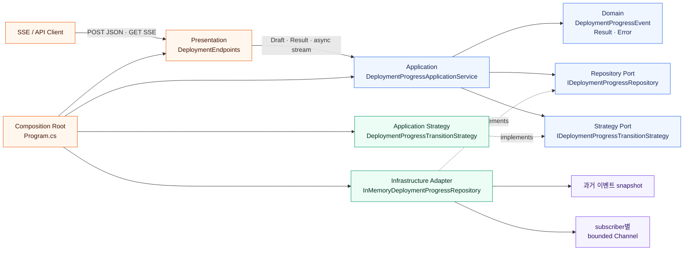
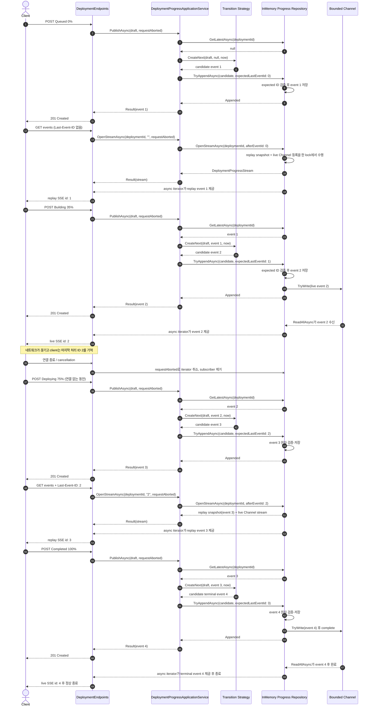

# .NET 10 SSE로 배우는 재연결 가능한 배포 진행률 API

## 👣 코드 읽는 순서 (Reading order)

처음부터 비동기 스트림과 동시성 코드를 한꺼번에 이해하려 하지 않아도 됩니다. 아래 순서대로 **HTTP 계약 → 한 개 이벤트 → 업무 규칙 → 저장 경계 → replay/live 스트림 → SSE 변환 → 조립과 검증**을 따라가세요.

1. 이 README의 [오늘의 목표](#-오늘의-목표)와 [HTTP 계약](#-http-계약)을 읽어 완성된 동작을 먼저 봅니다.
2. [`DeploymentSseApi.csproj`](./src/DeploymentSseApi/DeploymentSseApi.csproj)에서 `net10.0`, C# 14, nullable, warning-as-error 설정을 확인합니다.
3. [`DeploymentContracts.cs`](./src/DeploymentSseApi/Presentation/DeploymentContracts.cs)에서 POST 요청, JSON 응답, SSE `data`의 모양을 봅니다.
4. [`DeploymentProgressDraft.cs`](./src/DeploymentSseApi/Domain/DeploymentProgressDraft.cs), [`DeploymentIdentity.cs`](./src/DeploymentSseApi/Domain/DeploymentIdentity.cs), [`DeploymentProgressEvent.cs`](./src/DeploymentSseApi/Domain/DeploymentProgressEvent.cs)에서 신뢰하지 않는 입력, 공통 ID 규칙, 불변 이벤트를 구분합니다. [`Error.cs`](./src/DeploymentSseApi/Domain/Error.cs)와 [`Result.cs`](./src/DeploymentSseApi/Domain/Result.cs)도 함께 봅니다.
5. [`DeploymentProgressTransitionStrategy.cs`](./src/DeploymentSseApi/Application/DeploymentProgressTransitionStrategy.cs)에서 단계 전이, percent 단조 증가, terminal 상태를 판단하는 Strategy를 확인합니다.
6. [`DeploymentProgressApplicationService.cs`](./src/DeploymentSseApi/Application/DeploymentProgressApplicationService.cs)에서 “낙관적 충돌을 재시도하며 게시하기”와 “`Last-Event-ID`를 해석해 stream 열기”라는 유스케이스를 따라갑니다.
7. [`IDeploymentProgressRepository.cs`](./src/DeploymentSseApi/Application/Ports/IDeploymentProgressRepository.cs)를 읽어 Application이 메모리·lock·`Channel<T>` 대신 Repository Port에 의존하는 이유를 봅니다. Strategy interface는 구현과 가까운 [`DeploymentProgressTransitionStrategy.cs`](./src/DeploymentSseApi/Application/DeploymentProgressTransitionStrategy.cs)에 있습니다.
8. [`InMemoryDeploymentProgressRepository.cs`](./src/DeploymentSseApi/Infrastructure/InMemoryDeploymentProgressRepository.cs)에서 저장된 과거 이벤트, subscriber별 bounded `Channel<T>`, 원자적인 replay/live 전환, 취소 정리를 확인합니다.
9. [`DeploymentEndpoints.cs`](./src/DeploymentSseApi/Presentation/DeploymentEndpoints.cs)에서 header 전달, `SseItem<T>`, `TypedResults.ServerSentEvents`가 HTTP SSE로 바뀌는 경계를 봅니다.
10. [`Program.cs`](./src/DeploymentSseApi/Program.cs)에서 DI 등록과 endpoint 연결을, [`SelfTestRunner.cs`](./src/DeploymentSseApi/SelfTesting/SelfTestRunner.cs)와 [`verify-http.ps1`](./verify-http.ps1)에서 검증 근거를 확인합니다.
11. [`EXERCISES.md`](./EXERCISES.md)를 Beginner부터 Pro+까지 풀고 [`CHECKPOINT.md`](./CHECKPOINT.md)로 자신의 말로 설명해 봅니다.

> 막히면 “Repository가 과거를 replay하고 `Channel<T>`이 새 이벤트를 live로 전달하며, Application은 둘을 하나의 `IAsyncEnumerable<T>`로 보여 준다”라는 문장으로 돌아오세요.

---

## 📌 빠른 탐색

| 찾는 내용 | 바로가기 |
| --- | --- |
| 오늘 만들 결과 | [오늘의 목표](#-오늘의-목표) |
| 요청·응답·SSE 규칙 | [HTTP 계약](#-http-계약) |
| C# 기본·핵심 문법 | [Syntax와 Grammar](#-syntax와-grammar) |
| SSE/replay/backpressure | [핵심 동작 깊이 보기](#-핵심-동작-깊이-보기) |
| 계층과 시간 흐름 | [아키텍처 시각화](#-아키텍처-시각화) |
| 설계 선택의 이유 | [패턴과 설계 의도 Why](#-패턴과-설계-의도-why) |
| 파일 위치 | [파일 내비게이션 맵](#-파일-내비게이션-맵) |
| 빌드·실행·검증 | [검증 파이프라인](#-검증-파이프라인) |
| 버전·공식 문서 | [버전과 공식 출처](#-버전과-공식-출처) |

---

## 🎯 오늘의 목표

배포 작업의 진행 이벤트를 등록하고, 브라우저나 CLI가 한 HTTP 연결에서 계속 받아 보는 Minimal API를 만듭니다.

- `POST /deployments/{deploymentId}/events`로 `Queued`, `Building`, `Deploying`, `Completed`, `Failed` 이벤트를 기록합니다.
- `GET /deployments/{deploymentId}/events`로 `text/event-stream`을 열고 과거 이벤트를 순서대로 replay한 뒤 새 이벤트를 live로 받습니다.
- 연결이 끊겼다가 다시 열릴 때 `Last-Event-ID` 뒤의 이벤트만 받아 중복 처리를 줄입니다.
- `IAsyncEnumerable<T>`, `async`, `await`, `yield return`, `await foreach`로 “다음 값이 올 때까지 비동기로 기다리는 스트림”을 표현합니다.
- HTTP 요청의 `CancellationToken`을 저장소 읽기까지 전달해 연결 종료 시 subscriber를 제거합니다.
- subscriber마다 capacity 8의 bounded `Channel<T>`을 사용하고, buffer가 가득 차면 그 느린 구독만 종료해 메모리와 producer를 보호합니다.
- `record`, nullable, pattern matching, switch expression, LINQ, Result 패턴을 실제 코드에서 읽습니다.
- Domain, Application Service, Repository Port, In-memory Channel Adapter, Presentation, Composition Root를 분리합니다.
- Strategy, DI, SOLID가 테스트 대역과 저장소 교체 가능성에 어떤 도움을 주는지 확인합니다.

핵심 문장은 다음과 같습니다.

> SSE는 전달 형식이고, replay 정확성은 저장된 이벤트 로그가, live 전달은 subscriber 채널이, 끊어진 연결의 정리는 취소 토큰이 담당한다.

### 이 학습 예제의 경계

이 예제는 한 프로세스 안에서 동작하는 메모리 저장소입니다. 프로세스를 재시작하면 이벤트와 subscriber가 사라지고, 여러 서버 인스턴스가 각각 실행되면 서로의 이벤트를 알지 못합니다. 운영 환경에서는 인증·인가, 공유 durable event store, 보존 기간, idempotency key, heartbeat, proxy buffering/timeout, 관측 지표를 별도로 설계해야 합니다.

---

## 🌐 HTTP 계약

### Endpoint 요약

| Method / Path | 성공 | 예상 오류 | 역할 |
| --- | --- | --- | --- |
| `GET /` | `200 OK` | — | readiness 확인 |
| `POST /deployments/{deploymentId}/events` | `201 Created` + `Location` + 생성 이벤트 JSON | `400`, `409`, `415` Problem Details | 진행 이벤트 검증·추가·live fan-out |
| `GET /deployments/{deploymentId}/events` | `200 OK`, `Content-Type: text/event-stream` | 잘못된 ID/header는 `400`, 알 수 없는 배포는 `404` | 과거 replay 후 live 구독, terminal에서 종료 |

오류의 정확한 `code`, `field`, 상태 매핑은 [`DeploymentEndpoints.cs`](./src/DeploymentSseApi/Presentation/DeploymentEndpoints.cs)가 외부 계약을 소유합니다. Application의 `Error`를 HTTP 상태와 분리해 두면 웹이 아닌 소비자도 같은 유스케이스를 재사용할 수 있습니다.

### 진행 단계와 percent 규칙

| `stage` | 허용 `percent` | 의미 |
| --- | ---: | --- |
| `Queued` | `0` | 배포 대기 |
| `Building` | `1`–`69` | 빌드·패키징 |
| `Deploying` | `70`–`99` | 대상 환경 반영 |
| `Completed` | `100` | 성공 terminal |
| `Failed` | `0`–`99` | 실패 terminal |

`Completed`와 `Failed`는 terminal입니다. terminal 이벤트까지 SSE로 보낸 뒤 스트림을 끝내며, 그 뒤 이벤트 추가는 상태 충돌로 거절되어야 합니다. 단계 문자열은 대소문자 처리와 정규화 정책을 코드의 Strategy에서 한 번만 결정합니다.

첫 이벤트는 반드시 `Queued 0`이어야 하며 허용 전이는 다음과 같습니다.

```text
Queued   → Building | Failed
Building → Building | Deploying | Failed
Deploying→ Deploying | Completed | Failed
```

percent는 한 번 올라가면 내려갈 수 없습니다. 같은 `Building` 또는 `Deploying` 단계에서 percent를 유지한 채 message만 자세히 갱신하는 것은 의도적으로 허용합니다. ID는 앞뒤 공백만 제거하고 대소문자를 보존하므로 `deploy-1001`과 `DEPLOY-1001`은 서로 다른 stream입니다.

### 이벤트 기록 요청

```http
POST /deployments/deploy-1001/events HTTP/1.1
Content-Type: application/json

{
  "stage": "Queued",
  "percent": 0,
  "message": "배포 요청을 받았습니다."
}
```

성공하면 서버가 부여한 증가 ID와 정규화된 배포 ID·단계·진행률·메시지를 포함한 이벤트 JSON을 `201 Created`로 반환합니다. ID는 클라이언트가 임의로 고르는 값이 아니라 replay 위치를 나타내는 서버 순서표입니다.

```http
HTTP/1.1 201 Created
Location: /deployments/deploy-1001/events
Content-Type: application/json

{
  "eventId": 1,
  "deploymentId": "deploy-1001",
  "stage": "Queued",
  "percent": 0,
  "message": "배포 요청을 받았습니다.",
  "occurredAtUtc": "2026-10-15T01:00:00+00:00",
  "isTerminal": false
}
```

발생 시각은 실행 때마다 다릅니다. Application Service는 재시도 중 시각이 흔들리지 않도록 요청 하나에서 `TimeProvider`를 한 번만 읽습니다.

`percent`는 non-nullable `int`라서 기본 serializer 설정만 쓰면 “field 누락”이 `0`처럼 보일 수 있습니다. Composition Root는 `JsonSerializerOptions.RespectRequiredConstructorParameters = true`를 설정해 positional record 생성자 인수를 빠뜨린 JSON을 framework `400 http.bad_request`로 거절하고, 사용자가 명시적으로 보낸 `percent: 0`과 구분합니다.

### 최초 SSE 연결

```http
GET /deployments/deploy-1001/events HTTP/1.1
Accept: text/event-stream
```

헤더가 없으면 저장된 첫 이벤트부터 replay하고, 아직 terminal이 아니라면 연결을 유지하며 새 이벤트를 기다립니다. 각 항목은 개념적으로 다음 wire format을 가집니다. 실제 JSON 필드명은 Presentation contract가 결정합니다.

```text
id: 1
event: deployment-progress
retry: 2000
data: {"eventId":1,"deploymentId":"deploy-1001","stage":"Queued","percent":0,"message":"배포 요청을 받았습니다.","occurredAtUtc":"2026-10-15T01:00:00+00:00","isTerminal":false}

```

빈 줄 하나가 SSE 이벤트의 끝입니다. `SseItem<T>`의 `EventId`, `EventType`, `Data`를 사용하므로 문자열을 직접 이어 붙이지 않습니다.

### 재연결과 `Last-Event-ID`

클라이언트가 ID `7`까지 안전하게 처리한 뒤 연결이 끊어졌다면 다음처럼 재연결합니다.

```http
GET /deployments/deploy-1001/events HTTP/1.1
Accept: text/event-stream
Last-Event-ID: 7
```

서버는 `eventId > 7`인 저장 이벤트만 순서대로 replay하고, replay가 끝나는 순간 이후의 live 이벤트를 이어 보냅니다. `Last-Event-ID`는 “마지막으로 본 ID”이지 “다음에 받고 싶은 ID”가 아닙니다.

중요한 현실적 제한도 있습니다.

- SSE는 보통 **at-least-once에 가까운 재전송**을 허용합니다. 연결이 정확히 어느 바이트에서 끊겼는지 서버는 알 수 없으므로 클라이언트도 event ID로 중복을 무시해야 합니다.
- 이 예제의 ID는 한 deployment stream 안에서 비교합니다. 서로 다른 deployment의 ID를 섞지 않습니다.
- 너무 오래된 이벤트를 운영 저장소가 이미 정리했다면 무한 replay가 불가능합니다. 보존 정책과 “resume 불가” 응답 계약이 필요합니다.
- header가 없거나 공백이면 `0`으로 처리합니다. 숫자가 아니거나 음수이면 `400 deployment.last_event_id.invalid`입니다.
- 현재 마지막 ID보다 큰 값도 0 이상의 정수이므로 받아들이되, 그 ID보다 큰 이벤트만 내보냅니다. 따라서 현재와 이후 ID가 그 기준에 도달하지 않으면 빈 stream으로 기다리거나 terminal에서 바로 끝날 수 있습니다.

### 안정 오류 코드

| HTTP | 대표 `code` | 의미 |
| ---: | --- | --- |
| 400 | `deployment.id.invalid` | route ID가 공백이거나 1–64자/허용 문자 규칙 위반 |
| 400 | `deployment.stage.invalid` | 정의되지 않은 stage 또는 숫자 enum 문자열 |
| 400 | `deployment.percent.out_of_range` | percent가 전체 `0..100` 밖 |
| 400 | `deployment.*_percent.invalid` | stage별 percent 범위 위반 |
| 400 | `deployment.initial_stage.invalid` | 첫 이벤트가 `Queued`가 아님 |
| 400 | `deployment.message.invalid` | message가 공백이거나 200자 초과 |
| 400 | `deployment.percent.decreased` | 이전 percent보다 감소 |
| 400 | `deployment.last_event_id.invalid` | header가 0 이상의 정수가 아님 |
| 404 | `deployment.not_found` | GET할 event stream이 아직 없음 |
| 409 | `deployment.transition.invalid` | 허용되지 않은 단계 전이 |
| 409 | `deployment.already_terminal` | terminal 뒤 append |
| 409 | `deployment.concurrent_update` | 낙관적 충돌 재시도 5회 소진 |
| 415 | `http.unsupported_media_type` | POST body가 `application/json`이 아님 |

오류 응답은 `application/problem+json`이며 `type`, `title`, `status`, `detail`, `instance`와 확장 필드 `code`, `field`, `traceId`를 사용합니다. 깨진 JSON이나 JSON `null` body는 `400 http.bad_request`입니다.

### terminal에서 스트림 종료

`Completed` 또는 `Failed`가 저장되면 현재 subscriber는 terminal 이벤트를 받은 뒤 자연스럽게 열거를 끝냅니다. terminal 상태인 deployment에 나중에 연결한 구독자도 요청한 ID 뒤의 저장 이벤트를 replay한 다음 즉시 종료합니다. 이는 오류로 끊긴 것과 달리 “더 이상 정상 이벤트가 없다”는 완료입니다.

브라우저 `EventSource`는 서버가 정상 EOF로 닫아도 기본적으로 재연결을 시도합니다. 클라이언트는 payload의 `isTerminal: true`를 처리한 뒤 `eventSource.close()`를 호출해야 terminal stream에 반복 재연결하는 일을 멈출 수 있습니다.

---

## 🔤 Syntax와 Grammar

### 1. `var`: 형식이 없는 값이 아니다

```csharp
// 오른쪽 반환 형식으로 컴파일러가 정확한 정적 형식을 추론합니다.
var result = await service.PublishAsync(draft, cancellationToken);
```

`var`는 runtime의 `dynamic`이 아닙니다. 형식이 코드상 분명하고 반복 표기가 읽기를 방해할 때 사용합니다.

### 2. nullable `?`: 외부 입력의 불확실성을 숨기지 않는다

Composition Root가 `RespectRequiredConstructorParameters = true`를 켰으므로 요청 DTO의 positional parameter인 `stage`, `percent`, `message`를 **JSON에서 누락하면** framework가 Domain 호출 전에 `400`으로 거절합니다. 하지만 클라이언트가 `stage: null` 또는 `message: null`을 **명시해서 보낼 수는** 있으므로 두 property와 Domain draft는 `string?`로 현실을 표현하고 Strategy가 안정적인 오류로 검증합니다. `percent: null`은 non-nullable `int`에 bind할 수 없어 framework `400`입니다.

반면 `Last-Event-ID` header는 처음 연결에서 실제로 없을 수 있습니다. Presentation이 빈 문자열로 전달하고 Application이 resume cursor `0`으로 해석합니다. 검증을 통과한 Domain 값은 가능한 한 non-null로 바꿉니다.

```text
명시적 JSON null / optional header → framework binding + Result 검증·정규화 → Domain의 유효한 값
```

`!` null-forgiving 연산자는 값을 검사하지 않습니다. 앞선 분기로 안전함을 사람이 증명했음을 compiler에 알릴 뿐이므로 습관적으로 붙이면 안 됩니다.

### 3. `record`: 사건을 값으로 다룬다

배포 진행 이벤트는 “어느 시각에 이미 일어난 사실”입니다. `record`는 값 중심 비교와 간결한 불변 모델에 어울립니다. init-only property나 positional parameter를 사용하면 생성 뒤 우연한 수정 가능성을 줄일 수 있습니다.

불변성은 동시성 안전성의 전부가 아닙니다. 여러 producer가 다음 ID를 얻고 저장하며 subscriber에 알리는 복합 작업은 Repository가 한 일관된 순서로 관리해야 합니다.

### 4. generic `Result<T>`: 예상 실패를 값으로 표현한다

`T`는 성공 값의 형식을 채우는 자리입니다. 잘못된 deployment ID, 허용되지 않는 percent, terminal 뒤 추가처럼 호출자가 예상하고 처리할 수 있는 실패는 `Result<T>`가 적합합니다.

```text
Result 실패  : 입력·업무 규칙·현재 상태 때문에 예상 가능한 거절
예외         : 깨진 내부 불변식, 잘못된 DI 구성, 예상하지 못한 저장소 장애
취소         : 클라이언트가 연결을 끊어 결과를 더 기다리지 않는 제어 흐름
```

`OperationCanceledException`을 “서버 오류”나 업무 `Result`로 바꾸지 않아야 ASP.NET Core가 끊어진 요청을 올바르게 정리할 수 있습니다.

### 5. `async` / `await`: thread를 붙잡지 않고 기다린다

`await`는 I/O가 끝날 때까지 OS thread를 계속 점유하라는 뜻이 아닙니다. 아직 끝나지 않은 작업에서 현재 메서드를 일시 중단하고, 완료 뒤 나머지를 이어 실행하게 합니다.

메서드 이름의 `Async`는 호출자가 기다려야 함을 알려 주는 관례입니다. 모든 async 메서드가 별도 thread를 만들지는 않습니다.

### 6. `IAsyncEnumerable<T>`와 `yield return`: 하나씩 늦게 도착하는 값을 표현한다

일반 `Task<List<T>>`는 목록이 완성된 뒤 한 번 반환합니다. `IAsyncEnumerable<T>`는 값이 준비될 때마다 하나씩 내보낼 수 있습니다.

```csharp
// 단순화한 예시입니다. 모든 항목을 모은 목록이 아니라, 시간이 지나며 값을 내놓는 비동기 열을 반환합니다.
async IAsyncEnumerable<DeploymentProgressEvent> ReadEventsAsync(
    [EnumeratorCancellation] CancellationToken cancellationToken = default)
{
    // yield return은 메서드를 끝내지 않고 현재 항목 하나를 소비자에게 전달합니다.
    yield return firstEvent;

    // await는 다음 live 이벤트가 도착할 때까지 thread를 점유하지 않고 기다립니다.
    await Task.Delay(10, cancellationToken);
}
```

iterator 본문은 메서드를 호출할 때 모두 실행되는 것이 아니라 소비자가 열거를 시작하고 다음 항목을 요청할 때 진행됩니다.

### 7. `[EnumeratorCancellation]`: 열거를 멈추는 신호를 iterator 안으로 연결한다

async iterator는 메서드 호출 때 받은 token과 `GetAsyncEnumerator`/`WithCancellation`에서 받은 token을 다룰 수 있습니다. `[EnumeratorCancellation]`은 소비 측 token이 iterator 본문에 전달되도록 compiler에게 알려 줍니다.

HTTP 연결이 끊기면 이 token으로 `ChannelReader.ReadAllAsync`를 중단하고 `finally`에서 subscriber를 제거합니다. 이 연결이 빠지면 끊어진 클라이언트가 메모리와 fan-out 비용을 계속 차지할 수 있습니다.

### 8. `await foreach`: 비동기 스트림을 하나씩 소비한다

```csharp
// 다음 이벤트가 아직 없으면 비동기로 기다리고, 취소되면 반복을 중단합니다.
await foreach (var progressEvent in events.WithCancellation(cancellationToken))
{
    // 각 Domain 이벤트를 HTTP 전용 SseItem으로 바꾸는 책임은 Presentation에 둡니다.
    yield return new SseItem<DeploymentProgressResponse>(
        ToResponse(progressEvent),
        ProgressEventType)
    {
        EventId = progressEvent.EventId.ToString(CultureInfo.InvariantCulture),
        ReconnectionInterval = TimeSpan.FromSeconds(2)
    };
}
```

`await foreach`는 내부 enumerator의 `MoveNextAsync`를 기다리며, 정상 종료나 예외 시 비동기 dispose도 수행합니다.

### 9. pattern matching과 switch expression

`stage is Completed or Failed` 같은 property/constant pattern은 terminal 조건을 짧고 명시적으로 표현합니다. switch expression은 각 stage에 맞는 percent 규칙이나 오류 매핑을 한눈에 보여 줍니다.

분기 수가 늘어날 때 `default`로 조용히 허용하지 말고, 새 enum 값의 처리 누락이 드러나도록 설계하는 편이 안전합니다.

### 10. LINQ

replay snapshot에서 `Where(e => e.EventId > lastEventId)`로 기준 ID 이후 항목을 고르고 `OrderBy`로 순서를 명시할 수 있습니다. LINQ는 **이미 확보한 snapshot을 조회**하는 데 잘 맞습니다.

반대로 “다음 ID 발급 → 저장 → 모든 subscriber에 쓰기” 같은 상태 변경과 원자성은 LINQ 한 줄에 숨기지 않습니다. 순서와 동시성 경계를 읽을 수 있는 코드가 더 중요합니다.

---

## 🧠 핵심 동작 깊이 보기

### 1. SSE는 무엇이며 WebSocket과 어떻게 다른가

Server-Sent Events는 하나의 HTTP 응답을 오래 열어 두고 서버가 클라이언트 방향으로 이벤트를 연속 전송하는 표준입니다. 브라우저 `EventSource`는 재연결과 `Last-Event-ID`를 지원합니다.

- 진행률, 알림, 로그 tail처럼 서버 → 클라이언트 단방향 갱신에 적합합니다.
- 클라이언트 → 서버 명령은 이 예제처럼 별도 POST를 사용합니다.
- 양방향 저지연 메시지가 핵심이면 WebSocket/SignalR이 더 적합할 수 있습니다.
- SSE 본문은 JSON 배열 하나가 아니라 `id:`, `event:`, `data:` 줄과 빈 줄로 이어지는 스트림입니다.

### 2. 왜 `TypedResults.ServerSentEvents`인가

.NET 10의 ASP.NET Core는 `IAsyncEnumerable<SseItem<T>>`를 받는 `TypedResults.ServerSentEvents`를 공식 지원합니다. framework가 `text/event-stream` 형식, JSON 직렬화, flush를 담당하게 하고 애플리케이션은 typed payload와 ID에 집중합니다.

직접 `HttpResponse.Body.WriteAsync`로 `data:` 문자열을 조립하면 newline escaping, JSON 직렬화, flush, content type, 취소 처리의 책임이 endpoint에 섞입니다. typed result는 반환 형식이 구체적이어서 단위 테스트와 endpoint metadata에도 유리합니다.

### 3. 과거 replay와 live 전달을 왜 둘 다 제공하나

live 채널만 있으면 구독 전에 발생한 이벤트를 잃습니다. 과거 목록만 반환하면 요청 뒤 생긴 이벤트를 보려면 polling해야 합니다. 둘을 연결하면 한 번의 구독으로 현재 상태를 따라잡고 이후 변화까지 받습니다.

```text
저장된 snapshot에서 EventId > Last-Event-ID를 replay
                         ↓ 경계에서 누락 없이
bounded subscriber Channel에서 live 이벤트를 await
```

### 4. replay/live 사이의 race를 막는 법

순진한 구현은 먼저 목록을 복사한 뒤 subscriber를 등록합니다. 두 작업 사이에 새 이벤트가 들어오면 snapshot에도 없고 live 채널에도 없는 “구멍”이 생깁니다.

안전한 Adapter는 같은 동기화 경계에서 다음을 결정합니다.

1. 요청 시점의 replay snapshot 또는 cutover ID를 정합니다.
2. live subscriber를 등록합니다.
3. 이후 append는 더 큰 event ID로 저장하고 등록된 subscriber에 전달합니다.
4. 소비자는 snapshot을 먼저 yield하고, 이어서 채널을 읽습니다.

구체적인 lock 범위는 구현을 확인하되, **replay와 구독 사이에 이벤트가 빠지지 않는다는 불변식**이 핵심입니다. 중복은 ID로 제거할 수 있지만 누락된 이벤트는 복구하기 어렵습니다.

### 5. `Last-Event-ID`는 어디서 검증하나

Presentation은 `HttpContext`에서 문자열 header를 읽어 Application Service에 전달합니다. Application Service의 `ParseLastEventId`는 없거나 공백인 값을 `0`으로, 0 이상의 10진 정수를 replay 기준으로 바꿉니다. 부호, 소수점, 숫자가 아닌 값과 여러 header가 합쳐진 쉼표 문자열은 `deployment.last_event_id.invalid`로 거절합니다. Repository는 검증된 숫자만 받아 “이 ID보다 큰 이벤트”라는 의미를 처리합니다.

이 분리는 Domain/Repository가 `HttpContext`를 몰라도 되게 합니다. 다만 header 이름과 문자열 추출은 Presentation, use case의 resume cursor 해석은 Application이라는 현재 코드의 경계를 함께 기억하세요.

### 6. bounded `Channel<T>`와 backpressure

생산 속도가 소비 속도보다 빠른데 queue가 무제한이면 느린 클라이언트 한 명이 메모리를 계속 늘릴 수 있습니다. bounded channel은 subscriber가 보유할 수 있는 대기 이벤트 수에 상한을 둡니다.

`BoundedChannelFullMode`는 제품 계약입니다.

| Mode | 가득 찼을 때 | 적합한 경우와 주의점 |
| --- | --- | --- |
| `Wait` | writer가 공간을 기다림 | 이벤트 손실을 피하지만 느린 subscriber가 producer 지연에 영향을 줄 수 있음 |
| `DropOldest` | 가장 오래된 대기 항목 제거 | 최신 상태가 중요한 telemetry; 연속 event log에는 gap 탐지/재연결 필요 |
| `DropNewest` | 가장 최근 대기 항목 제거 | 오래된 queue를 우선 전달할 특별한 경우 |
| `DropWrite` | 새 항목 제거 | producer 지연을 막지만 손실 관측과 복구 계약이 필요 |

이 예제의 Composition Root는 subscriber별 capacity를 `8`로 구성합니다(`DefaultSubscriberCapacity`는 직접 인수를 생략할 때 `16`). Channel 자체의 full mode는 `Wait`지만 Repository는 lock 안에서 기다리지 않기 위해 `WriteAsync`가 아니라 `TryWrite`를 사용합니다. 가득 차서 `TryWrite`가 `false`이면 그 느린 subscriber만 제거하고 channel을 오류로 완료합니다. producer와 다른 subscriber는 계속 진행하며, 끊긴 client는 마지막으로 처리한 ID로 재연결해 durable history에서 복구합니다.

즉, 이 구현은 “모든 writer를 기다리게 하는 backpressure”보다 **고정된 메모리 상한 + 느린 연결 끊기(overload shedding) + replay 복구**를 선택했습니다. history 목록 자체는 무제한이므로 운영에서는 별도의 retention이 필요합니다.

### 7. broadcast와 work queue는 다르다

여러 subscriber가 하나의 `ChannelReader<T>`를 함께 읽으면 항목을 나눠 가져가는 **work queue**가 됩니다. SSE broadcast에서는 각 subscriber가 모든 이벤트를 받아야 하므로 subscriber마다 channel이 필요합니다.

Repository는 deployment별 subscriber 집합을 관리하고 append 때 각 채널로 fan-out합니다. 구독 종료 시 반드시 제거해야 하며, terminal에서는 writer를 complete해 기다리는 reader가 정상 종료하게 합니다.

### 8. 취소는 정상적인 연결 수명이다

브라우저 탭 종료, 네트워크 변화, reverse proxy timeout은 흔합니다. `HttpContext.RequestAborted`가 취소되면 다음 read/write가 중단되고 async iterator의 `finally`가 subscriber를 제거해야 합니다.

취소를 로그의 error로 과도하게 기록하면 실제 장애가 묻힙니다. 다만 subscriber 수가 줄지 않거나 취소 정리가 늦는 현상은 metric으로 관측할 가치가 있습니다.

### 9. terminal과 channel completion

terminal event를 저장하기 전에 채널을 complete하면 마지막 진행 상태를 놓칩니다. 올바른 순서는 “ID 부여·저장 → terminal 이벤트 fan-out → writer complete”입니다. 이미 저장된 terminal stream을 replay하는 구독도 terminal 이후 live 대기 없이 끝나야 합니다.

### 10. 낙관적 동시성과 제한된 재시도

두 POST가 동시에 같은 마지막 이벤트를 읽으면 둘 다 같은 다음 `EventId` 후보를 만들 수 있습니다. Application Service는 읽은 ID를 `expectedLastEventId`로 Repository에 보내고, Adapter는 lock 안의 실제 최신 ID와 비교합니다. 먼저 저장한 요청만 성공하고 뒤 요청은 `Conflict`를 받습니다.

Application Service는 충돌 시 최신 이벤트를 다시 읽어 Strategy 검증부터 다시 수행하며 최대 5회 시도합니다. 다른 요청 때문에 stage가 terminal이 되었거나 전이가 달라졌다면 단순 저장 재시도가 아니라 새 업무 결과를 반환해야 하기 때문입니다. 한 HTTP 요청의 모든 재시도에는 `TimeProvider`에서 처음 읽은 같은 `OccurredAtUtc`를 사용합니다. 제한을 소진하면 `deployment.concurrent_update`를 `409`로 반환해 무한 반복을 막습니다.

### 11. 메모리 예제에서 운영 시스템으로

운영에서는 다음 질문에 답해야 합니다.

- 이벤트와 event ID를 어느 durable store에 transaction으로 기록하는가?
- 여러 인스턴스가 live fan-out을 어떻게 공유하는가(Kafka, Redis Streams, Service Bus 등)?
- event ID는 stream별 sequence인가, 전역 offset인가?
- 보존 기간이 지난 `Last-Event-ID`를 받으면 snapshot을 줄지, `409/410`으로 재동기화를 요구할지?
- 인증된 사용자가 해당 deployment를 구독할 권한이 있는가?
- CDN/proxy의 buffering과 idle timeout을 어떻게 끄거나 heartbeat로 방지하는가?
- 느린 소비자, channel 포화, replay 크기, 연결 수를 어떤 metric으로 보는가?

---

## 🗺 아키텍처 시각화

### 계층과 의존성 방향



의존성 화살표의 핵심은 Application이 `InMemoryDeploymentProgressRepository`를 직접 알지 않는다는 점입니다. Adapter가 Port를 구현하고 Composition Root만 concrete type, lifetime, subscriber capacity를 결정합니다.

### 최초 연결과 재연결의 replay/live 흐름



### 책임 표

| 질문 | 책임을 가진 계층 |
| --- | --- |
| 요청 JSON과 `Last-Event-ID` header를 어떻게 읽나? | Presentation |
| resume cursor 문자열을 0 이상의 정수로 어떻게 해석하나? | Application Service |
| 단계/percent 조합이 유효한가? | Strategy + Domain/Application |
| 이전 이벤트로 다음 event ID 후보와 전이를 누가 계산하나? | Transition Strategy |
| 기대한 마지막 ID를 원자적으로 검증하고 저장 순서를 누가 확정하나? | Repository Adapter |
| replay와 live를 어떤 유스케이스로 노출하나? | Application Service |
| SSE `id/event/data`로 어떻게 직렬화하나? | Presentation |
| 어떤 구현을 singleton으로 연결하나? | Composition Root |

---

## 🧩 패턴과 설계 의도 (Why)

### Nullable 안전성

외부 입력은 신뢰할 수 없으므로 DTO가 nullable 가능성을 표현합니다. Application 경계에서 검사한 뒤 Domain에는 유효한 값만 넘기면 핵심 코드의 모든 줄에서 null 검사를 반복하지 않아도 됩니다. nullable warning을 억제하기보다 불확실성이 사라지는 경계를 코드로 만듭니다.

### 불변 Domain event

이벤트는 이미 일어난 사실이므로 수정 가능한 entity보다 불변 `record`가 자연스럽습니다. 잘못된 과거 수정, subscriber마다 다른 값 관찰, dictionary 내부 객체의 우발적 변경을 줄입니다. 새 진행은 기존 이벤트를 고치는 대신 새 ID의 이벤트를 append합니다.

### Result와 예외의 경계

- 빈 ID, 잘못된 stage/percent, terminal 뒤 append, 존재하지 않는 stream처럼 계약상 예상되는 실패는 `Result`입니다.
- switch가 처리하지 못한 내부 상태, 잘못된 DI 수명, 손상된 저장소 invariant는 예외입니다.
- 연결 종료는 실패 데이터가 아니라 cancellation입니다.

모든 것을 예외로 만들면 정상적인 400/409도 비싼 stack trace와 error log가 됩니다. 반대로 저장소 장애를 400 Result로 숨기면 운영자가 서버 결함을 찾기 어렵습니다.

### Application Service

Application Service는 “입력 정규화 → Strategy 검증 → Domain event 생성 → Repository append/subscribe” 순서를 조정합니다. HTTP header, SSE wire format, channel lock 구현을 몰라야 단위 테스트에서 웹 서버 없이 유스케이스를 검증할 수 있습니다.

### Repository Port와 In-memory Channel Adapter

Port는 Application이 필요로 하는 동작을 업무 언어로 정의합니다. Adapter는 history collection, lock, subscriber dictionary, `Channel<T>`를 사용해 이를 구현합니다. 나중에 durable database + message broker로 바꾸더라도 Application의 의존 방향은 유지할 수 있습니다.

Port가 있다고 자동으로 좋은 추상화가 되는 것은 아닙니다. `Channel<T>`나 `HttpContext`를 Port에 그대로 노출하면 Infrastructure/Presentation 세부사항이 Application으로 샙니다. Port는 append와 event stream이라는 의미를 표현해야 합니다.

### Strategy

`IDeploymentProgressTransitionStrategy`는 최초 단계, 허용 전이, 단계별 percent, 단조 증가와 terminal 판단을 캡슐화합니다. Application Service에 큰 switch를 흩뿌리지 않고 정책만 독립적으로 테스트하거나 교체할 수 있습니다. 새로운 `RollingBack` 단계가 추가되면 정책과 관련 테스트가 변경 지점임을 쉽게 찾습니다.

### DI와 Composition Root

`Program.cs`는 Port와 Adapter, Strategy, Application Service를 연결하는 유일한 Composition Root입니다. 메모리 Repository는 이벤트와 subscriber 상태를 요청 사이에 유지해야 하므로 lifetime 선택이 기능 정확성에 직접 영향을 줍니다.

DI container 사용 자체가 설계를 보장하지는 않습니다. 생성자에서 필요한 의존성을 명시하고, singleton이 scoped service를 붙잡지 않으며, mutable 상태의 thread safety를 해당 소유자가 책임져야 합니다.

### SOLID를 실제 코드에 연결하기

- **SRP**: HTTP 파싱, 업무 흐름, 진행 규칙, event storage/fan-out을 나눕니다.
- **OCP**: 새 Repository Adapter나 Progress Policy를 추가할 때 소비 코드를 크게 고치지 않습니다.
- **LSP**: fake repository도 replay 순서, cancellation, terminal 완료라는 Port 계약을 지켜야 합니다.
- **ISP**: Application이 필요 없는 ASP.NET/Channel API까지 interface로 노출하지 않습니다.
- **DIP**: 고수준 Application이 concrete in-memory 저장소가 아니라 Port에 의존합니다.

### 테스트 용이성

- Domain/Strategy 테스트: stage-percent 경계와 terminal 판단을 동기적으로 검사합니다.
- Application 테스트: fake Port로 Result와 취소 전달을 확인합니다.
- Adapter 테스트: replay/live race, subscriber별 broadcast, bounded channel 포화, terminal complete를 검사합니다.
- Presentation 테스트: `Last-Event-ID`, status code, content type, SSE ID/data를 검사합니다.
- black-box 테스트: 실제 Production Kestrel에 POST/GET하여 buffering과 streaming 동작을 확인합니다.

### lifetime과 동시성에서 자주 생기는 실수

| 실수 | 결과 | 개선 방향 |
| --- | --- | --- |
| Repository를 transient로 등록 | 요청마다 history가 사라짐 | 예제에서는 상태를 공유할 적절한 lifetime 사용 |
| subscriber가 한 channel을 공유 | 이벤트를 서로 나눠 가짐 | subscriber별 bounded channel |
| replay 후 subscriber 등록 | cutover 사이 이벤트 누락 | 같은 동기화 경계에서 snapshot/cutover와 등록 |
| 취소 시 subscriber 미제거 | memory leak, 불필요한 fan-out | async iterator `finally` 정리 |
| terminal 전에 writer complete | 마지막 이벤트 누락 | 저장·fan-out 뒤 complete |
| 무제한 queue | 느린 연결이 메모리 고갈 | bounded capacity + 명시적 full-mode 정책 |

---

## 🗂 파일 내비게이션 맵

```text
20261015/
├─ .gitignore
├─ README.md
├─ EXERCISES.md
├─ CHECKPOINT.md
├─ verify-http.ps1
└─ src/
   └─ DeploymentSseApi/
      ├─ DeploymentSseApi.csproj
      ├─ Program.cs
      ├─ Domain/
      │  ├─ Error.cs
      │  ├─ Result.cs
      │  ├─ DeploymentIdentity.cs
      │  ├─ DeploymentStage.cs
      │  ├─ DeploymentProgressDraft.cs
      │  └─ DeploymentProgressEvent.cs
      ├─ Application/
      │  ├─ DeploymentProgressTransitionStrategy.cs
      │  ├─ DeploymentProgressApplicationService.cs
      │  └─ Ports/
      │     └─ IDeploymentProgressRepository.cs
      ├─ Infrastructure/
      │  └─ InMemoryDeploymentProgressRepository.cs
      ├─ Presentation/
      │  ├─ DeploymentContracts.cs
      │  └─ DeploymentEndpoints.cs
      └─ SelfTesting/
         └─ SelfTestRunner.cs
```

| 파일 | 먼저 볼 내용 |
| --- | --- |
| [`DeploymentSseApi.csproj`](./src/DeploymentSseApi/DeploymentSseApi.csproj) | target framework, nullable, language version |
| [`DeploymentIdentity.cs`](./src/DeploymentSseApi/Domain/DeploymentIdentity.cs) | 게시·구독이 공유하는 ID 검증과 trim |
| [`DeploymentStage.cs`](./src/DeploymentSseApi/Domain/DeploymentStage.cs) | 허용된 다섯 단계 enum |
| [`DeploymentProgressDraft.cs`](./src/DeploymentSseApi/Domain/DeploymentProgressDraft.cs) | 아직 신뢰하지 않는 nullable 입력 |
| [`DeploymentProgressEvent.cs`](./src/DeploymentSseApi/Domain/DeploymentProgressEvent.cs) | event ID, stage, percent, 불변 데이터 |
| [`Error.cs`](./src/DeploymentSseApi/Domain/Error.cs) | 안정적인 오류 code와 field |
| [`Result.cs`](./src/DeploymentSseApi/Domain/Result.cs) | 예상 실패와 성공 값 |
| [`IDeploymentProgressRepository.cs`](./src/DeploymentSseApi/Application/Ports/IDeploymentProgressRepository.cs) | 최신 조회, 낙관적 append, 비동기 stream Port와 결과 값 |
| [`DeploymentProgressTransitionStrategy.cs`](./src/DeploymentSseApi/Application/DeploymentProgressTransitionStrategy.cs) | Strategy 계약과 단계 전이·progress 규칙 |
| [`DeploymentProgressApplicationService.cs`](./src/DeploymentSseApi/Application/DeploymentProgressApplicationService.cs) | 충돌 재시도 게시, cursor 파싱, stream orchestration |
| [`InMemoryDeploymentProgressRepository.cs`](./src/DeploymentSseApi/Infrastructure/InMemoryDeploymentProgressRepository.cs) | history, cutover, channel, 느린 구독 종료, cleanup |
| [`DeploymentContracts.cs`](./src/DeploymentSseApi/Presentation/DeploymentContracts.cs) | HTTP DTO와 SSE payload |
| [`DeploymentEndpoints.cs`](./src/DeploymentSseApi/Presentation/DeploymentEndpoints.cs) | header/status/SSE mapping |
| [`Program.cs`](./src/DeploymentSseApi/Program.cs) | DI와 Composition Root |
| [`SelfTestRunner.cs`](./src/DeploymentSseApi/SelfTesting/SelfTestRunner.cs) | 경계·동시성 자체 검증 |
| [`verify-http.ps1`](./verify-http.ps1) | 실제 Kestrel black-box 검증 |

---

## 🧪 검증 파이프라인

아래 명령은 저장소 루트 `D:\workspace\csharp_study`의 PowerShell에서 실행하는 기준입니다.

### Stage 0 — 설치 버전 확인

```powershell
dotnet --version
dotnet --list-runtimes
```

이 자료를 생성한 로컬 환경은 SDK `10.0.301`, .NET/ASP.NET Core runtime `10.0.9`입니다. 프로젝트는 stable `net10.0`과 C# 14 범위에서 컴파일되며 Preview SDK가 필요하지 않습니다.

### Stage 1 — Release 빌드

```powershell
dotnet build .\dailyStudy\exercise\20261015\src\DeploymentSseApi\DeploymentSseApi.csproj -c Release
```

기대 결과: build 성공, warning 0, error 0. `bin/`, `obj/`는 `.gitignore` 대상이며 커밋하지 않습니다.

### Stage 2 — 자체 테스트

```powershell
dotnet run --project .\dailyStudy\exercise\20261015\src\DeploymentSseApi\DeploymentSseApi.csproj -c Release --no-build -- --self-test
```

기대 결과의 마지막 표식:

```text
SELF-TEST PASSED: 74 assertions
```

자체 테스트는 최소한 다음 의미를 검증해야 합니다.

- ID/nullable/stage/percent/message 검증과 정규화
- `Queued 0`, `Building 1–69`, `Deploying 70–99`, `Completed 100`, `Failed 0–99` 경계
- event ID 증가와 replay 순서
- `Last-Event-ID` 뒤 항목만 선택
- replay와 live 사이 누락 없음
- 여러 subscriber가 각각 같은 live 이벤트를 수신
- cancellation 뒤 subscriber 정리
- bounded channel 포화 정책
- terminal event 전달 뒤 stream 완료
- terminal 뒤 append 거절

### Stage 3 — API 실행

한 PowerShell 창에서 실행합니다.

```powershell
$env:ASPNETCORE_URLS = 'http://127.0.0.1:5080'
dotnet run --project .\dailyStudy\exercise\20261015\src\DeploymentSseApi\DeploymentSseApi.csproj -c Release --no-build
```

다른 창에서 readiness를 확인합니다.

```powershell
Invoke-RestMethod http://127.0.0.1:5080/
```

### Stage 4 — 손으로 HTTP/SSE 관찰

GET은 아직 이벤트가 없는 deployment에 `404`를 반환하므로 먼저 `Queued` 이벤트로 stream을 만듭니다.

```powershell
$body = @{ stage = 'Queued'; percent = 0; message = '배포 요청을 받았습니다.' } | ConvertTo-Json
Invoke-RestMethod -Method Post -Uri http://127.0.0.1:5080/deployments/deploy-1001/events -ContentType 'application/json' -Body $body
```

이제 두 번째 PowerShell 창에서 SSE 소비자를 엽니다. `curl.exe -N`의 `-N`은 출력 buffering을 줄여 도착한 이벤트를 바로 보게 합니다. 저장된 `Queued`가 ID 1로 replay된 뒤 연결이 새 이벤트를 기다립니다.

```powershell
curl.exe -N -H "Accept: text/event-stream" http://127.0.0.1:5080/deployments/deploy-1001/events
```

첫 번째 창에서 `Building`을 추가하고 SSE 창에 ID 2가 live로 오는지 봅니다.

```powershell
$body = @{ stage = 'Building'; percent = 35; message = 'Release 패키지를 빌드합니다.' } | ConvertTo-Json
Invoke-RestMethod -Method Post -Uri http://127.0.0.1:5080/deployments/deploy-1001/events -ContentType 'application/json' -Body $body
```

SSE 창에서 `id`, `event`, 선택적 `retry`, `data`를 확인하고 ID 2까지 처리한 뒤 `Ctrl+C`로 연결을 끊습니다. 첫 번째 창에서 ID 3이 될 `Deploying`을 추가합니다.

```powershell
$body = @{ stage = 'Deploying'; percent = 75; message = '새 버전을 반영합니다.' } | ConvertTo-Json
Invoke-RestMethod -Method Post -Uri http://127.0.0.1:5080/deployments/deploy-1001/events -ContentType 'application/json' -Body $body
```

두 번째 창에서 마지막 처리 ID `2`로 재연결합니다.

```powershell
curl.exe -N -H "Accept: text/event-stream" -H "Last-Event-ID: 2" http://127.0.0.1:5080/deployments/deploy-1001/events
```

ID `2` 자체가 아니라 저장된 ID 3부터 replay되는지 확인합니다. 첫 번째 창에서 terminal 이벤트를 추가하면 ID 4가 live로 도착한 뒤 SSE 연결이 정상 종료되어야 합니다.

```powershell
$body = @{ stage = 'Completed'; percent = 100; message = '배포가 완료되었습니다.' } | ConvertTo-Json
Invoke-RestMethod -Method Post -Uri http://127.0.0.1:5080/deployments/deploy-1001/events -ContentType 'application/json' -Body $body
```

### Stage 5 — 자동 black-box 검증

수동 서버를 종료한 뒤 실행합니다.

```powershell
powershell -NoProfile -ExecutionPolicy Bypass -File .\dailyStudy\exercise\20261015\verify-http.ps1
```

기대 결과의 마지막 표식:

```text
HTTP VERIFY PASSED: 525 assertions
```

스크립트는 자신이 시작한 Production Kestrel만 종료해야 합니다. 임의의 `dotnet` 프로세스 전체를 종료해서는 안 됩니다.

### 초보자 이해도 검증 단계 (Validation stage)

명령이 성공한 뒤 다음 순서로 자신의 이해를 확인합니다.

1. **예측**: `Last-Event-ID: 2`로 연결하면 어떤 ID부터 올지 실행 전에 적습니다.
2. **관찰**: `curl.exe -N`에서 replay 항목과 나중에 POST한 live 항목을 구분합니다.
3. **중단**: 연결을 끊고 취소가 subscriber 제거로 이어지는 코드 경로를 찾습니다.
4. **압력**: channel이 가득 찼을 때 선택한 full mode가 생산자와 소비자에게 주는 영향을 설명합니다.
5. **종료**: `Completed`나 `Failed`가 마지막으로 전달된 뒤 stream이 끝나는 이유를 설명합니다.
6. **근거 찾기**: 각 답에 해당하는 Domain, Application, Adapter, Presentation 파일을 가리킵니다.
7. **회고**: [`CHECKPOINT.md`](./CHECKPOINT.md)의 답을 가리고 먼저 말한 뒤 해설과 비교합니다.

---

## 📦 버전과 공식 출처

확인 기준일은 **2026-10-15 (Asia/Seoul)**입니다.

### 현재 버전

| 구분 | 확인한 버전 | 이 자료에서의 사용 |
| --- | --- | --- |
| Stable .NET | `.NET 10.0.13` LTS | 학습 예제 target의 최신 stable servicing 기준 |
| Stable SDK | `10.0.402` | 공식 최신 .NET 10 SDK |
| Stable C# | `C# 14` | 예제가 사용하는 안정 언어 버전 |
| 로컬 SDK | `10.0.301` | 실제 빌드 환경 |
| 로컬 runtime | `.NET / ASP.NET Core 10.0.9` | 실제 실행 환경 |
| Preview/RC .NET | `.NET 11 RC 2` | 최신 동향 설명만 포함 |
| Preview/RC SDK | `11.0.100-rc.2` | 예제 빌드에는 사용하지 않음 |
| Preview C# | `C# 15 preview` | 설명만 포함, 소스에서 사용하지 않음 |

Stable 예제를 우선한 이유는 학습자가 설치된 SDK `10.0.301`로 그대로 빌드·실행할 수 있게 하기 위해서입니다. .NET 11 RC 2는 go-live 지원이 있더라도 GA stable과 같은 뜻은 아닙니다. C# 15의 union type, collection expression arguments 등은 문서에서만 소개하고 프로젝트의 `LangVersion`을 `preview`로 올리지 않습니다.

### Microsoft 공식 문서

- [.NET 10 다운로드 — 10.0.13, SDK 10.0.402, C# 14](https://dotnet.microsoft.com/en-us/download/dotnet/10.0)
- [.NET 11 RC 2 발표 — .NET Blog](https://devblogs.microsoft.com/dotnet/dotnet-11-rc-2/)
- [.NET 11 다운로드 — SDK 11.0.100-rc.2](https://dotnet.microsoft.com/en-us/download/dotnet/11.0)
- [C# 14의 새로운 기능](https://learn.microsoft.com/en-us/dotnet/csharp/whats-new/csharp-14/)
- [C# 15의 새로운 기능 — Preview](https://learn.microsoft.com/en-us/dotnet/csharp/whats-new/csharp-15/)
- [ASP.NET Core in .NET 10 릴리스 노트 — SSE 지원](https://learn.microsoft.com/en-us/aspnet/core/release-notes/aspnetcore-10.0?view=aspnetcore-10.0#support-for-server-sent-events-sse)
- [`TypedResults.ServerSentEvents` API](https://learn.microsoft.com/en-us/dotnet/api/microsoft.aspnetcore.http.typedresults.serversentevents?view=aspnetcore-10.0)
- [Minimal API 응답 — Server-Sent Events](https://learn.microsoft.com/en-us/aspnet/core/fundamentals/minimal-apis/responses?view=aspnetcore-10.0#server-sent-events-sse)
- [`SseItem<T>` API](https://learn.microsoft.com/en-us/dotnet/api/system.net.serversentevents.sseitem-1?view=net-10.0)
- [async stream 생성과 소비](https://learn.microsoft.com/en-us/dotnet/csharp/asynchronous-programming/generate-consume-asynchronous-stream)
- [C# async 반환 형식과 `IAsyncEnumerable<T>`](https://learn.microsoft.com/en-us/dotnet/csharp/asynchronous-programming/async-return-types#async-streams-with-iasyncenumerablet)
- [.NET `Channel<T>` 가이드 — bounded channel과 backpressure](https://learn.microsoft.com/en-us/dotnet/core/extensions/channels)
- [`System.Threading.Channels` API](https://learn.microsoft.com/en-us/dotnet/api/system.threading.channels?view=net-10.0)

공식 문서의 `TypedResults.ServerSentEvents` overload는 `IAsyncEnumerable<SseItem<T>>`를 받아 event별 ID·type·data를 표현할 수 있습니다. async stream 문서는 `[EnumeratorCancellation]`과 `WithCancellation`의 역할을, Channel 문서는 capacity가 찼을 때 `Wait`/drop mode가 만드는 backpressure 정책을 설명합니다.

---

## ✅ 간결한 복습 체크리스트

- [ ] SSE가 서버 → 클라이언트 단방향 HTTP stream임을 설명한다.
- [ ] `TypedResults.ServerSentEvents`와 `SseItem<T>`의 역할을 구분한다.
- [ ] `IAsyncEnumerable<T>`, `yield return`, `await foreach`를 설명한다.
- [ ] replay와 live 모두 `Last-Event-ID`보다 **큰** ID만 전달해야 함을 안다.
- [ ] replay와 live 구독 사이 race가 이벤트 누락을 만들 수 있음을 안다.
- [ ] subscriber마다 별도 bounded channel이 필요한 이유를 안다.
- [ ] bounded capacity와 full mode가 제품 정책임을 설명한다.
- [ ] 취소 token이 async iterator와 channel read까지 전달됨을 확인한다.
- [ ] terminal 이벤트를 전달한 뒤 stream을 완료한다.
- [ ] nullable 경계와 non-null Domain을 구분한다.
- [ ] 예상 실패는 Result, 내부 장애는 예외, 연결 종료는 취소로 구분한다.
- [ ] record/불변성, LINQ, Strategy, Repository Port의 사용 이유를 말한다.
- [ ] DI lifetime과 mutable singleton의 thread safety를 함께 생각한다.
- [ ] 메모리 Adapter의 단일 프로세스 한계를 안다.
- [ ] Release build, self-test, 실제 Kestrel HTTP 검증을 모두 실행한다.
- [ ] `bin/`, `obj/`를 커밋하지 않는다.
