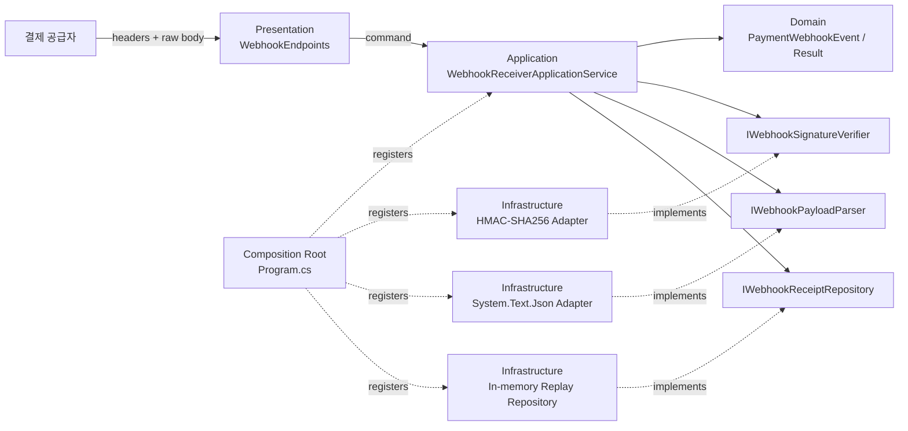
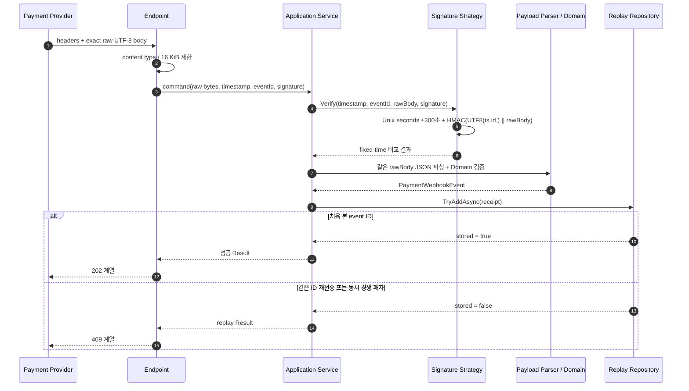
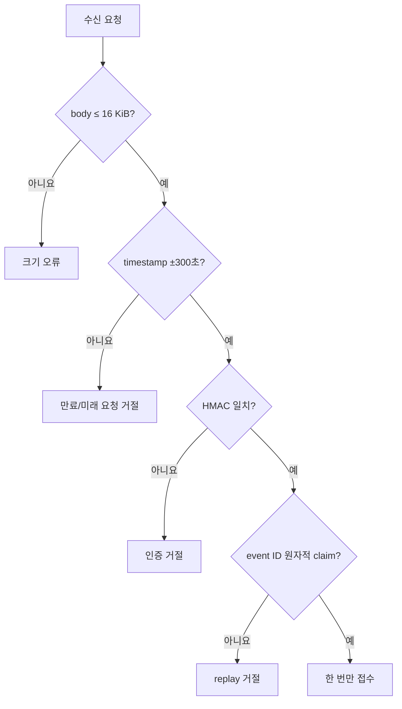

# .NET 10 HMAC-SHA256 결제 웹훅 수신 API

## 👣 코드 읽는 순서 (Reading order)

처음부터 암호화 코드와 웹 API 전체를 한꺼번에 이해하려 하지 않아도 됩니다. **외부 계약 → 입력 경계 → 서명 → 업무 규칙 → 재전송 방지 → 조립 → 검증** 순서로 읽으세요.

1. 이 README의 [오늘의 목표](#-오늘의-목표)와 [한 줄 보안 계약](#한-줄-보안-계약)을 먼저 읽습니다.
2. [`WebhookReceiverApi.csproj`](./src/WebhookReceiverApi/WebhookReceiverApi.csproj)에서 `net10.0`, C# 14, nullable, warning-as-error 설정을 확인합니다.
3. [`WebhookContracts.cs`](./src/WebhookReceiverApi/Presentation/WebhookContracts.cs)와 [`WebhookEndpoints.cs`](./src/WebhookReceiverApi/Presentation/WebhookEndpoints.cs)에서 HTTP 헤더, **raw body**, 상태 코드의 경계를 봅니다.
4. [`ReceiveWebhookCommand.cs`](./src/WebhookReceiverApi/Application/ReceiveWebhookCommand.cs)에서 HTTP 계층이 Application Service에 넘기는 값의 모양을 확인합니다.
5. [`HmacSha256WebhookSignatureVerifier.cs`](./src/WebhookReceiverApi/Infrastructure/HmacSha256WebhookSignatureVerifier.cs)에서 canonical bytes와 `HMACSHA256`, 64자리 hex 파싱, `FixedTimeEquals`를 읽습니다.
6. [`WebhookEventId.cs`](./src/WebhookReceiverApi/Domain/WebhookEventId.cs), [`PaymentWebhookDraft.cs`](./src/WebhookReceiverApi/Domain/PaymentWebhookDraft.cs), [`PaymentWebhookEvent.cs`](./src/WebhookReceiverApi/Domain/PaymentWebhookEvent.cs)에서 검증 전 입력과 검증된 불변 Domain 값을 구분합니다.
7. [`Error.cs`](./src/WebhookReceiverApi/Domain/Error.cs)와 [`Result.cs`](./src/WebhookReceiverApi/Domain/Result.cs)에서 예상 실패를 예외 대신 값으로 표현하는 방법을 봅니다.
8. [`WebhookReceiverApplicationService.cs`](./src/WebhookReceiverApi/Application/WebhookReceiverApplicationService.cs)에서 timestamp → 서명 → JSON/Domain → replay claim으로 이어지는 유스케이스를 따라갑니다.
9. [`IWebhookSignatureVerifier.cs`](./src/WebhookReceiverApi/Application/Ports/IWebhookSignatureVerifier.cs), [`IWebhookPayloadParser.cs`](./src/WebhookReceiverApi/Application/Ports/IWebhookPayloadParser.cs), [`IWebhookReceiptRepository.cs`](./src/WebhookReceiverApi/Application/Ports/IWebhookReceiptRepository.cs)에서 Application이 구체 구현 대신 Port에 의존하는 이유를 확인합니다.
10. [`InMemoryWebhookReceiptRepository.cs`](./src/WebhookReceiverApi/Infrastructure/InMemoryWebhookReceiptRepository.cs)에서 같은 event ID를 동시에 보낸 요청 중 하나만 성공하게 하는 원자적 claim을 봅니다.
11. [`WebhookSecurityOptions.cs`](./src/WebhookReceiverApi/Infrastructure/WebhookSecurityOptions.cs)와 [`Program.cs`](./src/WebhookReceiverApi/Program.cs)에서 Options 검증, DI, Composition Root를 확인합니다.
12. [`SelfTestRunner.cs`](./src/WebhookReceiverApi/SelfTesting/SelfTestRunner.cs)와 [`verify-http.ps1`](./verify-http.ps1)로 내부 규칙과 실제 HTTP 계약을 각각 검증합니다.
13. [`EXERCISES.md`](./EXERCISES.md)를 Beginner부터 Pro까지 풀고, [`CHECKPOINT.md`](./CHECKPOINT.md)의 답을 먼저 말한 뒤 정답을 펼칩니다.

> 막히면 “**서명은 원본 bytes가 바뀌지 않았음을 확인하고, timestamp는 오래된 요청을 줄이며, 원자적 event-id 저장소는 같은 요청의 재사용을 막는다**”라는 문장으로 돌아오세요.

---

## 📌 빠른 탐색

| 유형 | 바로가기 |
| --- | --- |
| 🎯 학습 목표 | [오늘의 목표](#-오늘의-목표) |
| 🌐 외부 계약 | [HTTP 계약](#-http-계약) |
| 🔐 보안 핵심 | [raw body와 canonical bytes](#-raw-body와-canonical-bytes) |
| 🔤 언어 기초 | [Syntax와 Grammar](#-syntax와-grammar) |
| 🏗️ 아키텍처 | [아키텍처 시각화](#-아키텍처-시각화) |
| ✅ 실행 검증 | [Validation stage](#-validation-stage) |
| 📚 최신 정보 | [버전과 Microsoft 공식 출처](#-버전과-microsoft-공식-출처) |

---

## 🎯 오늘의 목표

외부 결제 공급자가 보낸 JSON 웹훅을 그대로 신뢰하지 않고 다음 방어선을 차례로 통과시키는 ASP.NET Core Minimal API를 만듭니다.

- body는 UTF-8 JSON이지만, 서명 검증 전에는 JSON 객체가 아니라 **최대 16 KiB의 원본 byte 배열**로 읽습니다.
- `X-Webhook-Timestamp`는 Unix seconds이며 서버 현재 시각과의 차이가 **±300초** 이내여야 합니다.
- `X-Webhook-Id`는 공급자가 이벤트마다 발급한 고유 ID이며 서명 대상과 replay 저장 키 양쪽에 사용합니다.
- `X-Webhook-Signature`는 정확히 `v1=<64 lowercase hex>` 형식입니다.
- canonical 입력은 정확히 `UTF8(timestamp + "." + eventId + ".") || rawBody`입니다.
- 서명은 `HMAC-SHA256(secret, canonicalBytes)`로 계산하고, 받은 32 bytes와 `CryptographicOperations.FixedTimeEquals`로 비교합니다.
- 인증과 payload 검증을 통과한 event ID는 Repository에서 **원자적으로 한 번만 claim**합니다.
- 성공한 요청은 불변 `WebhookReceipt`로 보관하고, 같은 ID의 재전송은 거절합니다.
- Domain, Application Service, Ports, Infrastructure, Presentation, Composition Root를 나누어 테스트 가능한 구조를 연습합니다.

### 한 줄 보안 계약

```text
expected = HMAC-SHA256(secret, UTF8(timestamp + "." + eventId + ".") || exactRawBody)
accept   = body <= 16 KiB AND |now - timestamp| <= 300s
           AND FixedTimeEquals(expected, supplied)
           AND atomicClaim(eventId) succeeds
```

여기서 `||`는 문자열 연산자가 아니라 **byte sequence 이어 붙이기**를 뜻합니다. prefix만 UTF-8로 인코딩하고 body는 읽은 원본 bytes를 그대로 붙입니다.

### event ID까지 서명해야 하는 이유

서명 입력이 `timestamp + "." + body`뿐이면 공격자는 유효한 요청을 가로챈 뒤 `X-Webhook-Id`만 새 값으로 바꿀 수 있습니다. 저장소는 새 ID로 착각해 replay를 허용합니다. 따라서 replay key인 event ID도 서명 범위에 넣어 헤더 변경을 탐지해야 합니다.

---

## 🌐 HTTP 계약

### 요청 예시

```http
POST /webhooks/payments HTTP/1.1
Content-Type: application/json
X-Webhook-Timestamp: 1792112400
X-Webhook-Id: evt_20261016_0001
X-Webhook-Signature: v1=0123456789abcdef0123456789abcdef0123456789abcdef0123456789abcdef

{"type":"payment.succeeded","data":{"paymentId":"pay_1001","amount":39000.00,"currency":"KRW"}}
```

위 signature는 **형식 예시**일 뿐 실제 secret/body에 맞는 값이 아닙니다. 실행 검증에서는 [`verify-http.ps1`](./verify-http.ps1)이 현재 timestamp와 실제 HMAC을 만듭니다.

### 각 입력의 의미

| 입력 | 규칙 | 방어하려는 문제 |
| --- | --- | --- |
| `Content-Type` | JSON 요청만 허용 | 예상하지 않은 body 해석 |
| `X-Webhook-Timestamp` | Unix seconds, 현재와 ±300초 | 오래된 정상 요청의 뒤늦은 재사용 |
| `X-Webhook-Id` | 1~100자의 영문자·숫자·`_`·`-` | 중복 처리와 로그/키 삽입 위험 |
| `X-Webhook-Signature` | `v1=` + lowercase hex 64자 | 애매한 파싱과 알고리즘 혼동 |
| body | exact raw UTF-8 bytes, 최대 16,384 bytes | 재직렬화 불일치와 메모리 고갈 |

시간창은 header와 현재 시각을 모두 **정수 Unix seconds**로 바꾼 뒤 차이를 비교합니다. 발신 시각이 애초에 초 단위라 소수부를 복원할 수 없기 때문에 경계를 결정적으로 만드는 선택이며, 실제 wall-clock 기준 허용 폭은 최대 1초 미만 더 넓을 수 있습니다.

### body 예시와 Domain 규칙

```json
{
  "type": "payment.succeeded",
  "data": {
    "paymentId": "pay_1001",
    "amount": 39000.00,
    "currency": "KRW"
  }
}
```

- `type`: `payment.succeeded` 또는 `payment.failed`
- `paymentId`: 1~100자의 영문자, 숫자, `_`, `-`
- `amount`: 0보다 크고 100,000,000 이하이며 소수 둘째 자리까지
- `currency`: `KRW`, `USD`처럼 대문자 영문 세 글자

### 응답을 읽는 법

구체적인 상태·오류 코드는 [`WebhookEndpoints.cs`](./src/WebhookReceiverApi/Presentation/WebhookEndpoints.cs)가 소유합니다.

| Method / Path | 성공 | 역할 |
| --- | --- | --- |
| `GET /` | `200 OK` | 서비스와 body/timestamp 제한 확인 |
| `POST /webhooks/payments` | `202 Accepted` + `Location: /webhooks/receipts/{eventId}` | 인증·검증·원자적 접수 |
| `GET /webhooks/receipts/{eventId}` | `200 OK` | 메모리에 접수된 결과 조회 |

POST와 GET 성공 JSON은 다음 필드를 사용합니다.

```json
{
  "eventId": "evt_20261016_0001",
  "type": "payment.succeeded",
  "paymentId": "pay_1001",
  "amount": 39000.00,
  "currency": "KRW",
  "signedAtUtc": "2026-10-16T00:00:00+00:00",
  "receivedAtUtc": "2026-10-16T00:00:01+00:00",
  "status": "accepted"
}
```

오류의 개념적인 분류는 다음과 같습니다.

| 결과 | 대표 HTTP 의미 | 원인 |
| --- | --- | --- |
| 접수 성공 | `202 Accepted` 계열 | 인증·검증·원자적 claim 완료 |
| 잘못된 요청 | `400 Bad Request` 계열 | header 문법, timestamp, JSON, Domain 규칙 위반 |
| 인증 실패 | `401 Unauthorized` 계열 | signature 형식 또는 HMAC 불일치 |
| 중복 이벤트 | `409 Conflict` 계열 | 이미 claim한 event ID |
| 너무 큰 body | `413 Payload Too Large` | 16 KiB 초과 |
| 지원하지 않는 미디어 형식 | `415 Unsupported Media Type` | JSON이 아닌 content type |
| 접수 결과 없음 | `404 Not Found` | GET의 event ID가 저장소에 없음 |

인증 실패에는 `WWW-Authenticate` header가 붙습니다. `202`는 “수신기가 안전하게 접수했다”는 뜻이지, 환불·배송·회계 같은 모든 후속 작업이 이미 끝났다는 보장은 아닙니다. 이 예제의 GET은 같은 프로세스의 학습용 메모리를 조회하므로 재시작 뒤에는 `404`가 될 수 있습니다.

---

## 🔐 raw body와 canonical bytes

### JSON을 먼저 객체로 만들면 왜 안 되나요?

아래 두 body는 JSON 의미가 같을 수 있지만 bytes는 다릅니다.

```text
{"amount":39000,"currency":"KRW"}
{ "currency": "KRW", "amount": 39000 }
```

공백, property 순서, 숫자 표기, 줄바꿈이 달라졌습니다. 공급자는 자신이 전송한 bytes로 HMAC을 계산했으므로 수신기가 deserialize 후 다시 serialize한 bytes로 비교하면 정상 요청도 실패할 수 있습니다. 반대로 자신만의 정규화 규칙을 암묵적으로 넣으면 서로 다른 입력을 같은 것으로 취급할 위험도 있습니다.

따라서 endpoint는 body를 한 번, 제한된 크기로 읽어 `ReadOnlyMemory<byte>`에 보존하고 다음 두 소비자에게 같은 bytes를 전달합니다.

```text
raw bytes ──┬──> Signature Verifier
            └──> JSON Payload Parser
```

### canonical 입력을 손으로 따라가기

입력이 다음과 같다고 가정합니다.

```text
timestamp = 1792112400
eventId   = evt_20261016_0001
rawBody   = {"type":"payment.succeeded",...} 의 실제 UTF-8 bytes
```

1. 문자열 prefix `1792112400.evt_20261016_0001.`을 만듭니다.
2. prefix만 UTF-8 bytes로 바꿉니다.
3. 그 뒤에 `rawBody`를 **변경 없이** 붙입니다.
4. 완성된 bytes를 secret과 함께 HMAC-SHA256에 넣습니다.
5. 32-byte 결과를 lowercase hex 64자로 표현하면 header의 `v1=` 뒤 값이 됩니다.

구분점 `.`을 넣는 이유는 `12` + `3`과 `1` + `23`처럼 필드 경계가 모호해지는 일을 막기 위해서입니다. timestamp와 event ID 문자열은 공급자와 수신자가 합의한 그대로 사용하며 trim·대소문자 변경을 몰래 적용하지 않습니다.

### signature를 문자열 `==`로 비교하지 않는 이유

일반 비교는 첫 번째 다른 위치에서 일찍 끝날 수 있어 실행 시간 차이가 값에 관한 단서를 줄 수 있습니다. `CryptographicOperations.FixedTimeEquals`는 같은 길이의 byte sequence를 비교할 때 값이 아닌 길이에 의존하는 시간으로 비교하도록 제공된 API입니다. 먼저 엄격한 64자리 lowercase hex를 32 bytes로 파싱한 뒤 비교합니다.

---

## 🔤 Syntax와 Grammar

이 절은 C#을 처음 읽는 학습자를 위한 Beginner 문법 설명입니다.

### 1. 변수, 상수, 조건문

```csharp
// const는 실행 중 바뀌면 안 되는 보안 경계 값을 이름으로 설명합니다.
const int MaximumBodyBytes = 16 * 1024;

// var는 형식이 없는 값이 아닙니다. 오른쪽 식으로부터 int라는 정적 형식을 추론합니다.
var bodyLength = rawBody.Length;

// if는 body를 메모리에 더 읽거나 파싱하기 전에 거절할 조건을 표현합니다.
if (bodyLength > MaximumBodyBytes)
{
    // Result 실패는 호출자가 예상하고 HTTP 응답으로 바꿀 수 있는 거절입니다.
    return Result<WebhookReceipt>.Failure(error);
}
```

`16 * 1024`는 16 KiB, 즉 16,384 bytes입니다. 글자 수가 아닙니다. 한글 한 글자는 UTF-8에서 여러 bytes가 될 수 있으므로 보안 제한은 실제 bytes로 측정합니다.

### 2. nullable `?`와 null 검사

HTTP header와 JSON property는 빠지거나 `null`일 수 있습니다. `string?`는 “문자열 또는 값 없음”을 형식에 드러냅니다. 검증 경계를 통과한 Domain 객체는 가능한 한 non-null로 만들어 내부 코드가 매번 null을 의심하지 않게 합니다.

`!` null-forgiving 연산자는 runtime 검사가 아닙니다. 앞선 분기로 안전함을 이미 증명했음을 compiler에 알릴 뿐이므로, 검증 대신 습관적으로 사용하면 안 됩니다.

### 3. `record`와 불변성

`PaymentWebhookEvent`, `WebhookReceipt`, `Error`, `Result<T>`는 “나중에 마음대로 바꾸는 물건”보다 “이미 확정된 값/사실”에 가깝습니다. `record`는 값 중심 비교를 제공하고, get-only property와 함께 쓰면 생성 뒤 우연한 수정을 줄입니다.

불변 객체가 있다고 replay 저장소까지 자동으로 thread-safe해지는 것은 아닙니다. 여러 요청이 같은 ID를 동시에 claim하는 복합 상태 변경에는 별도의 원자성이 필요합니다.

### 4. generic `Result<T>`

`T`는 성공 값의 형식을 채우는 자리입니다. `Result<WebhookReceipt>`는 성공이면 receipt를, 실패이면 안정적인 `Error`를 운반합니다.

```text
Result 실패 : 잘못된 header/JSON/업무 값, 만료 timestamp, 서명 불일치, replay
예외        : 깨진 내부 invariant, 잘못된 DI 구성, 예상하지 못한 저장소 장애
취소        : client가 연결을 끊어 더 이상 요청 결과를 기다리지 않음
```

모든 오류를 예외로 던지면 정상적인 거절도 500처럼 보이기 쉽습니다. 반대로 실제 서버 결함을 `400` Result로 숨기면 운영자가 장애를 발견하기 어렵습니다.

### 5. `async` / `await`와 `CancellationToken`

request body 읽기는 I/O입니다. `await`는 I/O가 끝날 때까지 thread를 붙잡고 반복 대기하지 않고, 완료 뒤 메서드의 나머지를 이어 실행하게 합니다. `HttpContext.RequestAborted`에서 온 `CancellationToken`을 body read와 Application Service까지 전달하면 client 연결 종료 뒤 불필요한 일을 줄일 수 있습니다.

### 6. pattern matching과 switch expression

`PaymentWebhookEvent.Create`는 외부 문자열을 지원하는 `WebhookEventKind`로 제한합니다. switch expression은 “입력 하나를 결과 하나로 대응”하는 규칙을 간결하게 보여 줍니다. `_`는 앞선 경우에 맞지 않는 모든 값을 뜻하며, 이 예제에서는 지원하지 않는 이벤트 오류가 됩니다.

### 7. LINQ `All`

event ID와 payment ID의 모든 문자가 허용 집합에 속하는지 `All`로 읽기 쉽게 표현합니다. LINQ는 이미 가진 값의 질의·검사에 잘 맞지만, replay claim 같은 순서와 원자성이 중요한 상태 변경을 긴 LINQ chain에 숨기면 안 됩니다.

### 8. `ReadOnlyMemory<byte>`

서명할 원본 bytes는 “이 메서드가 수정하지 않는다”는 의도를 형식으로 표현합니다. 다만 `ReadOnlyMemory<byte>` 자체가 비밀을 자동으로 지우거나 다른 곳의 원본 배열 변경까지 모두 막아 주는 보안 저장소는 아닙니다. 소유권과 lifetime을 함께 설계해야 합니다.

---

## 🧭 핵심 처리 순서

방어선은 각각 다른 문제를 해결합니다. 하나를 통과했다고 다음 검사가 불필요해지지 않습니다.

1. endpoint가 JSON content type인지 확인합니다.
2. timestamp, event ID, signature header가 각각 정확히 하나씩 존재하는지 확인합니다.
3. body를 **최대 16 KiB까지만** 읽어 exact bytes를 보존합니다. `Content-Length`만 믿으면 안 됩니다. chunked 요청은 길이를 미리 모를 수 있기 때문입니다.
4. Application이 event ID 문법을 검증합니다.
5. `TimeProvider`의 UTC 현재 시각과 timestamp 차이가 ±300초인지 검사합니다.
6. signature가 `v1=<64 lowercase hex>`인지 확인하고 `UTF8(timestamp + "." + eventId + ".") || rawBody`의 HMAC-SHA256을 계산해 fixed-time으로 비교합니다.
7. 같은 raw bytes를 JSON으로 파싱하고 Domain 규칙을 검사합니다.
8. Repository가 event ID를 원자적으로 claim하며 receipt를 저장합니다.
9. 이미 claim한 ID면 side effect 없이 replay로 거절합니다.

크기 제한은 가능한 한 앞에서 적용하고, replay 저장은 인증·payload 검증 뒤에 수행합니다. 잘못된 공격 요청이 ID를 먼저 선점해 정상 요청을 막게 해서는 안 됩니다.

---

## 🏗️ 아키텍처 시각화

### 1. 계층과 의존성 방향



화살표의 핵심은 Application이 Infrastructure 구체 클래스가 아니라 자신이 필요한 Port에 의존한다는 점입니다. Infrastructure가 안쪽의 계약을 구현하므로 저장 기술과 암호 구현을 테스트 대역으로 바꾸기 쉽습니다.

### 2. 정상 요청과 replay 요청의 시간 흐름



### 3. 세 방어선의 역할



timestamp 창만으로는 5분 안의 반복 전송을 막지 못하고, replay 저장소만으로는 위조 body를 인증하지 못합니다. HMAC도 유효 요청을 그대로 다시 보내는 replay 자체는 막지 못합니다. 세 방어선을 조합해야 합니다.

---

## 🧩 패턴과 설계 의도 (Why)

### Application Service

`WebhookReceiverApplicationService`는 “안전하게 웹훅 하나를 접수한다”는 유스케이스 순서를 소유합니다. HTTP status나 Kestrel 형식은 모르고, 암호·파서·저장소는 Port로 호출합니다. 이 덕분에 순서 규칙을 HTTP 서버 없이 빠르게 테스트할 수 있습니다.

### Signature Strategy

`IWebhookSignatureVerifier`는 현재의 HMAC-SHA256 `v1` 정책을 별도 전략으로 격리합니다. 새 secret 회전이나 `v2` 알고리즘이 생겨도 Application 흐름 전체를 암호 세부 사항으로 채우지 않습니다. 단, 임의 알고리즘을 header가 선택하게 두면 downgrade 위험이 있으므로 서버가 허용 버전을 명시적으로 제한해야 합니다.

### Repository Port와 원자적 claim

“이미 있는가?”를 조회하고 나중에 “추가”하는 두 단계는 경쟁 조건이 있습니다.

```text
요청 A: 없음 확인 ─────────── 추가
요청 B:      없음 확인 ─────────── 추가   ← 둘 다 side effect 가능
```

Repository의 계약은 확인과 추가를 하나의 원자적 동작으로 묶어야 합니다. 현재 in-memory 구현은 학습용이지만, 운영 DB에서는 event ID unique constraint와 transaction을 이용할 수 있습니다. 단순 `Contains` 뒤 `Add`는 충분하지 않습니다.

### DI와 Composition Root

`Program.cs`는 구체 구현을 고르는 유일한 바깥 조립 지점입니다. Application Service는 `new HmacSha256WebhookSignatureVerifier(...)`를 직접 하지 않습니다. 이것이 의존성 역전 원칙(DIP)을 실제 코드에 적용한 모습입니다.

- 높은 수준의 접수 정책이 낮은 수준의 HMAC/JSON/메모리 구현에 직접 묶이지 않습니다.
- self-test는 fake clock, fake verifier, 작은 repository를 주입할 수 있습니다.
- 운영에서는 secret provider나 durable repository로 Adapter를 교체할 자리가 생깁니다.

interface를 많이 만든 것 자체가 SOLID는 아닙니다. 변경 이유가 다르고 테스트 경계가 분명한 곳에만 Port를 둡니다.

### Options pattern

`WebhookSecurityOptions`는 외부에서 받아야 하는 secret과 코드가 고정하는 허용 시간창·body 상한을 한 정책 형식에 모읍니다. `ValidateOnStart`는 secret 누락이나 짧은 값을 첫 요청까지 숨기지 않고 시작 시 실패시킵니다. secret은 소스나 커밋된 `appsettings.json`에 넣지 말고 환경 변수·개발자 비밀·운영 secret store로 공급해야 합니다.

### `TimeProvider`

코드 안에서 `DateTimeOffset.UtcNow`를 직접 읽으면 경계 테스트가 시계에 따라 흔들립니다. `TimeProvider`를 주입하면 정확히 300초, 301초, 미래 timestamp를 결정적으로 검증할 수 있습니다.

### 테스트 가능성

테스트는 다음 경계를 서로 다르게 확인합니다.

- Domain test: type, payment ID, amount, currency 규칙
- signature test: body 한 byte·timestamp·event ID 변경 시 실패
- clock test: ±300초 경계
- repository test: 동시에 같은 ID를 claim할 때 정확히 하나만 성공
- self-test: Application 흐름과 오류 code
- HTTP black-box test: 실제 header, raw body, status, content type, DI 조립

---

## ⚠️ 보안 한계와 운영 전 점검

이 예제는 중요한 개념을 작게 보여 주지만 운영용 결제 시스템 전체가 아닙니다.

- HMAC은 body를 **암호화하지 않습니다**. TLS(HTTPS)가 별도로 필요합니다.
- HMAC은 shared secret 보유자를 확인할 뿐 사용자 권한, 결제의 진실성, downstream side effect 성공까지 보장하지 않습니다.
- 학습용 receipt GET은 인증·인가를 생략했고 응답에는 `Cache-Control: no-store`만 적용합니다. 운영 공개 전에는 관리자 인증과 리소스 기반 인가를 반드시 추가해야 합니다.
- 예제의 in-memory replay 저장소는 프로세스 재시작 시 사라지고 여러 서버 인스턴스 사이에 공유되지 않습니다. 운영에서는 durable DB, unique event ID, transaction, retention 정책이 필요합니다.
- event ID를 영원히 저장하면 공간이 무한히 자랍니다. 공급자의 최대 재시도 기간보다 충분히 긴 TTL과 감사 요구를 함께 설계해야 합니다.
- timestamp 검증에는 서버와 공급자의 시계 동기화가 필요합니다. 허용창을 지나치게 넓히면 replay 기회가 커지고 지나치게 좁히면 정상 지연을 거절합니다.
- secret rotation은 이전/현재 key ID와 제한된 겹침 기간을 설계해야 합니다. signature header가 임의 알고리즘이나 key를 강제로 선택하게 두지 않습니다.
- 16 KiB 제한은 앱뿐 아니라 reverse proxy, IIS/Kestrel, API gateway에서도 일관되게 검토해야 합니다. `Content-Length`가 없거나 거짓일 수 있어 실제 읽기에도 상한이 필요합니다.
- body, signature, secret, 결제 개인정보를 로그에 그대로 남기지 않습니다. event ID와 안전한 오류 code, trace ID 중심으로 관측합니다.
- 여러 webhook 종류가 실제 side effect를 만들 때 inbox/outbox, idempotent handler, retry, dead-letter, 순서 정책이 추가로 필요합니다.
- 공급자마다 canonicalization과 header 계약이 다릅니다. 이 예제의 규칙을 다른 공급자에게 그대로 가정하지 말고 공식 계약과 test vector를 확인합니다.

---

## 🗺️ 파일 내비게이션 맵

```text
20261016/
├─ README.md                         # 개념, 구조, 실행·검증, 공식 출처
├─ EXERCISES.md                      # Beginner → Pro 단계별 과제
├─ CHECKPOINT.md                     # 초보자 이해도 질문과 정답
├─ verify-http.ps1                   # 실제 Kestrel black-box 검증
└─ src/WebhookReceiverApi/
   ├─ WebhookReceiverApi.csproj      # net10.0 / C# 14 / nullable
   ├─ Program.cs                     # Composition Root와 endpoint 연결
   ├─ Domain/                        # 불변 값, 업무 규칙, Result
   ├─ Application/                   # 유스케이스와 Ports
   ├─ Infrastructure/                # HMAC, JSON, replay 저장소, Options
   ├─ Presentation/                  # HttpContext와 HTTP 계약
   └─ SelfTesting/                   # 시계·보안·동시성 자체 검증
```

---

## ✅ Validation stage

아래는 초보자가 결과를 한 단계씩 확인하는 검증 순서입니다.

코드를 수정하기 전에 먼저 제공된 기준선을 그대로 실행하세요.

### 1단계: 환경 확인

```powershell
dotnet --version
dotnet --list-runtimes
```

이 작업 환경에서는 SDK `10.0.301`, .NET runtime `10.0.9`가 설치되어 있습니다. 최신 stable patch는 아래 출처 기준 SDK `10.0.402` / runtime `10.0.13`이지만, 예제는 설치된 stable SDK에서도 컴파일되도록 `net10.0`, C# 14만 사용합니다.

### 2단계: restore와 Release build

```powershell
Set-Location D:\workspace\csharp_study\dailyStudy\exercise\20261016
dotnet restore .\src\WebhookReceiverApi\WebhookReceiverApi.csproj
dotnet build .\src\WebhookReceiverApi\WebhookReceiverApi.csproj -c Release --no-restore
```

기대 결과는 warning 0개, error 0개입니다. `TreatWarningsAsErrors`가 켜져 있으므로 warning도 학습 코드의 결함으로 다룹니다.

### 3단계: 결정적인 self-test

```powershell
dotnet run --project .\src\WebhookReceiverApi\WebhookReceiverApi.csproj -c Release --no-build -- --self-test
```

출력의 통과 표식을 확인합니다. self-test는 실제 현재 시각 대신 `ManualTimeProvider`를 사용해 timestamp 경계와 replay 경쟁을 반복 가능하게 확인합니다.

### 4단계: 실제 HTTP 검증

```powershell
pwsh -NoProfile -File .\verify-http.ps1
```

스크립트는 Production Kestrel을 별도 프로세스로 실행하고 실제 raw bytes의 signature를 계산합니다. 정상 요청, 변조, 만료, replay, 16 KiB 초과 같은 외부 계약을 확인한 뒤 자신이 시작한 프로세스만 정리해야 합니다.

### 5단계: 결과를 말로 설명

다음 질문에 코드 줄을 보지 않고 답해 보세요.

1. 왜 deserialize한 객체가 아니라 raw body bytes에 서명하나요?
2. 왜 timestamp와 event ID를 모두 signature 입력에 포함하나요?
3. 왜 `Contains`와 `Add` 두 호출 대신 원자적 claim이 필요한가요?
4. `Result<T>`로 돌려줄 실패와 예외로 남길 장애는 어떻게 다른가요?
5. 테스트에서 `TimeProvider`가 없다면 어떤 검증이 불안정해지나요?

두 문장 이상으로 설명하기 어렵다면 [`CHECKPOINT.md`](./CHECKPOINT.md)를 펼치기 전에 관련 코드와 구조도를 다시 따라가세요.

---

## 🧪 실패 하나를 추적하는 디버깅 순서

정상 웹훅이 거절될 때 secret부터 무작정 바꾸지 마세요.

1. body의 **실제 byte 길이**가 16,384 이하인지 봅니다.
2. header가 하나씩만 있고 timestamp/event ID/signature 형식이 정확한지 봅니다.
3. timestamp를 UTC Unix seconds로 해석했는지, millisecond를 잘못 보낸 것은 아닌지 봅니다.
4. prefix 끝의 두 번째 점까지 포함했는지 확인합니다: `timestamp.eventId.`
5. body를 문자열로 다시 만들지 않고 전송한 bytes 그대로 HMAC에 사용했는지 봅니다.
6. hex가 lowercase 64자리인지 확인합니다.
7. signature가 맞는데도 실패하면 JSON/Domain 규칙과 replay 여부를 봅니다.

로그에는 secret이나 전체 signature/body를 남기지 말고 실패 단계, 안전한 error code, event ID, trace ID 정도만 기록합니다.

---

## 📚 버전과 Microsoft 공식 출처

확인 기준일은 **2026-10-16 (Asia/Seoul)**입니다.

| 구분 | 오늘 확인한 정보 | 이 예제의 선택 |
| --- | --- | --- |
| Stable .NET | .NET Runtime/ASP.NET Core `10.0.13`, SDK `10.0.402`, C# `14.0` | 사용 |
| 설치 환경 | SDK `10.0.301`, runtime `10.0.9` | 여기서 build/run 검증 |
| Preview/RC | .NET runtime `11.0.0-rc.2.26504.105`, SDK `11.0.100-rc.2.26504.105`, C# `15 preview` | 설명만, 코드에 사용하지 않음 |
| Target | `net10.0`, `<LangVersion>14.0</LangVersion>` | 재현 가능한 stable 예제 |

공식 자료:

- [.NET 10 다운로드 — 10.0.13 / SDK 10.0.402 / C# 14](https://dotnet.microsoft.com/en-us/download/dotnet/10.0)
- [.NET 10 release metadata JSON](https://builds.dotnet.microsoft.com/dotnet/release-metadata/10.0/releases.json)
- [.NET 2026년 10월 servicing update](https://devblogs.microsoft.com/dotnet/dotnet-and-dotnet-framework-october-2026-servicing-updates/)
- [.NET 10의 새로운 기능](https://learn.microsoft.com/en-us/dotnet/core/whats-new/dotnet-10/overview)
- [C# 14의 새로운 기능](https://learn.microsoft.com/en-us/dotnet/csharp/whats-new/csharp-14)
- [.NET 11 Release Candidate 2 발표](https://devblogs.microsoft.com/dotnet/dotnet-11-rc-2/)
- [.NET 11 다운로드](https://dotnet.microsoft.com/en-us/download/dotnet/11.0)
- [.NET 11 release metadata JSON](https://builds.dotnet.microsoft.com/dotnet/release-metadata/11.0/releases.json)
- [C# 15의 새로운 기능 — preview](https://learn.microsoft.com/en-us/dotnet/csharp/whats-new/csharp-15)
- [`HMACSHA256` API](https://learn.microsoft.com/en-us/dotnet/api/system.security.cryptography.hmacsha256?view=net-10.0)
- [`HMACSHA256.HashData` API](https://learn.microsoft.com/en-us/dotnet/api/system.security.cryptography.hmacsha256.hashdata?view=net-10.0)
- [`CryptographicOperations.FixedTimeEquals` API](https://learn.microsoft.com/en-us/dotnet/api/system.security.cryptography.cryptographicoperations.fixedtimeequals?view=net-10.0)
- [ASP.NET Core에서 `HttpContext` 사용](https://learn.microsoft.com/en-us/aspnet/core/fundamentals/use-http-context?view=aspnetcore-10.0)
- [ASP.NET Core 오류 처리와 `UseExceptionHandler`](https://learn.microsoft.com/en-us/aspnet/core/web-api/handle-errors?view=aspnetcore-10.0)
- [ASP.NET Core Options pattern](https://learn.microsoft.com/en-us/aspnet/core/fundamentals/configuration/options?view=aspnetcore-10.0)
- [ASP.NET Core Dependency Injection](https://learn.microsoft.com/en-us/aspnet/core/fundamentals/dependency-injection?view=aspnetcore-10.0)
- [Kestrel request limits와 보안 고려사항](https://learn.microsoft.com/en-us/aspnet/core/fundamentals/servers/kestrel/security-considerations?view=aspnetcore-10.0)

> .NET 11 RC 2 다운로드/metadata의 `csharp-version` 표시는 아직 14.0이지만 Microsoft Learn은 C# 15를 최신 preview로 안내합니다. 오늘의 보안 예제는 언어 실험보다 재현성과 검증 가능성이 중요하므로 stable C# 14 범위로 제한합니다.

---

## 🧾 간결한 복습 체크리스트

- [ ] 코드 읽는 순서를 따라 HTTP → Application → Domain → Infrastructure → Composition Root를 찾았다.
- [ ] canonical bytes를 `UTF8(timestamp + "." + eventId + ".") || rawBody`로 말할 수 있다.
- [ ] event ID도 서명해야 replay ID 바꿔치기를 막는 이유를 설명한다.
- [ ] signature 형식 `v1=<64 lowercase hex>`와 HMAC 결과 32 bytes의 관계를 안다.
- [ ] timestamp 허용창이 ±300초임을 안다.
- [ ] 16 KiB는 문자 수가 아니라 16,384 bytes임을 안다.
- [ ] `Content-Length` 검사만으로 충분하지 않은 이유를 안다.
- [ ] `FixedTimeEquals`를 일반 문자열 비교 대신 쓰는 이유를 안다.
- [ ] 원자적 replay claim이 동시 중복을 막는 이유를 설명한다.
- [ ] nullable 경계와 검증된 불변 `record`를 구분한다.
- [ ] Result, 예외, 취소의 역할을 구분한다.
- [ ] Application Service, Repository, Signature Strategy, DI/Composition Root의 Why를 말할 수 있다.
- [ ] self-test와 실제 HTTP 검증이 서로 다른 결함을 찾는다는 점을 안다.
- [ ] in-memory replay 저장소와 shared secret 방식의 운영 한계를 안다.
- [ ] stable .NET 10/C# 14와 .NET 11 RC 2/C# 15 preview를 구분한다.
- [ ] `bin/`, `obj/`, secret, 검증 로그를 커밋하지 않는다.
