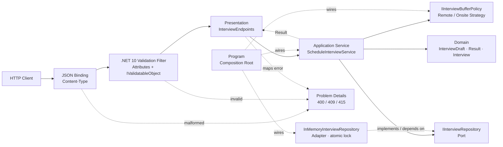
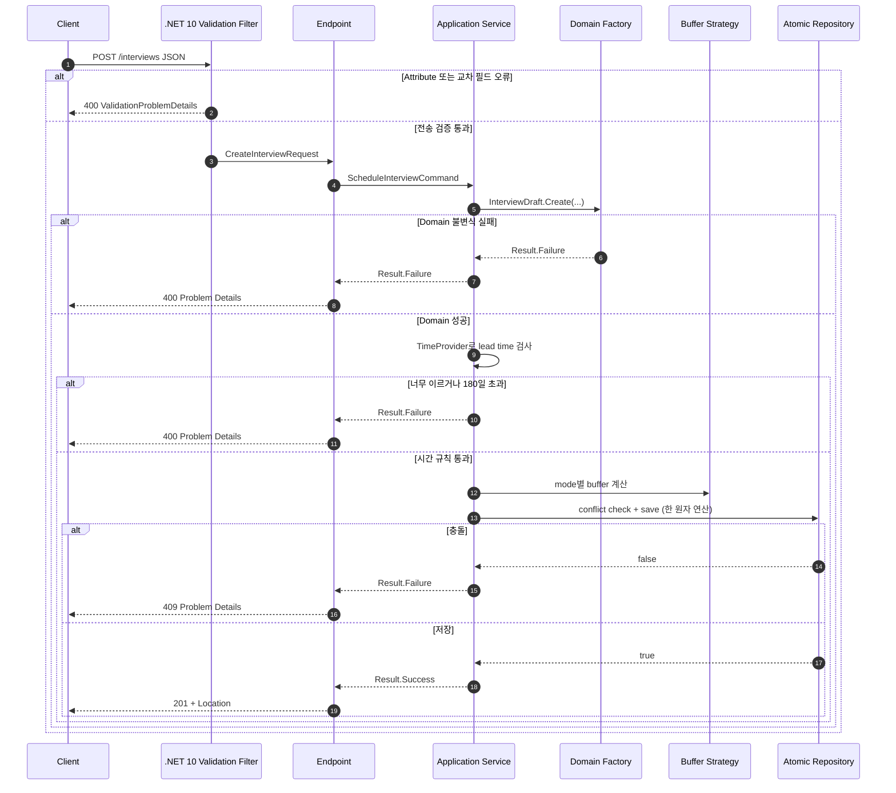

# .NET 10 Minimal API 자동 검증 면접 일정 API

## 👣 코드 읽는 순서 (Reading order)

처음부터 Attribute, Domain, 동시성 코드를 한꺼번에 이해하려 하지 않아도 됩니다. **HTTP 입력 → 자동 검증 → Domain 불변식 → 시간·충돌 업무 규칙 → 원자적 저장 → 조립 → 검증** 순서로 읽으세요.

1. 이 README의 [오늘의 목표](#-오늘의-목표)와 [검증 책임의 세 경계](#-검증-책임의-세-경계)를 먼저 읽습니다.
2. [`InterviewValidationApi.csproj`](./src/InterviewValidationApi/InterviewValidationApi.csproj)에서 `net10.0`, C# 14, nullable, warning-as-error 설정을 확인합니다.
3. [`InterviewContracts.cs`](./src/InterviewValidationApi/Presentation/InterviewContracts.cs)에서 `[Required]`, `[Range]`, 사용자 정의 `[UtcDateTime]`, `IValidatableObject`가 요청 모양을 검사하는 방법을 봅니다.
4. [`UtcDateTimeAttribute.cs`](./src/InterviewValidationApi/Presentation/Validation/UtcDateTimeAttribute.cs)에서 한 필드만 검사하는 사용자 정의 Attribute를 읽습니다.
5. [`InterviewEndpoints.cs`](./src/InterviewValidationApi/Presentation/InterviewEndpoints.cs)에서 **검증을 통과한 요청만** handler로 들어오고, handler는 HTTP와 Application 사이 변환만 맡는지 확인합니다.
6. [`InterviewDraft.cs`](./src/InterviewValidationApi/Domain/InterviewDraft.cs)에서 HTTP를 우회한 호출에도 불변식이 유지되도록 Domain이 핵심 규칙을 다시 지키는 이유를 봅니다.
7. [`Result.cs`](./src/InterviewValidationApi/Domain/Result.cs), [`Error.cs`](./src/InterviewValidationApi/Domain/Error.cs), [`Interview.cs`](./src/InterviewValidationApi/Domain/Interview.cs)를 읽어 private 생성 경로, 불변 컬렉션, 예상 실패 표현을 확인합니다.
8. [`ScheduleInterviewService.cs`](./src/InterviewValidationApi/Application/ScheduleInterviewService.cs)에서 현재 시각, Strategy 선택, Repository 호출을 조정하는 유스케이스를 따라갑니다.
9. [`IInterviewBufferPolicy.cs`](./src/InterviewValidationApi/Application/Ports/IInterviewBufferPolicy.cs)와 [`InterviewBufferPolicies.cs`](./src/InterviewValidationApi/Application/InterviewBufferPolicies.cs)에서 원격/대면 준비 시간 Strategy를 비교합니다.
10. [`IInterviewRepository.cs`](./src/InterviewValidationApi/Application/Ports/IInterviewRepository.cs)와 [`InMemoryInterviewRepository.cs`](./src/InterviewValidationApi/Infrastructure/InMemoryInterviewRepository.cs)에서 충돌 확인과 저장을 같은 `lock` 안에서 처리하는 이유를 확인합니다.
11. [`Program.cs`](./src/InterviewValidationApi/Program.cs)에서 `AddValidation`, DI, Composition Root, Problem Details 구성을 봅니다.
12. [`SelfTestRunner.cs`](./src/InterviewValidationApi/SelfTesting/SelfTestRunner.cs)와 [`verify-http.ps1`](./verify-http.ps1)로 내부 규칙과 실제 HTTP 계약을 각각 검증합니다.
13. [`EXERCISES.md`](./EXERCISES.md)를 Beginner부터 Pro까지 풀고, [`CHECKPOINT.md`](./CHECKPOINT.md)의 답을 먼저 말한 뒤 정답을 펼칩니다.

> 막히면 “**전송 형식은 Presentation, 항상 참이어야 하는 값 규칙은 Domain, 시간·저장소가 필요한 업무 규칙은 Application이 맡는다**”라는 문장으로 돌아오세요.

---

## 📌 빠른 탐색

| 유형 | 바로가기 |
| --- | --- |
| 🎯 학습 목표 | [오늘의 목표](#-오늘의-목표) |
| 🌐 외부 계약 | [HTTP 계약](#-http-계약) |
| ✅ 검증 핵심 | [검증 책임의 세 경계](#-검증-책임의-세-경계) |
| 🔤 언어 기초 | [Syntax와 Grammar](#-syntax와-grammar) |
| 🏗️ 아키텍처 | [아키텍처 시각화](#-아키텍처-시각화) |
| 🧪 실행 검증 | [Validation stage](#-validation-stage) |
| 📚 최신 정보 | [버전과 Microsoft 공식 출처](#-버전과-microsoft-공식-출처) |

---

## 🎯 오늘의 목표

면접 일정 생성 API를 만들며 .NET 10 Minimal API의 자동 검증과 실무적인 검증 책임 분리를 연습합니다.

- `AddValidation()`으로 Minimal API 요청의 자동 검증을 활성화합니다.
- `[Required]`, `[StringLength]`, `[Range]`, `[EmailAddress]`로 **한 속성의 모양**을 선언합니다.
- 사용자 정의 `[UtcDateTime]`으로 JSON binding 뒤 시작 시각의 오프셋이 0인지 검사합니다.
- `IValidatableObject`로 duration 15분 단위, 원격 URL/대면 회의실, 중복 면접관처럼 **여러 필드가 함께 만드는 규칙**을 검사합니다.
- 자동 검증 실패는 endpoint handler를 실행하기 전에 `400 ValidationProblemDetails`가 됩니다.
- HTTP를 통하지 않는 배치·메시지 소비자도 안전하도록 Domain 팩터리가 핵심 불변식을 다시 보장합니다.
- 현재 시각에서 최소 15분 뒤·최대 180일 이내라는 규칙은 `TimeProvider`가 필요한 Application 규칙으로 둡니다.
- 원격/대면 면접의 앞뒤 준비 시간은 Strategy로 분리합니다.
- 같은 면접관의 준비 시간을 포함한 일정 충돌은 Repository가 **검사와 저장을 원자적으로** 처리합니다.
- 예상 가능한 오류는 `Result<T>`, 취소와 예상 밖 장애는 예외로 구분합니다.
- Domain, Application, Port, Adapter, Presentation, Composition Root를 분리해 테스트 가능성을 확보합니다.

### 한 줄 검증 계약

```text
JSON / Content-Type
  -> property attributes
  -> IValidatableObject cross-field rules
  -> Domain invariants
  -> Application time rule
  -> atomic Repository conflict check + save
```

앞 단계가 통과해야 다음 단계로 갑니다. 전송 오류와 업무 충돌을 모두 하나의 거대한 validator에 넣지 않는 것이 오늘의 핵심입니다.

---

## 🌐 HTTP 계약

### 생성 요청

```http
POST /interviews HTTP/1.1
Content-Type: application/json

{
  "candidateName": "홍길동",
  "candidateEmail": "candidate@example.com",
  "startsAtUtc": "2026-10-21T06:00:00+00:00",
  "durationMinutes": 60,
  "mode": "remote",
  "meetingUrl": "https://meet.example.com/interviews/1001",
  "room": null,
  "interviewerIds": ["DEV-01", "QA-02"]
}
```

| 필드 | 전송 규칙 | 더 깊은 규칙 |
| --- | --- | --- |
| `candidateName` | 필수, 2~60자 | 양끝 공백 제거 |
| `candidateEmail` | 필수, 이메일 모양 | 양끝 공백 제거, 소문자 정규화 |
| `startsAtUtc` | 필수, binding 뒤 UTC 0 오프셋(대표 표기 `Z`, `+00:00`) | 현재보다 15분 이상 뒤, 180일 이내 |
| `durationMinutes` | 30~180 | 15분 단위 |
| `mode` | `remote` 또는 `onsite` | enum으로 변환 |
| `meetingUrl` | 최대 200자 | remote일 때만 절대 HTTPS URL 필수 |
| `room` | 최대 40자 | onsite일 때만 2~40자 필수 |
| `interviewerIds` | 필수, 1~5개 | 각 ID 형식, 대소문자 무시 중복 금지 |

원격과 대면 위치 계약은 서로 배타적입니다.

| mode | `meetingUrl` | `room` |
| --- | --- | --- |
| `remote` | 절대 HTTPS URL 필수 | 보내면 오류 |
| `onsite` | 보내면 오류 | 2~40자 필수 |

### 성공 응답

```http
HTTP/1.1 201 Created
Location: /interviews/11111111-2222-3333-4444-555555555555
Content-Type: application/json
```

```json
{
  "id": "11111111-2222-3333-4444-555555555555",
  "candidateName": "홍길동",
  "candidateEmail": "candidate@example.com",
  "startsAtUtc": "2026-10-21T06:00:00+00:00",
  "endsAtUtc": "2026-10-21T07:00:00+00:00",
  "mode": "remote",
  "location": "https://meet.example.com/interviews/1001",
  "interviewerIds": ["DEV-01", "QA-02"],
  "createdAtUtc": "2026-10-19T01:00:00+00:00"
}
```

### 상태 코드

| Method / Path | 결과 | 의미 |
| --- | --- | --- |
| `GET /` | `200` | 서비스와 공개 가능한 제한 확인 |
| `POST /interviews` | `201` | 검증·충돌 검사를 통과하고 저장 |
| `POST /interviews` | `400` | binding, Attribute, 교차 필드, Domain, 시간 규칙 실패 |
| `POST /interviews` | `409` | 같은 면접관의 준비 시간을 포함한 일정 충돌 |
| `POST /interviews` | `415` | JSON이 아닌 Content-Type |
| `GET /interviews/{id}` | `200` | 저장된 일정 조회 |
| `GET /interviews/{id}` | `404` | 일정 없음 |

자동 검증 오류도 `application/problem+json`이며 `errors` 사전에 필드별 메시지가 들어갑니다. 이 예제는 모든 Problem Details에 안정적인 `code`, 가까운 `field`, 서버 추적용 `traceId`를 추가합니다.

---

## ✅ 검증 책임의 세 경계

### 1. Presentation: 요청의 모양

[`CreateInterviewRequest`](./src/InterviewValidationApi/Presentation/InterviewContracts.cs)는 HTTP/JSON 계약을 표현합니다.

- `[Required]`: JSON에서 반드시 받아야 하는가?
- `[StringLength]`, `[Range]`: 한 필드의 길이·숫자 범위가 맞는가?
- `[EmailAddress]`: 이메일의 기본 모양인가?
- `[UtcDateTime]`: JSON binding이 만든 시각 값의 offset이 0인가?
- `IValidatableObject`: mode와 location처럼 여러 필드를 함께 봐야 하는가?

`builder.Services.AddValidation()`은 source generator가 검증 metadata를 만들게 하고 endpoint filter가 handler 전에 검사하게 합니다. 실패하면 handler, Application Service, Repository는 호출되지 않습니다.

중요한 실행 순서는 **속성 Attribute → 속성의 하위 값 → 객체의 `IValidatableObject`**입니다. 속성 단계에서 오류가 있으면 객체 단계는 실행되지 않을 수 있으므로, 한 응답에 모든 가능한 종류의 오류가 반드시 함께 나온다고 가정하면 안 됩니다.

#### JSON 원문 표기와 binding 뒤 값

`DateTimeOffset` JSON binder는 `Z`, `+00:00`, `-00:00`처럼 결과 오프셋이 0인 표기를 같은 값으로 바꿉니다. 이때 `-00:00`이라는 원문 철자는 사라지므로 `[UtcDateTime]`은 `Offset == TimeSpan.Zero`라는 **binding 뒤 의미**를 검사합니다. 원문을 `Z` 또는 `+00:00` 두 철자로만 제한해야 하는 계약이라면 DTO에서 `string`으로 받은 뒤 parse하거나 사용자 정의 JSON converter에서 원문을 검사해야 합니다. HTTP verifier는 `-00:00`이 0 오프셋으로 받아들여지고 응답에서 정규화되는 현재 계약도 고정합니다.

### 2. Domain: 항상 참이어야 하는 불변식

HTTP가 유일한 진입점이라는 보장은 없습니다. 내일 메시지 소비자나 배치 작업이 `ScheduleInterviewService`를 직접 호출할 수 있습니다. 따라서 [`InterviewDraft.Create`](./src/InterviewValidationApi/Domain/InterviewDraft.cs)는 다음 핵심 규칙을 다시 확인합니다.

- 지원자 이름·이메일 정규화와 기본 유효성
- 시작 시각 UTC
- duration 범위와 15분 단위
- mode 문자열을 enum으로 안전하게 변환
- 원격 URL/대면 회의실의 배타적 조합
- 면접관 ID 형식·중복·정렬

이것은 “검증 코드를 무조건 복사한다”는 뜻이 아닙니다. Presentation의 목적은 좋은 HTTP 오류 응답이고, Domain의 목적은 어떤 호출 경로에서도 잘못된 상태가 만들어지지 않게 하는 것입니다.

### 3. Application: 외부 상태가 필요한 업무 규칙

[`ScheduleInterviewService`](./src/InterviewValidationApi/Application/ScheduleInterviewService.cs)는 순수한 값 하나만 보고 판단할 수 없는 규칙을 맡습니다.

- `TimeProvider.GetUtcNow()`가 필요한 최소 15분·최대 180일 규칙
- mode에 맞는 buffer Strategy 선택
- 기존 일정이 필요한 충돌 검사와 저장
- 취소 신호 전파

DataAnnotations validator 안에서 DB를 조회하거나 네트워크 I/O를 하지 않습니다. validator는 여러 번 실행될 수 있고 동기 API가 많으며, I/O가 섞이면 지연·실패·테스트 경계가 모호해집니다.

### Result와 예외의 경계

| 상황 | 표현 | 이유 |
| --- | --- | --- |
| 잘못된 업무 입력 | `Result<T>.Failure` | 호출자가 code를 보고 고칠 수 있음 |
| 일정 충돌 | `Result<T>.Failure` | 정상적인 경쟁 결과이며 409로 변환 가능 |
| 클라이언트 취소 | `OperationCanceledException` | 실패로 숨기지 않고 host가 취소로 인식해야 함 |
| 구성 누락·코딩 오류 | 예외 | 정상 업무 분기로 계속하면 안 됨 |
| 저장소 단절 같은 예상 밖 장애 | 예외 → 중앙 500 | 내부 세부 정보를 감춘 채 운영 경보 대상이 됨 |

---

## 🔤 Syntax와 Grammar

| 문법 | 쉬운 뜻 | 이 예제에서 쓰는 이유 |
| --- | --- | --- |
| `[Required]` | type/member에 붙이는 metadata인 Attribute | 검증 규칙을 요청 DTO 옆에 선언 |
| `string?` | null이 올 수 있음을 compiler에 알림 | JSON 필드 누락 가능성을 정직하게 표현 |
| `record` | 값 중심 데이터 선언과 값 비교 지원 | DTO, Error, Domain 값의 의도를 선명하게 함. 단, record 자체가 깊은 불변성을 보장하지는 않음 |
| `ImmutableArray<T>` | 만든 뒤 원소를 바꿀 수 없는 값형 컬렉션 | 외부 배열을 복사해 Repository 내부 상태가 호출자에게 변하지 않게 보호 |
| `enum` | 허용된 선택지를 제한 | 임의 문자열이 Domain 안으로 퍼지는 것을 방지 |
| `IValidatableObject` | 객체 전체를 검사하는 약속 | 여러 필드 조합 규칙 구현 |
| `yield return` | 결과를 발견할 때 하나씩 전달 | 여러 ValidationResult를 간결하게 반환 |
| `partial` + `[GeneratedRegex]` | compiler가 정규식 구현 생성 | runtime 재해석 비용과 오타 범위를 줄임 |
| `switch` 식 | 입력에 따라 값을 고르는 식 | mode 문자열을 enum 또는 null로 변환 |
| `Result<T>` | 성공 값/예상 오류를 명시적으로 운반 | 예외 남용 없이 400·409 분기 |
| `var` | 오른쪽 값에서 정적 형식을 추론 | 긴 형식 이름을 반복하지 않고 의미에 집중 |
| LINQ | 컬렉션 변환·검사를 연결 | ID 정규화, 중복 검사, Strategy 사전 구성 |
| `async` / `await` | 비동기 완료를 기다리고 흐름을 이어 감 | 저장 Adapter가 실제 DB로 바뀌어도 확장 가능 |
| `CancellationToken` | 더 이상 작업이 필요 없다는 신호 | 끊어진 요청의 불필요한 I/O를 줄임 |
| `lock` | 한 번에 한 실행 흐름만 임계 구역 진입 | 충돌 검사와 저장 사이 경쟁 조건 방지 |
| `[]` | C# collection expression | 빈 Dictionary와 작은 목록을 간결하게 생성 |
| `with` | record 일부만 바꾼 복사본 생성 | 자체 테스트 입력을 안전하게 변형 |

### Attribute와 업무 코드의 차이

Attribute는 마법이 아닙니다. `AddValidation`이 metadata를 읽고 endpoint filter를 추가하기 때문에 실행됩니다. 반면 `InterviewDraft.Create`는 평범한 C# 메서드라 HTTP framework가 없어도 호출할 수 있습니다.

### `yield return`을 일반 `return`과 구분하기

`Validate`는 오류 하나가 아니라 `IEnumerable<ValidationResult>`를 반환합니다. `yield return`은 오류를 하나 발견할 때마다 열거 결과에 추가하고 검사를 계속합니다. `yield break`는 더 검사할 값이 없어 열거를 끝냅니다.

### 반열린 시간 구간

Repository는 시간을 `[start, end)`로 봅니다. 시작은 포함하고 끝은 포함하지 않습니다.

```text
겹침 = proposedStart < existingEnd
    AND existingStart < proposedEnd
```

따라서 한 유효 구간의 끝과 다음 유효 구간의 시작이 정확히 같으면 겹치지 않습니다. 단, 양쪽 면접의 before/after buffer도 먼저 포함해야 합니다.

---

## 🏗️ 아키텍처 시각화

### 요청 흐름과 의존성 방향



화살표의 중요한 방향은 Application이 `InMemoryInterviewRepository`를 직접 모른다는 점입니다. Application은 Port에만 의존하고 Composition Root가 Adapter를 연결합니다. 이것이 DIP(Dependency Inversion Principle)이며, 테스트에서 메모리·가짜 Adapter로 바꾸기 쉬운 이유입니다.

### 생성 요청 수명 주기



### 검증 책임 지도

```text
Presentation                    Domain                         Application/Infrastructure
────────────────────────       ─────────────────────────      ─────────────────────────────
JSON인가?                      이름·이메일 값이 유효한가?    지금 예약 가능한 시각인가?
필드가 있는가?                mode가 허용된 값인가?         기존 일정과 충돌하는가?
한 필드 모양이 맞는가?        잘못된 상태 생성 가능한가?    검사+저장이 원자적인가?
필드 조합이 맞는가?           호출 경로와 무관한가?         I/O·시간·동시성이 필요한가?
```

---

## 🧠 설계 선택의 이유 (Why)

### 자동 검증과 Domain 검증을 둘 다 둔 이유

자동 검증은 API 사용자에게 여러 필드 오류를 친절하게 돌려주고 불필요한 handler 실행을 줄입니다. Domain 팩터리는 HTTP 외의 호출 경로에서도 잘못된 상태를 차단합니다. 서로 목적이 다르므로 한쪽이 다른 쪽을 완전히 대체하지 않습니다.

### `TimeProvider`를 주입한 이유

`DateTimeOffset.UtcNow`를 코드 곳곳에서 직접 호출하면 “정확히 15분” 같은 경계 테스트가 실행 순간마다 달라집니다. `TimeProvider`를 주입하면 운영에서는 시스템 시계를, 테스트에서는 [`ManualTimeProvider`](./src/InterviewValidationApi/SelfTesting/ManualTimeProvider.cs)를 사용해 같은 결과를 재현할 수 있습니다.

### Strategy를 둔 이유

원격은 장비 점검 때문에 앞뒤 5분, 대면은 이동·회의실 정리 때문에 앞뒤 15분을 사용합니다. 큰 `if/else`를 Application Service에 계속 추가하지 않고 `IInterviewBufferPolicy` 구현으로 분리하면 새 mode 정책을 독립적으로 테스트하고 추가할 수 있습니다. 이것은 OCP와 SRP를 작게 적용한 예입니다.

### 충돌 확인과 저장을 한 Repository 호출로 만든 이유

다음 두 호출로 나누면 경쟁 조건이 생깁니다.

```text
요청 A: 충돌 없음 확인 ─────────── 저장
요청 B:      충돌 없음 확인 ───── 저장  ← 이중 예약
```

그래서 `TryScheduleAsync`가 `lock` 안에서 충돌 확인과 추가를 함께 처리합니다. 운영 DB에서는 같은 의미를 transaction, exclusion constraint, serializable isolation, advisory lock 등 저장 기술에 맞는 원자적 수단으로 구현해야 합니다.

### Singleton Repository에 thread safety가 필요한 이유

DI에서 Repository는 Singleton이라 모든 요청이 같은 Dictionary를 공유합니다. `Dictionary`는 동시 쓰기에 안전하지 않으므로 `_gate`로 모든 읽기·검사·쓰기를 보호합니다. 실무에서는 lock 범위 안에서 원격 I/O를 기다리지 말아야 합니다.

### private 생성 경로, 불변 컬렉션, nullable 안전성

`record`라는 문법만으로 깊은 불변성이 생기지는 않습니다. 이 예제는 `InterviewDraft`와 `Interview`의 생성자를 private으로 두고 검증 팩터리만 공개합니다. 면접관 목록도 배열을 그대로 `IReadOnlyList` 뒤에 숨기지 않고 `ImmutableArray<string>`으로 방어적 복사합니다. 그래서 호출자가 결과를 cast해도 Repository가 보관한 목록을 바꿀 수 없습니다. 반면 외부 JSON DTO는 누락 가능성을 `string?`, `DateTimeOffset?`로 정직하게 표현하고 검증 뒤에만 non-null Domain 값으로 바꿉니다.

### 테스트 용이성

- Port 덕분에 DB 없이 메모리 Repository를 사용합니다.
- `TimeProvider` 덕분에 시간 경계를 고정합니다.
- Strategy를 각각 독립된 클래스로 확인할 수 있습니다.
- `--self-test`는 Domain, 깊은 불변성, 최대 시각, Application, buffer 경계, 24개 병렬 충돌, 취소를 검증합니다.
- HTTP verifier는 실제 Production Kestrel에서 자동 검증, 최대 시각의 안전한 400, 201/400/404/409/415, Problem Details를 검증합니다.

---

## 🗂️ 파일 지도

| 경로 | 역할 | 먼저 볼 핵심 |
| --- | --- | --- |
| [`Program.cs`](./src/InterviewValidationApi/Program.cs) | Composition Root | `AddValidation`, DI, Problem Details |
| [`InterviewContracts.cs`](./src/InterviewValidationApi/Presentation/InterviewContracts.cs) | 요청/응답 DTO | Attributes, `IValidatableObject`, `yield` |
| [`UtcDateTimeAttribute.cs`](./src/InterviewValidationApi/Presentation/Validation/UtcDateTimeAttribute.cs) | 단일 필드 custom validator | null은 Required에 위임 |
| [`InterviewEndpoints.cs`](./src/InterviewValidationApi/Presentation/InterviewEndpoints.cs) | HTTP 경계 | 얇은 mapping, 201/400/404/409 |
| [`InterviewDraft.cs`](./src/InterviewValidationApi/Domain/InterviewDraft.cs) | Domain 팩터리 | 정규화, 불변식, enum 변환 |
| [`Interview.cs`](./src/InterviewValidationApi/Domain/Interview.cs) | 저장 완료 Domain Model | private 팩터리, get-only 값, `ImmutableArray` |
| [`Result.cs`](./src/InterviewValidationApi/Domain/Result.cs) | 성공/예상 실패 | generic과 nullable |
| [`ScheduleInterviewService.cs`](./src/InterviewValidationApi/Application/ScheduleInterviewService.cs) | Application Service | 시간 규칙, 정책 선택, 저장 조정 |
| [`IInterviewBufferPolicy.cs`](./src/InterviewValidationApi/Application/Ports/IInterviewBufferPolicy.cs) | Strategy Port | mode별 교체 가능 규칙 |
| [`InterviewBufferPolicies.cs`](./src/InterviewValidationApi/Application/InterviewBufferPolicies.cs) | Strategy 구현 | 원격 5분, 대면 15분 |
| [`IInterviewRepository.cs`](./src/InterviewValidationApi/Application/Ports/IInterviewRepository.cs) | Repository Port | 원자적 `TryScheduleAsync` 계약 |
| [`InMemoryInterviewRepository.cs`](./src/InterviewValidationApi/Infrastructure/InMemoryInterviewRepository.cs) | 메모리 Adapter | lock, 반열린 구간, 면접관 교집합 |
| [`SelfTestRunner.cs`](./src/InterviewValidationApi/SelfTesting/SelfTestRunner.cs) | 내부 회귀 검증 | 29 assertions, 병렬 요청 24개 |
| [`verify-http.ps1`](./verify-http.ps1) | black-box HTTP 검증 | Production Kestrel 78 assertions |

---

## 🏭 운영 환경으로 확장할 때

이 예제의 Repository는 **한 프로세스 메모리**에만 존재합니다. 재시작하면 데이터가 사라지고 여러 서버 인스턴스는 서로의 일정을 모릅니다.

- 영속 DB와 transaction 또는 DB 고유의 시간 구간 충돌 제약을 사용합니다.
- 일정 수정/삭제에는 version 또는 ETag 기반 낙관적 동시성을 고려합니다.
- 동일 생성 요청 재시도에는 idempotency key를 설계합니다.
- 면접 저장과 이메일/캘린더 발행을 함께 보장하려면 Transactional Outbox를 고려합니다.
- 인증·인가를 추가해 일정 생성자와 조회 권한을 제한합니다.
- 이메일, meeting URL 같은 개인정보·비밀 링크를 로그에 그대로 남기지 않습니다.
- `CancellationToken`, DB command timeout, 제한된 transient retry를 끝까지 전파합니다.
- `validation.failed`, `slot_conflict`, 처리 지연, 저장 실패율을 낮은 카디널리티 metric과 trace로 관찰합니다.
- 같은 후보자 중복 일정, 면접관 근무 시간, 휴일, 시간대 표시는 별도 업무 정책으로 확장합니다.
- DataAnnotations 메시지의 다국어 지원과 API 계약 버전을 관리합니다.

검증 Attribute에서 외부 서비스를 호출하지 말고, I/O가 필요한 규칙은 Application/Repository 경계에서 취소·timeout·오류 정책과 함께 다룹니다.

---

## 🧪 실행 방법

Windows PowerShell 기준입니다.

```powershell
cd dailyStudy/exercise/20261019
dotnet restore .\src\InterviewValidationApi\InterviewValidationApi.csproj
dotnet build .\src\InterviewValidationApi\InterviewValidationApi.csproj -c Release --no-restore
dotnet run --project .\src\InterviewValidationApi\InterviewValidationApi.csproj -c Release --no-build -- --self-test
.\verify-http.ps1
```

서버를 직접 실행하려면 다음을 사용합니다.

```powershell
dotnet run --project .\src\InterviewValidationApi\InterviewValidationApi.csproj -c Release --no-build -- --urls http://127.0.0.1:5080
```

다른 terminal에서 `startsAtUtc`를 현재보다 충분히 미래의 UTC로 바꿔 요청합니다.

```powershell
$body = @{
    candidateName = '홍길동'
    candidateEmail = 'candidate@example.com'
    startsAtUtc = [DateTimeOffset]::UtcNow.AddDays(2).ToString('O')
    durationMinutes = 60
    mode = 'remote'
    meetingUrl = 'https://meet.example.com/interviews/1001'
    room = $null
    interviewerIds = @('DEV-01', 'QA-02')
} | ConvertTo-Json

Invoke-RestMethod `
    -Uri 'http://127.0.0.1:5080/interviews' `
    -Method Post `
    -ContentType 'application/json' `
    -Body $body
```

---

## ✅ Validation stage

초보자도 아래 순서로 “어디까지 맞는지” 확인할 수 있습니다.

### Stage 1 — 빌드

```powershell
dotnet restore .\src\InterviewValidationApi\InterviewValidationApi.csproj
dotnet build .\src\InterviewValidationApi\InterviewValidationApi.csproj -c Release --no-restore
```

기대 결과: `경고 0개`, `오류 0개`.

### Stage 2 — 내부 규칙

```powershell
dotnet run --project .\src\InterviewValidationApi\InterviewValidationApi.csproj -c Release --no-build -- --self-test
```

기대 결과: `[SELF-TEST PASS] 29 assertions`.

검사 범위:

- HTTP 우회 시 Domain 불변식
- 이름·이메일·면접관 ID 정규화
- 공개 컬렉션의 외부 변경 차단
- 최대 `DateTimeOffset`과 duration 조합의 안전한 검증 오류
- 정확히 15분과 180일 시간 경계
- 원격 buffer 충돌과 정확한 반열린 구간 경계
- 다른 면접관의 같은 시각 허용
- 같은 슬롯 병렬 요청 24개 중 정확히 1개 성공
- 취소 예외 전파와 저장 0건

### Stage 3 — 실제 HTTP 계약

```powershell
.\verify-http.ps1
```

기대 결과: `HTTP VERIFY PASSED: 78 assertions`.

검사 범위:

- Production 환경의 실제 Kestrel과 동적 loopback port
- 속성 Attribute 오류와 `IValidatableObject` 오류
- `-00:00` 원문이 binding 뒤 0 오프셋으로 정규화되는 계약
- `201 + Location`, 생성 후 GET
- 시간 충돌 `409`, 다른 면접관 성공
- Application 시간 규칙 `400`
- 종료 시각을 표현할 수 없는 최대 날짜 입력 `400`
- 원격·대면 성공 계약
- malformed JSON `400`, 잘못된 media type `415`, 없는 일정 `404`
- 모든 주요 오류의 Problem Details와 `code`·`traceId`

### Stage 4 — format

```powershell
dotnet format .\src\InterviewValidationApi\InterviewValidationApi.csproj --verify-no-changes --no-restore
```

출력 없이 종료 코드 0이면 formatting이 깨끗합니다.

---

## ✍️ 연습과 이해도 검증

- 실행 가능한 단계별 과제: [`EXERCISES.md`](./EXERCISES.md)
- 초보자용 질문·숨은 정답: [`CHECKPOINT.md`](./CHECKPOINT.md)

권장 순서:

1. 먼저 원본의 self-test와 HTTP 검증을 모두 통과시킵니다.
2. 과제 하나만 바꿉니다.
3. build → self-test → HTTP 검증을 다시 실행합니다.
4. 실패한 assertion이 어떤 계약을 보호했는지 한 문장으로 적습니다.

---

## 📚 버전과 Microsoft 공식 출처

2026-10-19(Asia/Seoul)에 코드 작성 **전에** Microsoft 공식 문서와 .NET Blog를 확인했습니다.

| 구분 | 확인한 최신 상태 | 이 자료의 선택 |
| --- | --- | --- |
| 안정 .NET | .NET Runtime **10.0.13**, SDK **10.0.402**, 2026-10-13 공개, .NET 10 LTS | 설치된 안정 SDK와 호환되는 `net10.0` |
| 안정 C# | **C# 14**, .NET 10에서 지원 | `<LangVersion>14.0</LangVersion>` |
| 사전 공개 .NET | **.NET 11 RC2**, runtime `11.0.0-rc.2.26504.105`, SDK `11.0.100-rc.2.26504.105`, 2026-10-13 공개 | 설명만 제공, 빌드 대상에서 제외 |
| 사전 공개 C# | **C# 15 Preview** | 설명만 제공, preview 문법 미사용 |
| 이 PC | SDK **10.0.301**, runtime/ASP.NET Core **10.0.9** | 실제 restore/build/run/HTTP 검증에 사용 |

이 PC는 공식 최신 patch보다 낮습니다. 학습 코드는 설치된 Stable SDK에서 컴파일되도록 외부 preview package 없이 작성했지만, 실제 개발 PC와 운영 서버는 최신 보안 servicing patch로 업데이트하는 것이 좋습니다.

`AddValidation`과 built-in Minimal API validation filter는 .NET 10의 안정 기능입니다. 관련 하위 resolver API 중 experimental 표시가 있는 항목은 이 예제에서 직접 사용하지 않습니다. C# 15의 union type, closed hierarchy, collection expression arguments 같은 preview 문법도 설명 대상으로만 남기고 실행 코드에는 넣지 않았습니다.

### 공식 출처 URL

- [ASP.NET Core 10의 Minimal API validation 지원](https://learn.microsoft.com/en-us/aspnet/core/release-notes/aspnetcore-10.0?view=aspnetcore-10.0)
- [ASP.NET Core validation 개요 — AddValidation, 실행 순서, source generator](https://learn.microsoft.com/en-us/aspnet/core/validation/overview?view=aspnetcore-10.0)
- [Minimal APIs 빠른 참조 — validation과 Problem Details](https://learn.microsoft.com/en-us/aspnet/core/fundamentals/minimal-apis?view=aspnetcore-10.0)
- [.NET 10 다운로드 — 10.0.13 / SDK 10.0.402](https://dotnet.microsoft.com/en-us/download/dotnet/10.0)
- [.NET 및 .NET Framework 2026년 10월 servicing 공지](https://devblogs.microsoft.com/dotnet/dotnet-and-dotnet-framework-october-2026-servicing-updates/)
- [.NET 10의 새로운 기능과 LTS 안내](https://learn.microsoft.com/en-us/dotnet/core/whats-new/dotnet-10/overview)
- [C# 14의 새로운 기능 — 최신 안정 C#](https://learn.microsoft.com/en-us/dotnet/csharp/whats-new/csharp-14)
- [C# 언어 버전과 target framework 매핑](https://learn.microsoft.com/en-us/dotnet/csharp/language-reference/language-versioning)
- [.NET 11 RC2 공식 발표](https://devblogs.microsoft.com/dotnet/dotnet-11-rc-2/)
- [.NET 11 RC2 정확한 SDK/runtime release notes](https://github.com/dotnet/core/blob/main/release-notes/11.0/preview/rc2/11.0.0-rc.2.md)
- [C# 15 Preview의 새로운 기능](https://learn.microsoft.com/en-us/dotnet/csharp/whats-new/csharp-15)

---

## 🔁 간결한 복습 체크리스트

- [ ] `AddValidation`이 handler 전에 요청을 검사한다는 뜻을 설명한다.
- [ ] 한 필드 Attribute와 `IValidatableObject` 교차 검증을 구분한다.
- [ ] Presentation 검증이 있어도 Domain 불변식이 필요한 이유를 말한다.
- [ ] 시간·DB 조회 규칙을 DataAnnotations에 넣지 않는 이유를 말한다.
- [ ] nullable DTO가 검증 뒤 non-null Domain 값으로 바뀌는 흐름을 따라간다.
- [ ] `Result<T>`와 예외·취소의 경계를 설명한다.
- [ ] mode별 buffer Strategy가 OCP와 테스트 용이성에 주는 이점을 말한다.
- [ ] 충돌 확인과 저장을 원자화하지 않을 때 생기는 경쟁 조건을 그린다.
- [ ] 반열린 시간 구간과 before/after buffer를 계산한다.
- [ ] build, 29개 self-test, 78개 HTTP assertion을 직접 통과시킨다.
- [ ] .NET 10/C# 14 안정 코드와 .NET 11/C# 15 Preview 설명을 구분한다.
