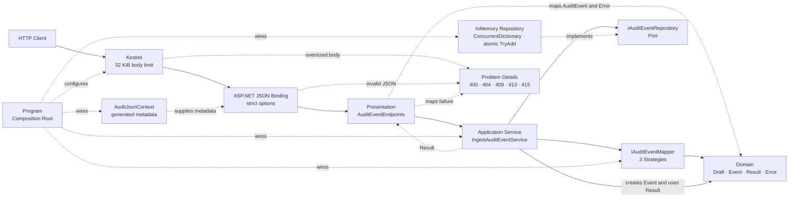
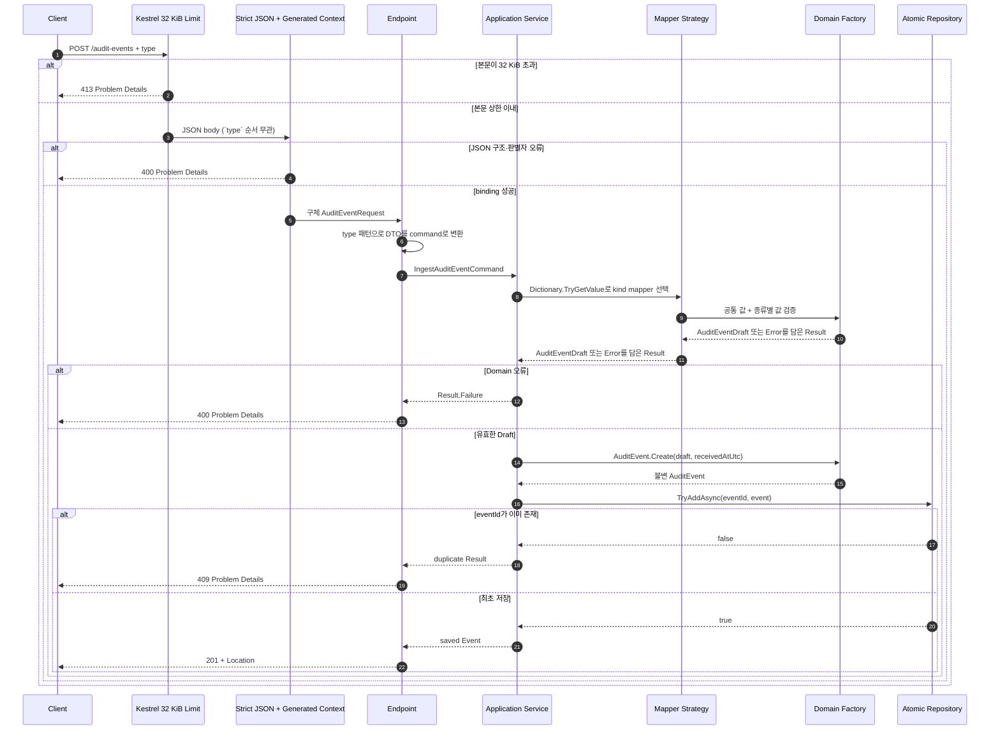

# 감사 이벤트 API로 배우는 안전한 다형성 JSON과 소스 생성

## 👣 초보자를 위한 코드 읽는 순서 (Reading order)

처음부터 모든 파일을 이해하려 하지 않아도 됩니다. 아래 순서로 **HTTP 입력 → 업무 흐름 → 저장 → 실행 조립**을 한 바퀴 따라가세요.

1. 이 README의 [한 줄 계약](#-오늘-만들-것과-한-줄-계약)과 [요청 예시](#요청-json-세-종류)를 먼저 읽습니다.
2. [`AuditEventContracts.cs`](./src/AuditEventApi/Presentation/AuditEventContracts.cs)에서 `type`에 따라 달라지는 세 요청 모양을 봅니다.
3. [`AuditJsonContext.cs`](./src/AuditEventApi/Serialization/AuditJsonContext.cs)에서 빌드 시 JSON metadata를 만드는 선언을 봅니다.
4. [`AuditEventEndpoints.cs`](./src/AuditEventApi/Presentation/AuditEventEndpoints.cs)에서 HTTP 요청이 Application command로 바뀌는 지점을 찾습니다.
5. [`IngestAuditEventService.cs`](./src/AuditEventApi/Application/IngestAuditEventService.cs)에서 Strategy 선택과 저장 순서를 따라갑니다.
6. [`AuditEventMappers.cs`](./src/AuditEventApi/Application/AuditEventMappers.cs)와 [`AuditEventDraft.cs`](./src/AuditEventApi/Domain/AuditEventDraft.cs)에서 종류별 규칙과 공통 불변식을 구분합니다.
7. [`InMemoryAuditEventRepository.cs`](./src/AuditEventApi/Infrastructure/InMemoryAuditEventRepository.cs)에서 중복 확인과 저장이 왜 한 원자 연산인지 확인합니다.
8. 마지막으로 [`Program.cs`](./src/AuditEventApi/Program.cs)를 읽어 source-generated JSON, DI, Port, Adapter가 어디서 연결되는지 확인합니다.
9. [`SelfTestRunner.cs`](./src/AuditEventApi/SelfTesting/SelfTestRunner.cs)와 [`verify-http.ps1`](./verify-http.ps1)을 직접 실행해 이해를 증명합니다.

막히면 `Presentation → Application → Domain → Infrastructure → Program` 순서만 기억하세요. 처음에는 attribute 이름을 외우는 것보다 **어느 경계가 무엇을 책임지는지** 설명하는 것이 더 중요합니다.

---

## 📌 빠른 탐색

| 구분 | 바로가기 |
| --- | --- |
| 🎯 목표와 계약 | [오늘 만들 것과 한 줄 계약](#-오늘-만들-것과-한-줄-계약) |
| 🌐 HTTP | [요청 JSON 세 종류](#요청-json-세-종류), [HTTP 계약](#http-계약) |
| 🔤 기초 | [Syntax와 Grammar](#-syntax와-grammar) |
| 🔐 JSON | [다형성·소스 생성·엄격 입력](#-다형성소스-생성엄격-입력) |
| 🏗️ 구조 | [아키텍처 시각화](#-아키텍처-시각화), [설계 이유](#-설계-선택의-이유-why) |
| 🗂️ 파일 | [파일 지도](#-파일-지도) |
| 🧪 실행 | [실행 방법](#-실행-방법), [Validation stage](#-validation-stage) |
| ✍️ 연습 | [연습과 이해도 검증](#-연습과-이해도-검증) |
| 📚 최신화 | [버전과 Microsoft 공식 출처](#-버전과-microsoft-공식-출처) |
| 🔁 복습 | [간결한 체크리스트](#-간결한-복습-체크리스트) |

---

## 🎯 오늘 만들 것과 한 줄 계약

여러 시스템이 보내는 로그인·문서 변경·권한 변경 사건을 한 endpoint로 받는 작은 **감사 이벤트 수집 API**를 만듭니다.

> `type` 허용 목록과 엄격한 JSON 경계로 입력 모양을 먼저 확정합니다. Domain 규칙을 통과한 첫 `eventId`만 `201`로 저장하고, 같은 ID의 후속 요청은 `409`로 거절해 **한 프로세스 안에서 최대 한 건(at-most-once)** 만 남깁니다. 이는 분산 시스템의 exactly-once 보장이 아닙니다.

> ⚠️ **배포 금지:** 이 프로젝트는 인증·인가, 영속 저장소, 여러 인스턴스 사이의 중복 차단, 비밀 관리와 rate limit을 구현하지 않은 학습용 예제입니다. 32 KiB 요청 본문 상한은 JSON buffering 위험을 줄이는 한 겹의 경계일 뿐, 운영 보안을 완성하지 않습니다. 실제 감사 데이터나 개인정보를 받는 서비스로 그대로 배포하지 마세요.

오늘의 핵심 학습 목표는 다음과 같습니다.

- 기본 구문: 변수, 조건, 문자열, nullable, collection expression, `async`/`await`
- 핵심 문법: `record`, 상속, `abstract`/`sealed`, `required`, `init`, attribute, 패턴 매칭
- JSON 계약: `JsonPolymorphic`, `JsonDerivedType`, type discriminator, source generation metadata mode
- .NET 10 입력 안전: 알 수 없는 속성·중복 속성·대소문자 오타·필수 멤버 누락 거절, 순서와 무관한 `type` 판별
- 전송 경계: 전체 요청 본문 32 KiB 상한과 안정적인 `413` Problem Details
- 아키텍처: 얇은 Presentation, Application Service, Domain Model, Result, Strategy, Repository Port/Adapter, DI, Composition Root
- 운영 사고방식: `eventId` 기반 원자적 중복 차단, at-most-once 저장, 민감정보 최소화, 취소 전파, 안정적인 오류 계약

### 요청 JSON 세 종류

공통 필드는 `eventId`, `occurredAtUtc`, `actorId`입니다. `type`은 CLR 클래스 이름이 아니라 공개 API가 정한 안전한 판별자입니다.

#### 1. 로그인 사건

```json
{
  "type": "user-signed-in",
  "eventId": "EVT-20261020-0001",
  "occurredAtUtc": "2026-10-20T01:00:00Z",
  "actorId": "USER-100",
  "ipAddress": "203.0.113.10",
  "succeeded": true
}
```

#### 2. 문서 변경 사건

```json
{
  "type": "document-changed",
  "eventId": "EVT-20261020-0002",
  "occurredAtUtc": "2026-10-20T01:05:00Z",
  "actorId": "EDITOR-7",
  "documentId": "DOC-42",
  "changeSummary": "제목과 공개 범위를 수정함"
}
```

#### 3. 권한 변경 사건

```json
{
  "type": "permission-changed",
  "eventId": "EVT-20261020-0003",
  "occurredAtUtc": "2026-10-20T01:10:00Z",
  "actorId": "ADMIN-3",
  "targetUserId": "USER-100",
  "permission": "document.read",
  "action": "grant"
}
```

### HTTP 계약

| 요청 | 성공 | 예상 실패 |
| --- | --- | --- |
| `GET /` | `200`, JSON 정책과 허용 type | - |
| `POST /audit-events` | `201`, `Location`, 저장된 이벤트 | 잘못된 JSON/업무 값 `400`, 중복 `409`, 본문 32 KiB 초과 `413`, media type `415` |
| `GET /audit-events/{eventId}` | `200`, 저장된 이벤트 | 없음 `404` |

오류는 Problem Details 형식에 안정적인 `code`, `field`, `traceId`를 추가합니다. 본문이 32 KiB를 넘으면 `code = http.payload_too_large`, `field = http`인 `413`을 반환하며, 내부 예외 메시지나 원본 민감 payload는 응답하지 않습니다.

---

## 🔤 Syntax와 Grammar

| 문법 | 쉬운 뜻 | 이 예제에서 쓰는 이유 |
| --- | --- | --- |
| `var` | 오른쪽 값으로 지역 변수 형식을 compiler가 판단 | 형식이 분명한 지역 코드의 반복 감소 |
| `string?` | 문자열 또는 `null`이 올 수 있음 | 외부 JSON의 누락·명시적 null 가능성을 숨기지 않음 |
| `required` | 객체 생성 시 해당 멤버를 지정해야 함 | “필드가 없음”과 “필드는 있지만 null”을 구분 |
| `init` | 객체를 만들 때만 값을 설정 | 요청 DTO가 생성 뒤 뜻밖에 바뀌지 않게 함 |
| `record` | 값 중심 데이터 형식 | 요청·결과·Domain 값의 의도를 표현하고 비교하기 쉬움 |
| `abstract` | 공통 틀만 제공하고 직접 생성은 금지 | `AuditEventRequest` 자체가 아니라 세 구체 사건만 허용 |
| `sealed` | 더 이상 상속할 수 없음 | 허용한 요청 계층이 임의로 확장되는 것을 줄임 |
| `[Attribute]` | type에 metadata를 붙이는 문법 | JSON 판별자와 source generation 대상을 선언 |
| `partial` | 여러 소스 조각을 한 type으로 합침 | 사람이 쓴 context와 compiler 생성 코드를 결합 |
| `switch` 패턴 | 실제 runtime 형식이나 값에 따라 분기 | 세 요청 DTO를 안정적인 Application command로 변환 |
| `=>` | 짧은 식으로 결과를 표현 | 단순 mapping과 Strategy 선택을 읽기 쉽게 유지 |
| `async` / `await` | I/O 완료를 막지 않고 기다림 | Repository가 DB로 바뀌어도 호출 구조 유지 |
| `CancellationToken` | 더 이상 결과가 필요 없다는 취소 신호 | 끊어진 요청의 불필요한 I/O를 줄임 |
| `IEnumerable<T>` | 같은 계약의 여러 구현을 순서대로 열거 | 세 mapper Strategy를 DI로 주입 |
| LINQ | 목록을 선언적으로 변환·집계 | self-test에서 병렬 요청을 만들고 성공·중복 결과 수를 검증 |
| `ConcurrentDictionary.TryAdd` | 같은 key의 확인과 추가를 한 원자 연산으로 실행 | 중복 확인과 저장 사이 경쟁 조건 방지 |
| `[]` | C# collection expression | 작은 허용 목록과 빈 컬렉션을 명확하게 생성 |

이 예제의 `switch` 패턴 매칭은 Endpoint의 **DTO → command 변환**에만 사용됩니다. Application Service가 Mapper Strategy를 고를 때는 패턴 매칭이 아니라 `Dictionary.TryGetValue(command.Kind, out mapper)`를 사용합니다.

### `required`와 `?`는 서로 반대가 아닙니다

`required string? EventId`는 이상해 보일 수 있습니다. 두 문법은 서로 다른 질문에 답합니다.

- `required`: JSON에 `eventId`라는 멤버를 **보냈는가?**
- `string?`: 보낸 값이 `null`일 가능성을 C# type이 **정직하게 표현하는가?**
- Domain: null, 공백, 길이, 문자 규칙을 통과해 **업무 식별자가 될 수 있는가?**

따라서 serializer는 구조 오류를 일찍 거절하고, Domain은 HTTP가 아닌 다른 호출 경로에서도 의미 오류를 막습니다.

### `record`가 자동으로 깊은 불변성을 만들지는 않습니다

`record`의 속성이 `List<T>`라면 목록 내부는 여전히 바뀔 수 있습니다. 이 예제는 외부에 mutable 컬렉션을 노출하지 않고, 완성된 Domain 값에 get-only 값을 둡니다. “record를 썼다”보다 **외부에서 저장 상태를 바꿀 경로가 없는지**가 더 중요합니다.

---

## 🔐 다형성·소스 생성·엄격 입력

### 1. 다형성 JSON: 하나의 입구, 세 가지 모양

`POST /audit-events`의 parameter는 공통 기반인 `AuditEventRequest`입니다. `System.Text.Json`은 `type`을 보고 다음 허용 목록만 선택합니다.

| `type` | C# 요청 형식 | 종류별 필드 |
| --- | --- | --- |
| `user-signed-in` | `UserSignedInRequest` | `ipAddress`, `succeeded` |
| `document-changed` | `DocumentChangedRequest` | `documentId`, `changeSummary` |
| `permission-changed` | `PermissionChangedRequest` | `targetUserId`, `permission`, `action` |

알 수 없는 `type`을 기본 사건으로 조용히 처리하지 않습니다. 또한 assembly-qualified CLR type 이름을 payload에서 받지 않습니다. 공개 discriminator와 허용 목록은 외부 계약이고, 내부 클래스 이름은 구현 세부사항입니다.

### 2. source generation: runtime 전에 JSON 계약 준비

보통 serializer는 처음 만난 type의 property와 생성자를 runtime reflection으로 조사하고 metadata를 cache합니다. [`AuditJsonContext`](./src/AuditEventApi/Serialization/AuditJsonContext.cs)는 `[JsonSerializable]` 대상의 metadata 생성 코드를 compiler가 빌드 중 만들게 합니다.

이 예제는 **metadata mode**를 사용합니다. 다형성 역직렬화는 metadata 기반 source generation에서 지원되고, fast-path는 주로 직렬화 처리량을 위한 별도 선택입니다.

source generation의 장점은 다음과 같습니다.

- 계약 누락 일부를 빌드 경고·오류로 더 일찍 발견할 수 있습니다.
- 첫 runtime reflection 비용과 metadata 준비 작업을 줄일 수 있습니다.
- trimming과 Native AOT로 확장할 때 reflection 의존성을 줄이는 토대가 됩니다.

하지만 context를 추가했다고 전체 앱이 자동으로 AOT 안전해지는 것은 아닙니다. framework가 쓰는 모든 JSON 형식, reflection 기반 라이브러리, 동적 코드 여부를 별도로 점검해야 합니다.

### 3. .NET 10 엄격 입력 정책

`Program`은 source-generated resolver를 가장 먼저 등록하고 .NET 10 `JsonSerializerOptions.Strict`가 대표하는 핵심 정책을 HTTP serializer에 명시적으로 적용합니다. 여기에 JSON property 순서와 공개 계약을 맞추기 위해 `AllowOutOfOrderMetadataProperties = true`를 별도로 더합니다.

| 입력 문제 | 느슨한 처리의 위험 | 오늘의 처리 |
| --- | --- | --- |
| 알 수 없는 property | 오타가 조용히 무시됨 | `UnmappedMemberHandling.Disallow`로 `400` |
| 같은 property 두 번 | 뒤 값이 앞 값을 덮을 수 있음 | `AllowDuplicateProperties = false`로 `400` |
| `eventId` / `EventId` 혼동 | 생산자 계약 오류가 숨겨짐 | 대소문자 구분으로 `400` |
| 필수 member 누락 | 값 형식의 기본값처럼 보일 수 있음 | required/constructor 존중으로 `400` |
| non-null 계약에 null | null이 내부 깊숙이 이동 | nullable annotation 존중 또는 Domain 오류 |
| 모르는 discriminator | 잘못된 하위 형식이나 fallback | 허용 목록 밖이면 `400` |
| `type`이 첫 property가 아님 | 정상 JSON이 property 순서 때문에 거절됨 | 순서 밖 metadata를 허용해 구체 DTO로 binding |

JSON 객체의 property 순서에는 의미가 없으므로 `type`은 첫 property일 필요가 없습니다. 다만 serializer는 뒤쪽의 `type`을 찾는 동안 앞선 property를 임시 buffering할 수 있습니다. 이 예제는 그 메모리 위험을 무제한으로 두지 않고 Kestrel의 **전체 요청 본문 상한을 32 KiB**로 제한합니다. 상한을 넘는 요청은 binding 전에 `413`과 안정적인 `http.payload_too_large` 오류 계약으로 끝납니다.

엄격함은 호환성 비용도 가집니다. API 버전 없이 새 property를 먼저 보내는 클라이언트는 거절됩니다. 공개 API에서는 계약 버전, 점진 배포 순서, 관찰 지표를 함께 설계해야 합니다.

### 4. 전송 오류, 업무 실패, 예외·취소의 경계

- **JSON binding 오류**: 구조를 읽을 수 없으므로 framework `400`입니다.
- **본문 크기 초과**: Kestrel이 binding 전에 32 KiB 상한을 적용하고 안정적인 `413` Problem Details로 바꿉니다.
- **예상 가능한 업무 실패**: 잘못된 ID, 시각, action, 중복처럼 호출자가 고칠 수 있어 `Result<T>`로 표현합니다.
- **예상 밖 장애**: programming bug나 저장 장치 장애는 예외로 관찰·처리합니다.
- **취소**: 사용자가 요청을 취소한 사실을 업무 오류로 숨기지 않고 `OperationCanceledException` 흐름으로 전파합니다.

---

## 🏗️ 아키텍처 시각화

### 계층과 의존성 방향



Application은 `InMemoryAuditEventRepository`를 직접 참조하지 않고 Port만 압니다. 구체 Adapter 연결은 Composition Root의 책임입니다. 이 의존성 방향 덕분에 DB Adapter나 test fake로 교체해도 업무 흐름을 고치지 않아도 됩니다.

### 요청 수명 주기와 중복 처리



### 검증 책임 지도

```text
Presentation / Serializer          Domain / Strategy                Repository / Operations
─────────────────────────         ─────────────────────────        ──────────────────────────
JSON 문법이 맞는가?               ID 값이 유효한가?               eventId가 이미 있는가?
type이 허용 목록인가?             UTC 시각인가?                    검사+저장이 원자적인가?
필수 property가 있는가?           종류별 필드가 유효한가?          취소가 I/O 경계까지 가는가?
중복·오타 property가 있는가?      안전한 요약을 만들 수 있는가?    장애를 관찰할 수 있는가?
```

---

## 🧠 설계 선택의 이유 (Why)

### DTO와 Domain Model을 분리한 이유

외부 JSON DTO는 `null`, 오타, 잘못된 조합을 받아야 하므로 느슨한 상태를 표현합니다. Domain Model은 검증을 끝낸 값만 가지며 잘못된 상태로 생성되지 않습니다. DTO를 Repository까지 흘려보내면 모든 계층이 외부 계약 변화와 null 방어를 떠안게 됩니다.

### Mapper를 Strategy로 둔 이유

세 사건은 공통 필드가 있지만 종류별 검증과 요약 생성 방식이 다릅니다. Application Service에 큰 `if/else`를 계속 늘리지 않고 `IAuditEventMapper` 구현으로 분리하면 다음 장점이 있습니다.

- 한 mapper가 바뀌어도 다른 종류에 영향이 적습니다(SRP).
- 새 종류의 Mapper를 추가해도 `IngestAuditEventService`의 처리 순서는 바꾸지 않아도 됩니다. 이 제한된 범위에서 OCP를 연습합니다.
- 각 전략을 framework 없이 독립적으로 테스트할 수 있습니다.

새 외부 `type`을 추가하는 전체 작업은 Mapper와 DI만으로 끝나지 않습니다. 파생 요청 `record`와 `[JsonDerivedType]`, source-generation context의 `[JsonSerializable]`, `IngestAuditEventCommand`의 필드, `AuditEventEndpoints.ToCommand`의 type 패턴, Domain 팩터리와 Mapper, Mapper 구성/DI, self-test와 HTTP 계약 테스트를 함께 바꿔야 합니다. 이 중 하나가 빠지면 binding, DTO→command 변환, metadata 생성 또는 Application 처리 중 한 경계에서 실패합니다.

### Result와 예외를 구분한 이유

잘못된 action이나 중복 event ID는 충분히 예상되며 호출자가 고칠 수 있습니다. 이런 실패를 예외로만 표현하면 정상 분기까지 stack trace 비용과 예외 중심 흐름에 의존합니다. 반대로 메모리 부족, programming bug, 저장소 연결 장애까지 Result로 숨기면 운영자가 장애를 놓칩니다. 취소 역시 실패 응답으로 바꾸지 않고 그대로 전파합니다.

### 중복 검사와 저장을 한 Repository 호출로 만든 이유

다음처럼 두 단계로 나누면 같은 `eventId`의 병렬 요청 둘이 모두 “없음”을 보고 둘 다 저장할 수 있습니다.

```text
요청 A: 없음 확인 ─────────── 저장
요청 B:      없음 확인 ───── 저장  ← 경쟁 조건
```

`TryAddAsync`는 `ConcurrentDictionary.TryAdd` 한 번으로 검사와 추가를 원자적으로 수행합니다. 운영 DB에서는 `event_id` unique constraint와 transaction을 최종 방어선으로 사용하고, unique 위반을 안정적인 중복 결과로 매핑해야 합니다.

### source generation과 엄격 입력을 함께 쓴 이유

source generation은 **metadata를 언제·어떻게 준비하는가**의 문제이고, 엄격 옵션은 **어떤 JSON을 계약 위반으로 볼 것인가**의 문제입니다. 서로 대체 관계가 아닙니다. 생성된 metadata를 사용해도 중복 property를 허용할 수 있고, 엄격 옵션을 써도 reflection 기반일 수 있습니다.

### explicit allowlist를 사용한 이유

외부 payload가 임의 CLR type 이름을 지정하게 하면 내부 구현 노출과 원치 않는 type 활성화 위험이 생깁니다. 짧고 버전 관리 가능한 discriminator를 공개하고, 지원 type을 코드에 명시하면 입력 표면과 호환성 정책을 검토하기 쉽습니다.

### 테스트 용이성

- Domain 팩터리와 mapper는 HTTP 없이 검증합니다.
- Repository Port 덕분에 메모리 Adapter나 fake로 바꿀 수 있습니다.
- `TimeProvider`를 주입해 수신 시각을 고정할 수 있습니다.
- `--self-test`는 Domain, Strategy, Application, 같은 ID의 순차·병렬 at-most-once 저장, 취소, generated JSON 계약의 대표 사례를 검증합니다.
- HTTP verifier는 실제 Production 환경 설정의 Kestrel에서 순서와 무관한 다형성 binding, 엄격 입력, 32 KiB 상한의 대표적인 `400/413/415`, `201/404/409` 계약을 black-box로 확인합니다.

---

## 🗂️ 파일 지도

| 경로 | 역할 | 먼저 볼 핵심 |
| --- | --- | --- |
| [`AuditEventApi.csproj`](./src/AuditEventApi/AuditEventApi.csproj) | 빌드 계약 | `net10.0`, C# 14, nullable, warning-as-error |
| [`Program.cs`](./src/AuditEventApi/Program.cs) | Composition Root | JSON options, 32 KiB body limit, DI, Problem Details |
| [`AuditEventContracts.cs`](./src/AuditEventApi/Presentation/AuditEventContracts.cs) | 외부 DTO | 다형성 allowlist, `required`, nullable |
| [`AuditJsonContext.cs`](./src/AuditEventApi/Serialization/AuditJsonContext.cs) | source generation 선언 | `partial`, metadata mode, `[JsonSerializable]` |
| [`AuditEventEndpoints.cs`](./src/AuditEventApi/Presentation/AuditEventEndpoints.cs) | HTTP 경계 | DTO→command, Result→status code |
| [`IngestAuditEventCommand.cs`](./src/AuditEventApi/Application/IngestAuditEventCommand.cs) | Application 입력 | Presentation에서 분리된 안정적 값 |
| [`IngestAuditEventService.cs`](./src/AuditEventApi/Application/IngestAuditEventService.cs) | Application Service | Strategy 선택, 저장 조정, 취소 전파 |
| [`IAuditEventMapper.cs`](./src/AuditEventApi/Application/Ports/IAuditEventMapper.cs) | Strategy Port | 종류별 mapping 계약 |
| [`AuditEventMappers.cs`](./src/AuditEventApi/Application/AuditEventMappers.cs) | Strategy 구현 | 로그인·문서·권한 규칙 |
| [`AuditEventDraft.cs`](./src/AuditEventApi/Domain/AuditEventDraft.cs) | Domain 생성 경계 | 공통 불변식과 정규화 |
| [`AuditEvent.cs`](./src/AuditEventApi/Domain/AuditEvent.cs) | 저장 가능한 Domain Model | 불변 값과 안전한 요약 |
| [`Error.cs`](./src/AuditEventApi/Domain/Error.cs) | 예상 실패 계약 | 안정적인 `code`, 설명, 입력 필드 |
| [`Result.cs`](./src/AuditEventApi/Domain/Result.cs) | 성공/예상 실패 | generic, nullable 안전성 |
| [`IAuditEventRepository.cs`](./src/AuditEventApi/Application/Ports/IAuditEventRepository.cs) | Repository Port | 원자적 추가와 조회 계약 |
| [`InMemoryAuditEventRepository.cs`](./src/AuditEventApi/Infrastructure/InMemoryAuditEventRepository.cs) | 메모리 Adapter | `ConcurrentDictionary.TryAdd`, process-local 한계 |
| [`SelfTestRunner.cs`](./src/AuditEventApi/SelfTesting/SelfTestRunner.cs) | 내부 회귀 검증 | JSON·Domain·Strategy·동시성·취소 |
| [`verify-http.ps1`](./verify-http.ps1) | 실제 HTTP 검증 | Production Kestrel, property 순서·strict JSON·413 계약 |
| [`EXERCISES.md`](./EXERCISES.md) | 실행 가능한 연습 | Beginner→Pro 단계별 변경·관찰·검증 |
| [`CHECKPOINT.md`](./CHECKPOINT.md) | 이해도 검증 | 먼저 답한 뒤 펼쳐 보는 해설 |
| [`.gitignore`](./.gitignore) | 산출물 제외 | `bin/`, `obj/` 비추적 |

---

## 🏭 운영 환경으로 확장할 때

> ⚠️ 현재 API에는 인증·인가가 없습니다. 누구나 요청할 수 있는 형태이므로 외부 네트워크에 노출하거나 실제 감사·개인정보 데이터를 넣지 마세요. 아래 항목을 설계하고 검증하기 전에는 운영 배포 대상이 아닙니다.

이 예제는 학습을 위해 한 프로세스 메모리에 저장합니다. 재시작하면 데이터가 사라지고 여러 인스턴스는 서로의 중복을 알지 못합니다. 현재 보장은 첫 추가만 성공하고 이후 같은 ID를 `409`로 막는 **프로세스 내부 at-most-once 저장**이며, 성공 응답 재현이나 exactly-once 처리를 제공하지 않습니다.

- DB의 unique constraint로 여러 인스턴스에서도 `eventId`당 최대 한 행만 남도록 보장하고, 재전송을 같은 성공 결과로 돌려줄지 `409`로 거절할지 별도의 멱등 응답 정책을 정합니다.
- 이벤트 저장과 후속 메시지 발행을 함께 보장하려면 Transactional Outbox를 검토합니다.
- 생산자별 인증·인가를 적용하고 허용 event type과 actor 범위를 제한합니다.
- 원본 IP, 권한, 문서 내용 같은 개인정보·보안 정보를 로그와 오류 응답에 그대로 남기지 않습니다.
- 현재 32 KiB 상한은 이 작은 계약의 buffering 위험을 제한하는 학습용 값입니다. 운영에서는 실제 payload 분포와 reverse proxy 상한을 함께 검토하고 `413`을 관찰하며, 별도로 요청 timeout과 rate limit을 둡니다.
- 계약 버전을 discriminator 또는 envelope에서 명시하고 생산자·소비자의 배포 순서를 설계합니다.
- `audit.accepted`, `audit.duplicate`, `audit.rejected` 수와 처리 지연을 낮은 카디널리티 metric으로 관찰합니다.
- trace에는 event ID처럼 검색 가능한 업무 상관관계를 넣되 민감 payload는 넣지 않습니다.
- 보존 기간, 삭제 불가 정책, 암호화, 접근 기록을 조직의 감사·법률 요구에 맞춥니다.
- source-generated context에 응답·오류·collection 형식을 빠뜨리지 않는 계약 테스트를 둡니다.

strict 입력은 좋은 기본값이지만 “새 필드를 먼저 보내도 구버전 서버가 무시해야 한다”는 확장성 전략과 충돌할 수 있습니다. 공개 계약의 변경 정책을 먼저 정한 뒤 선택하세요.

---

## 🧪 실행 방법

Windows PowerShell 기준입니다.

```powershell
cd dailyStudy/exercise/20261020
dotnet restore .\src\AuditEventApi\AuditEventApi.csproj
dotnet build .\src\AuditEventApi\AuditEventApi.csproj -c Release --no-restore
dotnet run --project .\src\AuditEventApi\AuditEventApi.csproj -c Release --no-build -- --self-test
.\verify-http.ps1
```

서버를 직접 실행하려면 다음을 사용합니다.

```powershell
dotnet run --project .\src\AuditEventApi\AuditEventApi.csproj -c Release --no-build -- --urls http://127.0.0.1:5080
```

다른 terminal에서 로그인 사건을 보냅니다.

```powershell
$body = @{
    type = 'user-signed-in'
    eventId = 'EVT-MANUAL-0001'
    occurredAtUtc = [DateTimeOffset]::UtcNow.ToString('O')
    actorId = 'USER-100'
    ipAddress = '203.0.113.10'
    succeeded = $true
} | ConvertTo-Json

Invoke-RestMethod `
    -Uri 'http://127.0.0.1:5080/audit-events' `
    -Method Post `
    -ContentType 'application/json' `
    -Body $body
```

같은 `$body`를 다시 보내 `409`가 되는지 확인하고, 응답의 `Location`을 `GET`해 저장 값을 조회해 보세요.

---

## ✅ Validation stage

초보자도 아래 순서로 “어디까지 맞는지” 좁혀 갈 수 있습니다.

### Stage 1 — restore와 빌드

```powershell
dotnet restore .\src\AuditEventApi\AuditEventApi.csproj
dotnet build .\src\AuditEventApi\AuditEventApi.csproj -c Release --no-restore
```

기대 결과: `경고 0개`, `오류 0개`. 이 단계에서 source generator가 JSON context의 다른 partial 선언도 만듭니다.

### Stage 2 — 내부 규칙

```powershell
dotnet run --project .\src\AuditEventApi\AuditEventApi.csproj -c Release --no-build -- --self-test
```

기대 결과: 종료 코드 `0`과 `[SELF-TEST PASS]` 요약. 테스트가 보강되면 assertion 수는 달라질 수 있으므로 숫자를 성공 조건으로 고정하지 않습니다.

검사 범위:

- Mapper Strategy와 Domain 팩터리의 대표 성공·실패 및 안전한 요약
- 공통 ID·UTC 시각·행위자 Domain 불변식
- 대소문자·공백 정규화 결과
- 알 수 없는 kind 거절
- 같은 event ID의 순차·병렬 요청에서 한 건만 저장되고 나머지는 중복 실패가 되는지 확인
- `TimeProvider`로 고정한 수신 시각
- 이미 취소된 작업의 예외 전파와 저장 0건
- source-generated 다형성 역직렬화, `type`이 뒤에 있어도 되는 순서 자유화, strict 중복·알 수 없는 property 거절

### Stage 3 — 실제 HTTP 계약

```powershell
.\verify-http.ps1
```

기대 결과: 종료 코드 `0`과 `HTTP VERIFY PASSED` 요약. assertion 수보다 모든 검증의 통과 여부를 확인합니다.

검사 범위:

- Production 환경의 실제 Kestrel과 동적 loopback port
- 세 `type`의 `201 + Location`과 후속 `GET 200`
- 같은 `eventId` 재전송의 `409`
- Domain 오류의 `400`, 없는 이벤트의 `404`
- 알 수 없는 discriminator/property, 중복 property, 잘못된 대소문자, 필수 멤버 누락, malformed JSON의 `400`
- `type`이 첫 property가 아닌 정상 요청의 `201`
- 32 KiB를 넘는 요청의 `413`과 `http.payload_too_large` 오류 계약
- 잘못된 media type의 `415`
- 주요 오류의 Problem Details와 `code`·`field`·`traceId`
- UTF-8 한글 요약과 내부 예외 정보 비노출

이 검증은 위에 적은 정상·예상 실패의 대표 사례만 다룹니다. 아직 구현하지 않은 인증·인가, 여러 인스턴스와 영속 DB의 at-most-once 보장, 실제 인프라 장애에서의 `5xx` 정보 비노출, 부하·침투 테스트를 증명하지 않으며 운영 배포 승인으로 사용할 수 없습니다.

### Stage 4 — formatting

```powershell
dotnet format .\src\AuditEventApi\AuditEventApi.csproj --verify-no-changes --no-restore
```

출력 없이 종료 코드 0이면 formatting이 깨끗합니다.

---

## ✍️ 연습과 이해도 검증

- 실행 가능한 Beginner→Pro 과제: [`EXERCISES.md`](./EXERCISES.md)
- 먼저 답하고 펼쳐 보는 질문: [`CHECKPOINT.md`](./CHECKPOINT.md)

권장 순서:

1. 원본 build, self-test, HTTP 검증을 모두 통과시킵니다.
2. 과제 하나만 바꿉니다.
3. build → self-test → HTTP 검증을 다시 실행합니다.
4. 실패한 assertion이 어떤 계약을 보호했는지 한 문장으로 적습니다.

---

## 📚 버전과 Microsoft 공식 출처

2026-10-20(Asia/Seoul)에 코드 작성 **전에** Microsoft 공식 문서와 .NET Blog를 확인했습니다.

| 구분 | 확인한 최신 상태 | 이 자료의 선택 |
| --- | --- | --- |
| 안정 .NET | .NET Runtime **10.0.13**, SDK **10.0.402**, 2026-10-13 공개, .NET 10 LTS | 설치된 안정 SDK와 호환되는 `net10.0` |
| 안정 C# | **C# 14**, .NET 10에서 지원 | `<LangVersion>14.0</LangVersion>` |
| 사전 공개 .NET | **.NET 11 RC2**, runtime `11.0.0-rc.2.26504.105`, SDK `11.0.100-rc.2.26504.105`, 2026-10-13 공개 | 설명만 제공, 빌드 대상에서 제외 |
| 사전 공개 C# | Microsoft Learn 기준 **C# 15 Preview** | 설명만 제공, preview 문법 미사용 |
| 이 PC | SDK **10.0.301**, runtime/ASP.NET Core **10.0.9** | 실제 restore/build/run/HTTP 검증에 사용 |

이 PC는 공식 최신 security servicing patch보다 낮습니다. 예제는 설치된 Stable SDK에서 컴파일되지만, 실제 개발 PC와 운영 서버는 조직의 검증 절차에 따라 최신 patch로 업데이트하는 것이 좋습니다.

### C# 15/.NET 11은 왜 설명만 하나요?

.NET 11 RC2는 go-live 지원이 있는 release candidate지만 아직 GA 전입니다. C# 15 문서는 최신 Preview로 분류되며 union type과 closed hierarchy를 소개합니다. .NET 11에서는 closed hierarchy로 다형성 목록을 추론하는 기능도 제공하지만, 오늘 코드는 설치된 C# 14에서 명시적 `[JsonDerivedType]` 허용 목록을 사용합니다.

명시 목록은 조금 반복되지만 지금 어떤 외부 `type`을 허용하는지 코드 리뷰에서 바로 보인다는 장점도 있습니다. Preview 문법을 안정 예제에 섞지 않았으므로 설치된 Stable SDK에서 그대로 빌드됩니다.

### 공식 출처 URL

> 🔗 [System.Text.Json source generation 사용법](https://learn.microsoft.com/en-us/dotnet/standard/serialization/system-text-json/source-generation)

> 🔗 [reflection과 source generation 선택 기준](https://learn.microsoft.com/en-us/dotnet/standard/serialization/system-text-json/reflection-vs-source-generation)

> 🔗 [System.Text.Json 다형성 직렬화와 discriminator](https://learn.microsoft.com/en-us/dotnet/standard/serialization/system-text-json/polymorphism)

> 🔗 [.NET 10 libraries — duplicate property와 Strict JSON](https://learn.microsoft.com/en-us/dotnet/core/whats-new/dotnet-10/libraries#serialization)

> 🔗 [`JsonSerializerOptions.Strict` API](https://learn.microsoft.com/en-us/dotnet/api/system.text.json.jsonserializeroptions.strict?view=net-10.0)

> 🔗 [`AllowOutOfOrderMetadataProperties`와 buffering 주의](https://learn.microsoft.com/en-us/dotnet/api/system.text.json.jsonserializeroptions.allowoutofordermetadataproperties?view=net-10.0)

> 🔗 [Kestrel `MaxRequestBodySize` API](https://learn.microsoft.com/en-us/dotnet/api/microsoft.aspnetcore.server.kestrel.core.kestrelserverlimits.maxrequestbodysize?view=aspnetcore-10.0)

> 🔗 [.NET 10 다운로드 — runtime 10.0.13 / SDK 10.0.402](https://dotnet.microsoft.com/en-us/download/dotnet/10.0)

> 🔗 [.NET 10의 새로운 기능과 LTS 안내](https://learn.microsoft.com/en-us/dotnet/core/whats-new/dotnet-10/overview)

> 🔗 [C# 14의 새로운 기능](https://learn.microsoft.com/en-us/dotnet/csharp/whats-new/csharp-14)

> 🔗 [C# 언어 버전과 target framework 매핑](https://learn.microsoft.com/en-us/dotnet/csharp/language-reference/language-versioning)

> 🔗 [.NET 11 RC2 공식 발표](https://devblogs.microsoft.com/dotnet/dotnet-11-rc-2/)

> 🔗 [.NET 11 RC2 정확한 SDK/runtime 다운로드](https://dotnet.microsoft.com/en-us/download/dotnet/11.0)

> 🔗 [C# 15 Preview의 새로운 기능](https://learn.microsoft.com/en-us/dotnet/csharp/whats-new/csharp-15)

---

## 🔁 간결한 복습 체크리스트

- [ ] `type` discriminator와 C# property의 차이를 설명한다.
- [ ] `[JsonDerivedType]` 허용 목록 밖의 type을 거절하는 이유를 말한다.
- [ ] source generation과 strict 입력 옵션이 서로 다른 문제를 푼다는 것을 설명한다.
- [ ] `type`의 property 순서를 자유롭게 허용할 때 생기는 buffering 위험을 32 KiB 상한과 `413`으로 제한하는 이유를 설명한다.
- [ ] metadata mode와 fast-path mode의 큰 차이를 말한다.
- [ ] `required string?`이 모순이 아닌 이유를 설명한다.
- [ ] DTO의 nullable 값이 검증된 Domain 값으로 바뀌는 경계를 찾는다.
- [ ] Mapper Strategy의 OCP 이점은 `IngestAuditEventService`의 처리 순서를 유지하는 범위이며, 새 공개 type은 다른 연결 지점도 바꿔야 함을 말한다.
- [ ] `Result<T>`로 표현할 실패와 예외·취소를 구분한다.
- [ ] 중복 확인과 저장을 원자화하지 않을 때 생기는 경쟁 조건과 현재의 프로세스 내부 at-most-once 한계를 설명한다.
- [ ] Application이 구체 Repository가 아니라 Port에 의존하는 이유를 말한다.
- [ ] strict unknown-property 정책의 안전성과 호환성 trade-off를 말한다.
- [ ] build, self-test, 실제 HTTP verifier, format 검증을 직접 통과시킨다.
- [ ] .NET 10/C# 14 안정 코드와 .NET 11/C# 15 Preview 설명을 구분한다.
