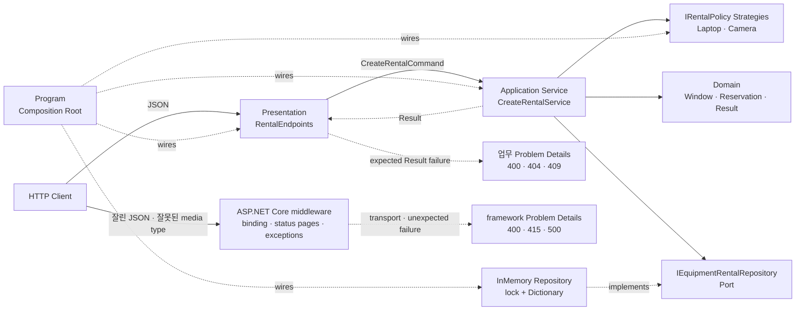
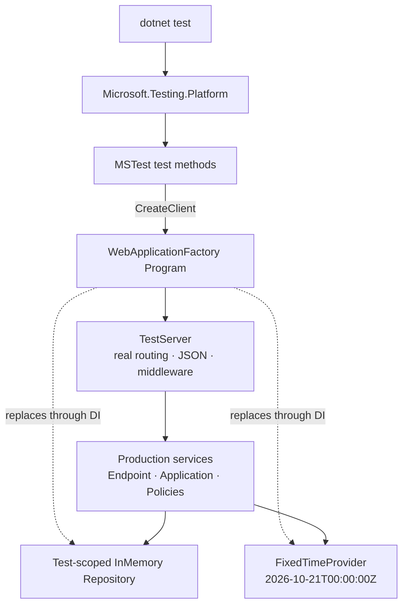

# 사내 장비 대여 API로 배우는 .NET 테스트 피라미드

## 👣 초보자를 위한 코드 읽는 순서 (Reading order)

처음부터 모든 테스트를 이해하려 하지 않아도 됩니다. **작은 규칙 → 업무 흐름 → 실제 HTTP** 순서로 범위를 넓혀 읽으세요.

1. 이 README의 [오늘 만들 것과 한 줄 계약](#-오늘-만들-것과-한-줄-계약)을 읽고 성공·실패 기준을 먼저 잡습니다.
2. [`RentalWindow.cs`](./src/EquipmentRentalApi/Domain/RentalWindow.cs)와 [`RentalWindowTests.cs`](./tests/EquipmentRentalApi.Tests/Domain/RentalWindowTests.cs)를 나란히 열어 가장 작은 단위 테스트를 봅니다.
3. [`RentalReservation.cs`](./src/EquipmentRentalApi/Domain/RentalReservation.cs)에서 nullable 입력이 Domain 값으로 바뀌는 과정을 읽습니다.
4. [`RentalPolicies.cs`](./src/EquipmentRentalApi/Application/RentalPolicies.cs)에서 노트북·카메라 Strategy의 차이를 찾습니다.
5. [`CreateRentalService.cs`](./src/EquipmentRentalApi/Application/CreateRentalService.cs)와 [`CreateRentalServiceTests.cs`](./tests/EquipmentRentalApi.Tests/Application/CreateRentalServiceTests.cs)를 비교해 Application 테스트의 경계를 확인합니다.
6. [`InMemoryEquipmentRentalRepository.cs`](./src/EquipmentRentalApi/Infrastructure/InMemoryEquipmentRentalRepository.cs)와 [`InMemoryRepositoryConcurrencyTests.cs`](./tests/EquipmentRentalApi.Tests/Infrastructure/InMemoryRepositoryConcurrencyTests.cs)에서 원자성과 경쟁 테스트를 읽습니다.
7. [`RentalEndpoints.cs`](./src/EquipmentRentalApi/Presentation/RentalEndpoints.cs)에서 HTTP DTO·상태 코드·Problem Details 변환만 담당하는지 확인합니다.
8. [`TestApplicationFactory.cs`](./tests/EquipmentRentalApi.Tests/Integration/TestApplicationFactory.cs)에서 Production DI를 테스트용 Repository와 고정 시간으로 바꾸는 지점을 찾습니다.
9. 마지막으로 [`EquipmentRentalApiTests.cs`](./tests/EquipmentRentalApi.Tests/Integration/EquipmentRentalApiTests.cs)를 실행해 routing, JSON, middleware, DI까지 한 번에 검증합니다.

막히면 `Domain unit test → Application test → Repository race test → HTTP integration test` 순서만 기억하세요. 테스트 attribute를 외우는 것보다 **어떤 위험을 어느 경계에서 가장 싸고 빠르게 잡는지** 설명하는 것이 더 중요합니다.

---

## 📌 빠른 탐색

| 유형 | 바로가기 |
| --- | --- |
| 🎯 목표 | [오늘 만들 것과 한 줄 계약](#-오늘-만들-것과-한-줄-계약) |
| 🌐 API | [HTTP 계약](#http-계약), [요청 예시](#요청-예시) |
| 🔤 기초 | [Syntax와 Grammar](#-syntax와-grammar) |
| 🧪 테스트 | [테스트 피라미드](#-테스트-피라미드), [AAA](#arrangeactassert-aaa) |
| 🏗️ 구조 | [아키텍처 시각화](#-아키텍처-시각화), [설계 선택의 이유](#-설계-선택의-이유-why) |
| 🗂️ 파일 | [파일 지도](#-파일-지도) |
| ▶️ 실행 | [실행 방법](#-실행-방법), [Validation stage](#-validation-stage) |
| ✍️ 연습 | [Beginner to Pro 연습](#-beginner-to-pro-연습과-검증) |
| 📚 최신화 | [버전과 Microsoft 공식 출처](#-버전과-microsoft-공식-출처) |
| 🔁 복습 | [간결한 체크리스트](#-간결한-복습-체크리스트) |

---

## 🎯 오늘 만들 것과 한 줄 계약

사내 노트북과 카메라의 대여 시간을 예약하는 작은 Minimal API를 만듭니다.

> 유효한 예약은 `201 Created`로 한 번만 저장하고, 같은 장비의 겹치는 시간은 `409 Conflict`로 거절합니다. 이 계약을 Domain, Application, Repository 동시성, HTTP 통합 테스트의 서로 다른 높이에서 검증합니다.

오늘의 핵심 학습 목표는 다음과 같습니다.

- 기본 구문: 변수, 조건문, 문자열, nullable, 배열, `async`/`await`
- 핵심 문법: `record`, `?`, `!`, `var`, `=>`, pattern matching, collection expression, `with`
- 테스트 기초: `[TestClass]`, `[TestMethod]`, `[DataRow]`, assertion, Arrange–Act–Assert
- 테스트 설계: 빠른 unit test, 협력 객체를 포함한 Application test, HTTP integration test
- 테스트 가능성: `TimeProvider`, Repository Port, Strategy, DI 교체, 테스트별 상태 격리
- 아키텍처: Domain Model, Result, Application Service, Repository Port/Adapter, Strategy, Composition Root
- 동시성: “확인 후 저장”을 하나의 `lock` 경계로 묶고 24개 경쟁 요청에서 한 건만 성공하는지 검증
- .NET 10 도구: MSTest, `MSTest.Sdk`, Microsoft.Testing.Platform(MTP), `dotnet test`

> ⚠️ **학습용 한계:** 인증·인가, 영속 DB, 여러 프로세스 사이의 분산 잠금, 감사 로그, rate limit이 없습니다. 메모리 Repository의 `lock`은 한 프로세스 안에서만 안전합니다. 실제 장비 관리 서비스로 그대로 배포하지 마세요.

### HTTP 계약

| 요청 | 성공 | 예상 실패 |
| --- | --- | --- |
| `GET /` | `200`, 서비스·분류·test runner 정보 | - |
| `POST /rentals` | `201`, `Location`, 정규화된 예약 JSON | 입력·정책 `400`, ID·시간 충돌 `409`, media type `415` |
| `GET /rentals/{reservationId}` | `200`, 예약 JSON | 없음 `404` |

Domain/Application이 판단한 예상 실패는 `code`, `field`, `detail`을 가진 Problem Details로 반환합니다. JSON 파싱 실패나 지원하지 않는 media type처럼 framework가 endpoint 전에 만든 `400`/`415`는 `code`, `field`, `traceId`를 보강하며 `detail`은 없을 수 있습니다. 프로그래밍 오류나 인프라 장애는 Result로 숨기지 않고 예외로 전파한 뒤 exception middleware가 안전한 `500`으로 바꿉니다. 요청 취소도 업무 실패로 바꾸지 않습니다.

### 요청 예시

```json
{
  "reservationId": "RES-20261021-001",
  "equipmentId": "EQ-LAPTOP-007",
  "borrowerId": "USER-100",
  "category": "laptop",
  "purpose": "신입 개발자 온보딩 실습",
  "startsAt": "2026-10-21T04:00:00Z",
  "endsAt": "2026-10-22T04:00:00Z"
}
```

카메라는 점검 준비 시간이 필요하므로 현재 시각보다 최소 2시간 뒤에 시작해야 하고 최대 2일만 빌릴 수 있습니다. 노트북은 과거에 시작할 수 없고 최대 7일까지 빌릴 수 있습니다.

---

## 🔤 Syntax와 Grammar

| 문법 | 쉬운 뜻 | 이 예제에서 쓰는 이유 |
| --- | --- | --- |
| `var` | 오른쪽 값으로 지역 변수의 정적 형식을 compiler가 판단 | `Result<RentalWindow>`처럼 이미 분명한 형식 반복 감소 |
| `string?` | 문자열 또는 `null`이 올 수 있음 | 외부 JSON의 누락·null 가능성을 거짓 없이 표현 |
| `!` | 앞선 검사 때문에 null이 아님을 compiler에 알림 | `IsSuccess` 확인 뒤 `Value!` 또는 `Error!` 접근 |
| `record` | 값 중심 데이터를 간결하게 표현 | Command, DTO, Error, Domain 값을 불변에 가깝게 유지 |
| `with` | record의 일부 값만 바꾼 복사본 생성 | 테스트에서 기본 입력과 관심 차이만 드러냄 |
| `=>` | 하나의 식으로 결과를 표현 | 단순 property와 고정 테스트 시각을 짧고 선명하게 작성 |
| `is < ... or > ...` | 값을 관계·논리 패턴으로 검사 | 길이와 오류 코드를 읽기 좋은 규칙으로 표현 |
| `async` / `await` | thread를 붙잡지 않고 비동기 완료를 기다림 | Repository와 HTTP가 실제 I/O로 바뀌어도 구조 유지 |
| `Task` | 나중에 끝날 비동기 작업 | MSTest가 비동기 테스트의 완료·예외를 정확히 기다림 |
| `ValueTask<T>` | 자주 즉시 끝나는 작업의 결과를 표현 | 메모리 Repository가 즉시 완료되면서도 async Port 유지 |
| `CancellationToken` | 결과가 더는 필요 없다는 협력적 취소 신호 | HTTP 연결 종료를 저장소까지 전달 |
| `[TestMethod]` | MSTest가 실행할 테스트 메서드 표시 | 일반 helper와 자동 실행 테스트 구분 |
| `[DataRow]` | 같은 테스트를 여러 입력으로 반복 | 같은 시각·역전 시각 경계를 중복 코드 없이 검증 |
| `Assert.AreEqual` | 실제 값이 기대값과 같은지 확인 | 테스트를 자동 판정 가능한 계약으로 만듦 |
| `lock` | 한 프로세스에서 공유 상태의 작은 임계 구역 보호 | 중복·겹침 확인과 저장 사이 경쟁 방지 |
| `[]` | C# collection expression | 정책 Strategy 배열을 간결하게 생성 |

### Nullable 안전성은 테스트 코드에도 적용됩니다

`ReadFromJsonAsync<T>()`의 반환 형식은 유효한 JSON `null`이나 converter가 null을 만들 가능성을 표현하려고 `T?`입니다. 잘린 JSON이나 비어 있는 잘못된 본문은 보통 `JsonException`으로 실패하지, 조용히 null이 되지 않습니다. 통합 테스트는 먼저 HTTP 상태를 확인하고 `Assert.IsNotNull(body)`로 실제 값을 검사한 뒤 사용합니다. `!`는 runtime 검사를 추가하지 않으므로 근거 없이 붙이면 NullReferenceException을 늦출 뿐입니다.

### `with`는 원본을 바꾸지 않습니다

```csharp
var first = ValidRequest();
var second = first with { ReservationId = "RES-HTTP-002" };
```

두 번째 줄은 `first`를 수정하지 않고 새 record를 만듭니다. 테스트가 공유 입력을 몰래 변경하면 실행 순서에 따라 결과가 달라질 수 있으므로, 불변 입력과 `with` 복사는 테스트 격리에 도움이 됩니다.

---

## 🧪 테스트 피라미드

테스트 피라미드는 “통합 테스트를 쓰지 말라”는 규칙이 아닙니다. 작은 규칙은 빠른 단위 테스트로 많이 확인하고, wiring과 HTTP 계약은 더 적은 수의 통합 테스트로 확인해 비용과 신뢰의 균형을 잡는 사고 도구입니다.

| 층 | 오늘의 파일 | 실제로 함께 실행하는 범위 | 잡기 좋은 결함 |
| --- | --- | --- | --- |
| Domain unit | `RentalWindowTests` | 값 객체 하나 | UTC 정규화, 종료 경계, 겹침 계산 |
| Application | `CreateRentalServiceTests` | Service + Strategy + Repository Adapter | 정책 선택, Result 변환, 충돌, 취소 전파 |
| Repository race | `InMemoryRepositoryConcurrencyTests` | 공유 상태 Adapter + 24 Task | TOCTOU, 원자성, 중복 우선순위 |
| HTTP integration | `EquipmentRentalApiTests` | TestServer + routing + JSON + middleware + DI + 전체 내부 흐름 | 201/400/404/409/415, Location, Problem Details, DI 누락 |

### Arrange–Act–Assert (AAA)

테스트 본문을 세 덩어리로 읽습니다.

1. **Arrange:** 입력, Test Double, 기대 상태를 준비합니다.
2. **Act:** 검증하려는 행동을 한 번 실행합니다.
3. **Assert:** 외부에서 관찰 가능한 결과를 확인합니다.

AAA는 주석 형식 자체가 목표가 아닙니다. Act가 여러 개 섞이거나 assertion이 구현 세부사항까지 검사하기 시작했다는 신호를 눈에 띄게 하는 읽기 도구입니다.

### 테스트 이름 읽는 법

`PostRental_WithOverlap_ReturnsConflictProblemDetails`는 다음 세 정보를 담습니다.

- 대상: `PostRental`
- 조건: `WithOverlap`
- 기대: `ReturnsConflictProblemDetails`

실패 로그만 보아도 깨진 계약을 추측할 수 있게 이름을 짓습니다. “Test1”, “Works”처럼 맥락이 없는 이름은 피합니다.

### 테스트는 무엇을 증명하고 무엇을 증명하지 못하는가

- 17개 테스트 통과는 **작성한 17개 시나리오**가 현재 환경에서 통과했다는 뜻입니다.
- 24개 Task 경쟁 테스트는 `lock`이 빠진 대표 회귀를 잘 찾지만 모든 thread interleaving을 수학적으로 증명하지는 않습니다.
- TestServer 통합 테스트는 OS TCP socket을 열지 않습니다. 실제 reverse proxy, TLS, Kestrel 제한, 운영 network는 별도 end-to-end 검증이 필요합니다.
- In-memory Adapter 통과는 SQL transaction, unique index, 여러 replica의 분산 경쟁까지 보장하지 않습니다.

---

## 🏗️ 아키텍처 시각화

### 운영 코드의 의존성 방향



화살표가 중요한 이유는 Domain/Application이 ASP.NET Core와 메모리 Dictionary를 몰라도 되기 때문입니다. 구체 기술은 바깥 Adapter와 Composition Root에 있고, 업무 규칙은 안쪽에 남습니다.

### 테스트가 Production 조립을 재사용하는 방식



[`architecture.html`](./architecture.html)은 같은 구조를 검색·확대·focus할 수 있는 독립형 시각화이고, [`architecture.json`](./architecture.json)은 그 입력 명세입니다. HTML의 고정 Viewer UI는 영어이지만 노드와 설명은 한국어로 작성했습니다.

### 저장의 원자성

잘못된 구현은 다음 두 단계를 분리합니다.

```text
1. 겹치는 예약이 있는가?  → 없음
2. 새 예약 저장            → 저장
```

두 thread가 1번을 동시에 통과하면 둘 다 저장할 수 있습니다. 오늘의 Adapter는 “ID 중복 확인 → 시간 겹침 확인 → 저장”을 같은 `lock` 안에서 수행합니다. 테스트는 같은 장비와 시간에 24개 후보를 동시에 보내 `Saved == 1`, `EquipmentUnavailable == 23`을 확인합니다.

---

## 🧠 핵심 테스트 도구의 역할

### MSTest와 Microsoft.Testing.Platform은 같은 것이 아닙니다

- **MSTest:** `[TestMethod]`, `[DataRow]`, `Assert`처럼 테스트를 작성하는 framework입니다.
- **Microsoft.Testing.Platform(MTP):** 테스트를 발견하고 실행하고 결과를 보고하는 runner platform입니다.
- **`dotnet test`:** SDK가 제공하는 CLI 진입점입니다. 오늘의 [`global.json`](./global.json)은 .NET 10의 전용 MTP mode를 선택합니다.
- **`MSTest.Sdk`:** test project에 MSTest와 MTP 실행 구성을 묶어 제공하는 project SDK입니다.

이 구분을 알면 “attribute를 바꿀 문제인지”, “runner 설정 문제인지”, “CLI 인수 문제인지”를 더 빨리 찾을 수 있습니다.

### WebApplicationFactory가 하는 일

`WebApplicationFactory<Program>`은 Production entry point가 있는 assembly를 찾아 TestServer 안에서 application을 시작합니다. 따라서 통합 테스트는 controller나 endpoint 메서드를 직접 호출하지 않고 `HttpClient`로 실제 pipeline을 통과합니다.

오늘의 `TestApplicationFactory`는 다음 두 의존성만 교체합니다.

- `IEquipmentRentalRepository`: 테스트마다 비어 있는 새 메모리 저장소
- `TimeProvider`: 항상 `2026-10-21T00:00:00Z`를 반환하는 고정 시계

Endpoint, Application Service, 정책 Strategy는 Production 등록을 그대로 사용합니다. 전부 가짜로 바꾸면 wiring 결함을 찾지 못하고, 아무것도 바꾸지 않으면 시간·외부 시스템 때문에 테스트가 느리고 불안정해집니다.

### `TimeProvider`가 테스트 가능성을 만드는 이유

업무 코드 안에서 `DateTimeOffset.UtcNow`를 직접 읽으면 어제는 통과한 입력이 오늘은 실패할 수 있습니다. `TimeProvider`를 주입하면 운영에서는 시스템 시간, 테스트에서는 고정 시간을 같은 Port로 제공합니다. 이것은 시간을 “mock하기 위한 요령”이 아니라 변하는 외부 환경을 명시적인 의존성으로 드러내는 설계입니다.

### 테스트 격리

각 HTTP 테스트는 새 `TestApplicationFactory`를 만들고 종료합니다. 따라서 Singleton Repository도 테스트마다 새로 만들어집니다. 테스트가 우연히 이전 테스트의 예약을 읽지 않으므로 실행 순서가 바뀌어도 같은 결과를 기대할 수 있습니다.

공유 fixture로 속도를 높일 수 있지만, mutable 상태를 공유한다면 reset 전략과 병렬 실행 정책을 먼저 설계해야 합니다.

---

## 💡 설계 선택의 이유 (Why)

### Result와 예외·취소의 경계

| 상황 | 표현 | 이유 |
| --- | --- | --- |
| 잘못된 ID·기간·분류 | `Result<T>` 실패 | 호출자가 입력을 고쳐 재시도 가능 |
| 같은 ID·겹치는 장비 시간 | `Result<T>` 실패 | 예상 가능한 업무 충돌 |
| client 연결 종료 | `OperationCanceledException` 흐름 | 실패가 아니라 결과가 더는 필요 없다는 제어 신호 |
| programming bug·저장 장치 장애 | 예외 | 조용히 업무 오류로 위장하지 않고 관찰·복구 정책에 맡김 |

### 불변성

`RentalWindow`, `RentalReservation`, Command와 DTO를 `record`로 표현하고 공개 setter를 두지 않습니다. 테스트 입력은 `with`로 새 복사본을 만듭니다. 불변성은 assertion 전후에 다른 코드가 관찰 대상을 바꾸는 위험을 줄이고, 병렬 테스트의 추론 비용도 낮춥니다.

단, `record` 안에 mutable `List<T>`를 넣으면 깊은 불변성이 자동으로 생기지 않습니다. 이 예제의 Domain Model은 mutable collection을 노출하지 않습니다.

### Strategy와 Open/Closed Principle

`IRentalPolicy`는 장비 분류마다 달라지는 규칙을 분리합니다. Application Service는 `category`로 Strategy를 고를 뿐 노트북·카메라의 기간 숫자를 알지 않습니다. 새 태블릿 정책은 새 구현과 DI 등록, 공개 metadata 갱신으로 추가할 수 있으며 **기존 Service의 정책 선택 분기**는 늘리지 않아도 됩니다.

### Repository Port/Adapter와 Dependency Inversion

Application은 `Dictionary`나 DB client가 아니라 `IEquipmentRentalRepository`에 의존합니다. 오늘은 메모리 Adapter를 쓰지만, 운영에서는 transaction과 unique/exclusion constraint를 갖춘 DB Adapter로 바꿀 수 있습니다. 테스트도 같은 Port를 통해 상태 경계를 통제합니다.

### Composition Root

[`Program.cs`](./src/EquipmentRentalApi/Program.cs)는 구체 구현을 알고 연결하는 유일한 곳입니다. 객체 생성과 업무 규칙을 섞지 않으면 DI 누락을 통합 테스트로 확인하고, Domain/Application을 ASP.NET Core 없이 빠르게 테스트할 수 있습니다.

### SOLID 관점

- **SRP:** HTTP 변환, 업무 조율, 정책, Domain 불변식, 저장을 분리합니다.
- **OCP:** 새 장비 정책은 `IRentalPolicy` 구현으로 확장하며 Service의 선택 분기는 수정하지 않습니다.
- **LSP:** 각 정책은 성공 또는 같은 Result 실패 계약을 지킵니다.
- **ISP:** Repository Port는 오늘 필요한 원자 저장과 단건 조회만 노출합니다.
- **DIP:** Application은 구체 메모리 저장소와 시스템 시각이 아니라 Port와 `TimeProvider`에 의존합니다.

---

## 🗂️ 파일 지도

> `generate-readme-map` 규칙에 따라 학습 목적별로 분류했습니다. 모든 링크는 현재 README 기준 상대 경로입니다.

### 실행·환경

| 문서 / 파일 | 역할 |
| --- | --- |
| [`EquipmentRental.slnx`](./EquipmentRental.slnx) | Production과 Test 프로젝트를 묶는 XML solution |
| [`global.json`](./global.json) | SDK 10.0.301과 MTP runner 선택 |
| [`EquipmentRentalApi.csproj`](./src/EquipmentRentalApi/EquipmentRentalApi.csproj) | `net10.0`, C# 14, nullable, warning-as-error 설정 |
| [`EquipmentRentalApi.Tests.csproj`](./tests/EquipmentRentalApi.Tests/EquipmentRentalApi.Tests.csproj) | MSTest.Sdk 4.5.1, Mvc.Testing 10.0.13, project reference |
| [`Program.cs`](./src/EquipmentRentalApi/Program.cs) | Composition Root, middleware, endpoint, demo 진입점 |

### Domain·Application·Adapter

| 문서 / 파일 | 역할 |
| --- | --- |
| [`RentalWindow.cs`](./src/EquipmentRentalApi/Domain/RentalWindow.cs) | UTC 정규화와 반열린 구간 겹침 규칙 |
| [`RentalReservation.cs`](./src/EquipmentRentalApi/Domain/RentalReservation.cs) | ID·분류·목적 불변식과 정규화 |
| [`Result.cs`](./src/EquipmentRentalApi/Domain/Result.cs), [`Error.cs`](./src/EquipmentRentalApi/Domain/Error.cs) | 성공 값과 예상 오류의 명시적 합 타입 |
| [`CreateRentalCommand.cs`](./src/EquipmentRentalApi/Application/CreateRentalCommand.cs) | Presentation에서 Application으로 전달하는 명령 |
| [`CreateRentalService.cs`](./src/EquipmentRentalApi/Application/CreateRentalService.cs) | 검증·정책·저장 순서 조율 |
| [`IRentalPolicy.cs`](./src/EquipmentRentalApi/Application/Ports/IRentalPolicy.cs), [`RentalPolicies.cs`](./src/EquipmentRentalApi/Application/RentalPolicies.cs) | Strategy Port와 노트북·카메라 구현 |
| [`IEquipmentRentalRepository.cs`](./src/EquipmentRentalApi/Application/Ports/IEquipmentRentalRepository.cs) | 원자 저장·조회 Repository Port |
| [`InMemoryEquipmentRentalRepository.cs`](./src/EquipmentRentalApi/Infrastructure/InMemoryEquipmentRentalRepository.cs) | `lock`으로 보호한 학습용 Adapter |
| [`RentalContracts.cs`](./src/EquipmentRentalApi/Presentation/RentalContracts.cs), [`RentalEndpoints.cs`](./src/EquipmentRentalApi/Presentation/RentalEndpoints.cs) | HTTP DTO, 상태 코드, Problem Details |

### 테스트 코드

| 문서 / 파일 | 역할 |
| --- | --- |
| [`RentalWindowTests.cs`](./tests/EquipmentRentalApi.Tests/Domain/RentalWindowTests.cs) | 빠른 Domain unit test와 DataRow |
| [`CreateRentalServiceTests.cs`](./tests/EquipmentRentalApi.Tests/Application/CreateRentalServiceTests.cs) | Application·Strategy·Result·취소 검증 |
| [`InMemoryRepositoryConcurrencyTests.cs`](./tests/EquipmentRentalApi.Tests/Infrastructure/InMemoryRepositoryConcurrencyTests.cs) | 24개 동시 저장과 원자성 회귀 검증 |
| [`EquipmentRentalApiTests.cs`](./tests/EquipmentRentalApi.Tests/Integration/EquipmentRentalApiTests.cs) | 실제 HTTP pipeline 계약 검증 |
| [`TestApplicationFactory.cs`](./tests/EquipmentRentalApi.Tests/Integration/TestApplicationFactory.cs) | TestServer와 DI override |
| [`FixedTimeProvider.cs`](./tests/EquipmentRentalApi.Tests/TestDoubles/FixedTimeProvider.cs), [`TestData.cs`](./tests/EquipmentRentalApi.Tests/TestDoubles/TestData.cs) | 결정적 시간과 읽기 쉬운 기본 입력 |

### 학습 문서·시각화

| 문서 / 파일 | 역할 |
| --- | --- |
| [`EXERCISES.md`](./EXERCISES.md) | Beginner → Pro 단계별 구현 과제 |
| [`CHECKPOINT.md`](./CHECKPOINT.md) | 초보자용 이해도 질문과 접힌 해설 |
| [`architecture.html`](./architecture.html) | 검색·focus·확대가 가능한 독립형 아키텍처 뷰어 |
| [`architecture.json`](./architecture.json) | Archify 시각화 입력 명세 |

---

## ▶️ 실행 방법

PowerShell에서 이 날짜 폴더로 이동합니다.

```powershell
cd dailyStudy/exercise/20261021
```

### 1. 복원과 Release 빌드

```powershell
dotnet restore .\EquipmentRental.slnx
dotnet build .\EquipmentRental.slnx -c Release --no-restore
```

### 2. 네트워크 없는 demo 실행

```powershell
dotnet run --project .\src\EquipmentRentalApi\EquipmentRentalApi.csproj -c Release --no-build -- --demo
```

예상 형식:

```text
[DEMO:SUCCESS] RES-DEMO-001 / EQ-LAPTOP-007 / ...
```

### 3. MTP로 전체 테스트 실행

```powershell
dotnet test --solution .\EquipmentRental.slnx -c Release --no-restore --no-build
```

현재 기준 예상 결과는 `합계 17, 실패 0, 성공 17`입니다. `global.json`이 MTP 전용 mode를 선택하므로 .NET 10에서는 solution을 `--solution`으로 명시합니다.

### 4. 특정 범주만 학습하고 싶을 때

MTP filter 문법은 VSTest와 다를 수 있습니다. 가장 단순한 시작은 IDE Test Explorer에서 class 단위로 실행하거나, 아래처럼 test project를 직접 지정하는 것입니다.

```powershell
dotnet test --project .\tests\EquipmentRentalApi.Tests\EquipmentRentalApi.Tests.csproj -c Release --no-restore --no-build
```

### 5. 실제 Kestrel 서버 실행

```powershell
dotnet run --project .\src\EquipmentRentalApi\EquipmentRentalApi.csproj -c Release --no-build --urls http://127.0.0.1:5088
```

다른 terminal에서 요청합니다. `startsAt`은 실행 시점보다 미래로 바꾸세요.

```powershell
$body = @{
    reservationId = 'RES-LOCAL-001'
    equipmentId = 'EQ-LAPTOP-007'
    borrowerId = 'USER-100'
    category = 'laptop'
    purpose = '로컬 HTTP 실행 검증'
    startsAt = (Get-Date).ToUniversalTime().AddHours(1).ToString('o')
    endsAt = (Get-Date).ToUniversalTime().AddDays(1).ToString('o')
} | ConvertTo-Json

Invoke-RestMethod -Method Post -Uri 'http://127.0.0.1:5088/rentals' `
    -ContentType 'application/json' -Body $body
```

### 6. 형식 검증

```powershell
dotnet format .\EquipmentRental.slnx --verify-no-changes --no-restore
```

---

## ✅ Validation stage

### Stage 1 — 코드가 도는가

- Release build가 warning 0, error 0인가?
- `--demo`가 성공 예약을 출력하는가?
- `dotnet test`가 17개 test를 모두 발견하고 실행하는가?

### Stage 2 — 작은 규칙을 설명할 수 있는가

- UTC 정규화가 필요한 이유를 설명할 수 있는가?
- `[start, end)` 반열린 구간에서 맞닿은 예약이 충돌하지 않는 이유를 설명할 수 있는가?
- `Result<T>`와 예외·취소의 경계를 말할 수 있는가?

### Stage 3 — 테스트 경계를 고를 수 있는가

- 기간 계산은 Domain unit test가 더 적합한 이유를 설명할 수 있는가?
- JSON property 이름과 `Location` header는 HTTP integration test가 필요한 이유를 설명할 수 있는가?
- `TimeProvider`와 Repository를 DI로 교체하면서 정책 Strategy는 Production 구현을 유지한 이유를 설명할 수 있는가?

### Stage 4 — Pro 운영 질문에 답할 수 있는가

- DB Adapter라면 어떤 transaction과 constraint로 시간 충돌을 막을 것인가?
- 여러 API replica에서는 in-process `lock`이 왜 부족한가?
- flaky test가 생겼을 때 random retry를 추가하기 전에 어떤 비결정성 원인을 찾을 것인가?
- TestServer 통과 뒤 실제 Kestrel·reverse proxy·TLS에서 무엇을 추가 검증할 것인가?

자동 검증 명령은 컴파일과 대표 계약을 확인하지만, 초보자가 코드를 이해했다는 사실까지 자동으로 증명하지는 않습니다. 각 질문을 자신의 말로 설명하고 [`CHECKPOINT.md`](./CHECKPOINT.md)의 답을 나중에 펼쳐 보세요.

---

## ✍️ Beginner to Pro 연습과 검증

[`EXERCISES.md`](./EXERCISES.md)에 다음 단계가 있습니다.

1. **Beginner:** 새 DataRow와 실패 assertion 추가
2. **Intermediate:** 태블릿 대여 Strategy를 test-first로 추가
3. **Advanced:** `WebApplicationFactory`에서 실패 Repository를 주입해 안전한 500 계약 검증
4. **Pro:** DB transaction/constraint 설계와 실제 Kestrel black-box test 계획

먼저 실패하는 test를 보고, 최소 구현으로 통과시키고, 이름과 중복을 정리하는 `Red → Green → Refactor` 순서를 직접 경험하세요.

---

## 📚 버전과 Microsoft 공식 출처

조사 기준은 **2026-10-21 (Asia/Seoul)** 입니다.

| 구분 | 오늘 확인한 상태 | 이 예제의 선택 |
| --- | --- | --- |
| 최신 Stable .NET | .NET 10 LTS, runtime/ASP.NET Core `10.0.13`, SDK `10.0.402` | 설치된 stable SDK `10.0.301`, runtime `10.0.9`로 실제 검증 |
| 최신 Stable C# | C# 14 | `<LangVersion>14.0</LangVersion>` |
| 최신 Preview/RC .NET | .NET 11 RC2, runtime `11.0.0-rc.2.26504.105`, SDK `11.0.100-rc.2.26504.105` | 설명만 제공, target에 사용하지 않음 |
| 최신 Preview C# | C# 15 Preview | preview syntax를 실행 코드에 사용하지 않음 |
| Test platform | .NET 10 `dotnet test`의 MTP 전용 mode | `global.json`에서 `Microsoft.Testing.Platform` 선택 |

공식 출처:

- [.NET 10 다운로드 — SDK 10.0.402, runtime 10.0.13, C# 14](https://dotnet.microsoft.com/en-us/download/dotnet/10.0)
- [.NET 10 공식 release metadata](https://builds.dotnet.microsoft.com/dotnet/release-metadata/10.0/releases.json)
- [.NET 및 .NET Core 지원 정책](https://dotnet.microsoft.com/en-us/platform/support/policy/dotnet-core)
- [What's new in C# 14](https://learn.microsoft.com/en-us/dotnet/csharp/whats-new/csharp-14)
- [C# language versioning](https://learn.microsoft.com/en-us/dotnet/csharp/language-reference/language-versioning)
- [.NET 11 다운로드](https://dotnet.microsoft.com/en-us/download/dotnet/11.0)
- [.NET 11 RC2 발표](https://devblogs.microsoft.com/dotnet/dotnet-11-rc-2/)
- [.NET 11 공식 release metadata](https://builds.dotnet.microsoft.com/dotnet/release-metadata/11.0/releases.json)
- [What's new in C# 15](https://learn.microsoft.com/en-us/dotnet/csharp/whats-new/csharp-15)
- [Microsoft.Testing.Platform 개요](https://learn.microsoft.com/en-us/dotnet/core/testing/microsoft-testing-platform-intro)
- [.NET 10의 새 dotnet test와 MTP](https://devblogs.microsoft.com/dotnet/dotnet-test-with-mtp/)
- [MSTest 개요](https://learn.microsoft.com/en-us/dotnet/core/testing/unit-testing-mstest-intro)
- [MSTest 테스트 작성법](https://learn.microsoft.com/en-us/dotnet/core/testing/unit-testing-mstest-writing-tests)
- [ASP.NET Core integration tests와 WebApplicationFactory](https://learn.microsoft.com/en-us/aspnet/core/test/integration-tests?view=aspnetcore-10.0)

`Microsoft.AspNetCore.Mvc.Testing`은 최신 .NET 10 servicing line인 `10.0.13`, `MSTest.Sdk`는 검증한 `4.5.1`로 명시했습니다. package version과 실행 SDK/runtime는 같은 개념이 아니며, 오늘 프로젝트는 위에 적은 로컬 stable SDK/runtime 조합에서 복원·빌드·실행·테스트했습니다.

---

## 🔭 운영으로 확장할 때

- 메모리 Adapter를 DB로 바꾸고 `(equipment_id, time range)` 충돌을 transaction과 DB constraint로 보호합니다.
- 예약 ID에 unique constraint를 두고 재시도의 멱등 의미를 “같은 payload 재응답”과 “다른 payload 충돌” 중 하나로 명확히 정합니다.
- 인증된 사용자와 `borrowerId`가 일치하는지 authorization policy로 검증합니다.
- 테스트 DB는 transaction rollback, schema-per-test, container-per-suite 중 비용에 맞는 격리 전략을 선택합니다.
- 실제 Kestrel black-box test, contract test, load test, 보안 test를 피라미드 위쪽에 필요한 만큼 추가합니다.
- 테스트 실패 보고서와 로그에 개인정보·token·내부 exception detail을 남기지 않습니다.

---

## 🔁 간결한 복습 체크리스트

- [ ] 작은 Domain 규칙과 HTTP 계약을 서로 다른 테스트 높이에서 검증한다.
- [ ] 테스트를 Arrange–Act–Assert로 읽을 수 있다.
- [ ] `Task`를 반환하는 test를 반드시 `await`한다.
- [ ] 시간은 `TimeProvider`로 주입해 결정적으로 만든다.
- [ ] 테스트마다 mutable Repository 상태를 격리한다.
- [ ] 예상 업무 실패는 Result, 예상 밖 장애는 예외, 중단은 취소로 구분한다.
- [ ] Repository의 확인과 저장을 하나의 원자 경계로 묶는다.
- [ ] WebApplicationFactory가 실제 routing·JSON·middleware·DI를 검증한다는 점을 안다.
- [ ] TestServer 통과가 실제 network 전체를 증명하지 않는다는 한계를 안다.
- [ ] `bin/`, `obj/`, `TestResults/`는 학습 소스와 함께 commit하지 않는다.
