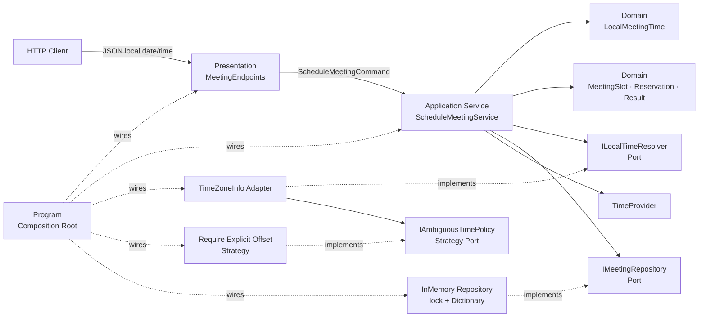
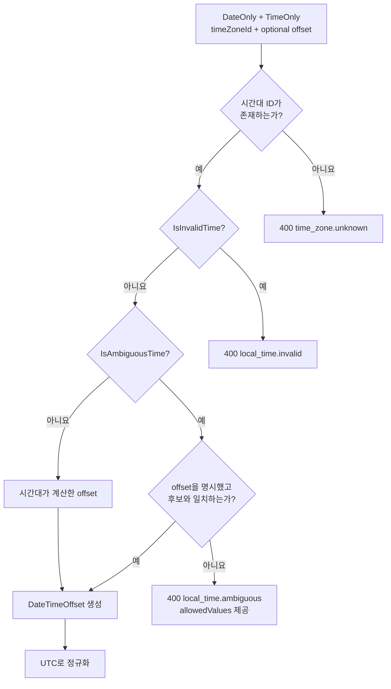

# 글로벌 일정 API로 배우는 C# 시간대와 DST 안전성

## 👣 초보자를 위한 코드 읽는 순서 (Reading order)

시간 코드는 `DateTime` API를 먼저 외우기보다 **사용자가 입력한 벽시계 → 시간대 규칙 → 확정된 UTC 순간 → 충돌 저장** 순서로 읽으면 훨씬 쉽습니다.

1. 이 README의 [오늘 만들 것과 한 줄 계약](#-오늘-만들-것과-한-줄-계약)에서 성공·실패 기준을 먼저 읽습니다.
2. [`LocalMeetingTime.cs`](./src/GlobalMeetingApi/Domain/LocalMeetingTime.cs)에서 `DateOnly`, `TimeOnly`, 시간대 ID, 선택적 offset이 왜 한 값으로 묶이는지 봅니다.
3. [`TimeZoneInfoLocalTimeResolver.cs`](./src/GlobalMeetingApi/Infrastructure/TimeZoneInfoLocalTimeResolver.cs)에서 정상 시각, 존재하지 않는 시각, 두 번 나타나는 시각의 분기를 따라갑니다.
4. [`RequireExplicitOffsetPolicy.cs`](./src/GlobalMeetingApi/Application/RequireExplicitOffsetPolicy.cs)에서 서버가 모호한 시각을 추측하지 않는 이유를 확인합니다.
5. [`MeetingSlot.cs`](./src/GlobalMeetingApi/Domain/MeetingSlot.cs)에서 UTC 반열린 구간 `[start, end)`의 겹침 공식을 읽습니다.
6. [`ScheduleMeetingService.cs`](./src/GlobalMeetingApi/Application/ScheduleMeetingService.cs)에서 Domain, 시간대 Port, Repository를 조율하는 Application Service를 읽습니다.
7. [`InMemoryMeetingRepository.cs`](./src/GlobalMeetingApi/Infrastructure/InMemoryMeetingRepository.cs)에서 서로 다른 표시 시간대도 UTC로 비교하고, 확인과 저장을 한 `lock`에 묶는 이유를 찾습니다.
8. [`MeetingEndpoints.cs`](./src/GlobalMeetingApi/Presentation/MeetingEndpoints.cs)에서 HTTP DTO와 상태 코드 변환만 담당하는지 확인합니다.
9. [`Program.cs`](./src/GlobalMeetingApi/Program.cs)에서 구체 구현을 DI로 조립하는 Composition Root를 확인합니다.
10. 마지막으로 [`SelfTestRunner.cs`](./src/GlobalMeetingApi/SelfTesting/SelfTestRunner.cs)를 `--self-test`로 실행해 17개 경계를 자동 검증합니다.

처음에는 `서울 09:00 → UTC 00:00`만 이해해도 충분합니다. 그다음 `뉴욕 02:30이 사라지는 날`, 마지막으로 `뉴욕 01:30이 두 번 생기는 날`을 읽으세요.

---

## 📌 빠른 탐색

| 유형 | 바로가기 |
| --- | --- |
| 🎯 목표 | [오늘 만들 것과 한 줄 계약](#-오늘-만들-것과-한-줄-계약) |
| 🔤 기초 | [Syntax와 Grammar](#-syntax와-grammar), [시간 형식 선택](#시간-형식은-역할이-다릅니다) |
| 🕰️ 핵심 | [DST의 두 함정](#dst-two-traps), [UTC 변환 규칙](#지역-시각을-utc로-바꾸는-규칙) |
| 🏗️ 구조 | [아키텍처 시각화](#️-아키텍처-시각화), [설계 선택의 이유](#-설계-선택의-이유-why) |
| 🌐 API | [HTTP 계약](#-http-계약), [요청 예시](#요청-예시) |
| 🗂️ 파일 | [파일 지도](#️-파일-지도) |
| ▶️ 실행 | [실행 방법](#️-실행-방법), [Validation stage](#-validation-stage) |
| ✍️ 연습 | [Beginner to Pro 연습](#beginner-to-pro) |
| 📚 최신화 | [버전과 Microsoft 공식 출처](#-버전과-microsoft-공식-출처) |
| 🔁 복습 | [간결한 체크리스트](#-간결한-복습-체크리스트) |

---

## 🎯 오늘 만들 것과 한 줄 계약

서울, 뉴욕 등 서로 다른 지역 사용자가 현지 달력 날짜와 벽시계 시각으로 회의를 예약하는 작은 ASP.NET Core Minimal API를 만듭니다.

> 지역 시각이 실제로 한 순간만 가리킬 때만 UTC로 확정하고, DST로 사라진 시각은 거절하며, 두 번 나타나는 시각은 사용자가 UTC offset을 고르게 합니다. 저장과 충돌 비교는 UTC로 수행하되 원래 지역 문맥도 보존합니다.

오늘의 학습 목표입니다.

- 기본 구문: 변수, 조건문, 문자열, 배열, 반복 없는 LINQ, `async`/`await`
- 핵심 문법: `record`, `?`, `var`, `=>`, pattern matching, collection expression, primary constructor
- 시간 형식: `DateOnly`, `TimeOnly`, `DateTime`, `DateTimeOffset`, `TimeSpan`, `TimeZoneInfo`
- 시간대 안전성: IANA ID, UTC offset, DST invalid time, DST ambiguous time
- Domain Model: 원래 지역 입력과 확정 UTC 순간을 다른 값으로 표현
- Result와 예외: 사용자가 고칠 오류는 `Result<T>`, 코드 결함·인프라 장애·취소는 예외/취소로 유지
- Application Service: 입력→해석→시간 구간→미래 경계→원자 저장 순서를 조율
- Repository Port/Adapter: 같은 주최자의 회의를 UTC 반열린 구간으로 원자적 비교
- Strategy: 중복 지역 시각을 서버가 임의 선택하지 않고 명시적 offset을 요구
- DI와 Composition Root: Domain/Application은 ASP.NET Core와 `Dictionary`를 모르게 유지
- 테스트 용이성: `TimeProvider`로 “현재 시각”을 고정해 날짜가 바뀌어도 같은 결과 검증

> ⚠️ **학습용 한계:** 인증·인가, 영속 DB, 분산 동시성, 반복 일정, 초대 참석자 충돌, 시간대 데이터베이스 업데이트 운영, 감사 로그가 없습니다. 메모리 Repository의 `lock`은 한 프로세스 안에서만 안전합니다. 실제 일정 서비스로 그대로 배포하지 마세요.

---

## 🔤 Syntax와 Grammar

| 문법 | 쉬운 뜻 | 이 예제에서 쓰는 이유 |
| --- | --- | --- |
| `var` | 오른쪽 값으로 지역 변수의 정적 형식을 compiler가 결정 | `Result<ResolvedLocalTime>`처럼 이미 분명한 형식 반복 감소 |
| `string?` / `TimeSpan?` | 값이 있거나 `null`일 수 있음 | 시간대 ID 누락, 중복 시각 offset 미선택을 거짓 없이 표현 |
| `record` | 값 중심 자료를 간결하고 불변에 가깝게 표현 | Error, Command, 지역 시각, UTC 해석 결과에 사용 |
| `=>` | 하나의 식으로 결과를 표현 | `IsSuccess`처럼 계산이 짧은 속성을 선명하게 표시 |
| `is not ('+' or '-')` | 여러 pattern 중 어느 것도 아닌지 검사 | offset 첫 문자가 `+`나 `-`인지 읽기 좋게 검증 |
| `is { } offset` | nullable 값이 있을 때 내부 값을 변수로 꺼냄 | offset이 있을 때만 범위를 검사 |
| `[.. sequence]` | sequence 원소를 새 컬렉션에 펼침 | 허용 offset 후보를 문자열 배열로 생성 |
| `switch` 식 | 한 값에 따라 결과 하나를 선택 | Repository 상태→Result, HTTP 상태→제목 변환 |
| `async` / `await` | thread를 붙잡지 않고 비동기 완료를 기다림 | Repository가 나중에 DB I/O로 바뀌어도 구조 유지 |
| `ValueTask<T>` | 자주 즉시 끝나는 비동기 결과 | 메모리 Adapter는 즉시 완료되지만 Port는 비동기 유지 |
| `CancellationToken` | 호출자가 결과를 더 기다리지 않는다는 협력적 신호 | HTTP 연결 종료를 Repository까지 전달 |
| primary constructor | class 선언 옆에서 생성자 매개변수를 받음 | Service와 Adapter 의존성을 짧고 명시적으로 주입 |
| `lock` | 한 프로세스의 작은 공유 상태를 한 번에 한 thread만 변경 | 충돌 확인과 저장 사이 경쟁 방지 |

### 시간 형식은 역할이 다릅니다

| 형식 | 담는 뜻 | 오늘의 역할 |
| --- | --- | --- |
| `DateOnly` | 달력 날짜만 | “2030-11-03” 보존 |
| `TimeOnly` | 하루 안의 벽시계 시각만 | “01:30” 보존 |
| `DateTime` + `Unspecified` | 어느 시간대인지 아직 해석하지 않은 지역 벽시계 | `TimeZoneInfo`에 전달 |
| `TimeSpan` | 두 시각의 차이 또는 UTC offset | `-04:00`, `-05:00` 후보 표현 |
| `DateTimeOffset` | UTC와의 차이가 정해진 하나의 순간 | 저장·정렬·충돌 비교 |
| `TimeZoneInfo` | 날짜별 offset과 DST 전환 규칙 | 지역 벽시계를 실제 순간으로 해석 |

`DateTimeOffset`은 하나의 순간을 명확히 나타내지만 “America/New_York”라는 시간대 규칙 자체는 기억하지 않습니다. 반대로 `DateOnly + TimeOnly + timeZoneId`는 사용자의 의도를 보존하지만 DST 중복 시 아직 한 순간이 아닐 수 있습니다. 그래서 예제는 **원래 지역 문맥과 확정된 UTC를 둘 다 저장**합니다.

### `DateTimeKind.Unspecified`가 의도적입니다

사용자 입력 `2030-11-03 01:30`은 서버 PC의 로컬 시각도 UTC도 아닙니다. `DateTimeKind.Local`이나 `Utc`로 표시하면 runtime이 엉뚱한 자동 변환을 할 수 있습니다. `Unspecified`로 만든 뒤 명시한 `America/New_York` 규칙에만 해석을 맡깁니다.

### Nullable은 “모른다”를 숨기지 않습니다

`preferredUtcOffset`은 평상시에는 없어도 되지만 DST 종료 중복 시각에는 반드시 필요합니다. 빈 문자열을 임의의 `00:00`으로 바꾸지 않고 `TimeSpan?`의 `null`로 유지하면 Strategy가 “선택이 빠짐”과 “잘못된 선택”을 구분할 수 있습니다.

---

<a id="dst-two-traps"></a>

## 🕰️ DST의 두 함정

### 1. 존재하지 않는 시각 — spring forward

미국 뉴욕에서는 2030-03-10에 시계가 01:59:59 다음 03:00:00으로 이동합니다. 따라서 `2030-03-10 02:30 America/New_York`은 실제 순간이 아닙니다.

```text
01:59:59 -05:00  ── 시계가 앞으로 이동 ──>  03:00:00 -04:00
                         02:30은 없음
```

예제는 `TimeZoneInfo.IsInvalidTime`이 `true`이면 `local_time.invalid`로 거절합니다. 다음 가능한 시각으로 몰래 보정하면 사용자가 선택하지 않은 회의 시각을 만들 수 있기 때문입니다.

### 2. 두 번 나타나는 시각 — fall back

뉴욕에서는 2030-11-03에 `01:30`이 서로 다른 offset으로 두 번 나타납니다.

```text
2030-11-03 01:30 -04:00  ==  2030-11-03 05:30Z
2030-11-03 01:30 -05:00  ==  2030-11-03 06:30Z
```

같은 글자 `01:30`이 실제로는 한 시간 차이인 두 순간입니다. `TimeZoneInfo.IsAmbiguousTime`과 `GetAmbiguousTimeOffsets`로 후보를 찾고, `RequireExplicitOffsetPolicy`가 사용자의 `preferredUtcOffset` 선택을 요구합니다.

### 지역 시각을 UTC로 바꾸는 규칙

1. `timeZoneId`를 `TimeZoneInfo.TryFindSystemTimeZoneById`로 찾습니다.
2. `DateOnly + TimeOnly`을 `DateTimeKind.Unspecified`로 합칩니다.
3. `IsInvalidTime`이면 즉시 거절합니다.
4. `IsAmbiguousTime`이면 가능한 offset 중 사용자가 고른 값만 승인합니다.
5. 평상시이면 시간대가 계산한 offset을 사용합니다.
6. `new DateTimeOffset(localDateTime, selectedOffset)`으로 한 순간을 만듭니다.
7. `ToUniversalTime()`으로 저장·비교용 UTC를 만듭니다.

offset만 받으면 미래의 DST 규칙과 지역 정체성을 알 수 없고, 시간대 ID만 받으면 중복 시각을 하나로 결정할 수 없습니다. 둘의 역할을 분리해서 다룹니다.

---

## 🏗️ 아키텍처 시각화

### 계층과 의존성 흐름



화살표의 핵심은 Domain/Application이 ASP.NET Core, 운영체제 시간대 조회, 메모리 `Dictionary`를 직접 알지 않는다는 점입니다. 구체 기술을 Port 뒤에 두면 시간대 정책·저장소·시계를 테스트나 운영 환경에 맞게 교체할 수 있습니다.

### DST 해석 결정 흐름



[`architecture.html`](./architecture.html)은 같은 구조를 검색·확대할 수 있는 독립형 시각화이고, [`architecture.json`](./architecture.json)은 검증 가능한 입력 명세입니다. HTML의 고정 Viewer UI는 영어지만 노드와 설명은 한국어입니다.

### UTC 반열린 구간으로 충돌 비교

회의 구간을 `[시작, 종료)`로 봅니다.

```text
기존: [05:30Z, 06:30Z)
겹침:          [05:45Z, 06:15Z)  → 충돌
인접:                          [06:30Z, 07:00Z)  → 허용
```

두 구간 `A`, `B`는 `A.Start < B.End && B.Start < A.End`일 때 겹칩니다. 현지 표시가 서울 14:30이든 뉴욕 01:30이든 같은 UTC 순간이면 같은 시간으로 비교됩니다.

---

## 🧠 설계 선택의 이유 (Why)

### Domain Model과 불변성

- `LocalMeetingTime`은 사용자의 지역 의도를 보존합니다.
- `ResolvedLocalTime`은 시간대 규칙과 offset으로 하나의 순간을 확정합니다.
- `MeetingSlot`은 UTC 시작·종료와 반열린 구간 불변식을 지킵니다.
- `MeetingReservation`은 검증된 값만 private 생성자로 받습니다.
- `record`와 getter-only property를 사용해 저장 후 값이 몰래 바뀌는 위험을 줄입니다.

### Result와 예외의 경계

| 상황 | 처리 | 이유 |
| --- | --- | --- |
| 알 수 없는 시간대, DST 공백·중복, 잘못된 길이 | `Result<T>` 실패 | 사용자가 입력을 고쳐 재요청 가능 |
| ID 중복, 주최자 시간 충돌 | `Result<T>` 실패 | 예상 가능한 업무 경쟁 |
| caller 취소 | `OperationCanceledException` 전파 | 업무 실패가 아니라 결과가 더 필요 없다는 제어 흐름 |
| 불가능한 내부 상태, 코드 결함 | 예외 | 정상 업무 결과인 것처럼 숨기면 안 됨 |
| DB·시간대 데이터 접근 장애 | 예외 후 중앙 처리 | 입력 수정으로 해결되지 않는 기술 장애 |

`catch (Exception) => 400`처럼 모든 예외를 업무 실패로 바꾸면 장애를 사용자 탓으로 기록하고 retry·경보 판단도 잃습니다.

### Strategy

`IAmbiguousTimePolicy`는 “중복 01:30 중 어느 순간인가?”라는 정책을 `TimeZoneInfo` 기술 세부사항과 분리합니다. 오늘 구현은 명시적 offset을 요구합니다. 다른 조직은 표준시 우선, 빠른 순간 우선, UI 재확인 같은 정책을 선택할 수 있지만 서버가 조용히 추측한다면 그 사실과 위험을 계약에 드러내야 합니다.

### Repository Port/Adapter와 원자성

`IMeetingRepository`는 Application이 저장 기술을 모르게 하는 Port입니다. `InMemoryMeetingRepository`는 학습용 Adapter입니다. “충돌 조회 → 저장”을 별도 lock으로 나누면 두 요청이 모두 빈 시간을 보고 둘 다 저장하는 TOCTOU 문제가 생깁니다. 예제는 ID 확인, UTC 충돌 확인, 저장을 같은 `lock` 안에서 처리합니다.

운영 DB에서는 같은 불변식을 transaction, exclusion constraint/range type, serializable isolation, compare-and-swap 등 DB에 맞는 원자 연산으로 지켜야 합니다. 여러 API 인스턴스에서 각 프로세스의 `lock`은 서로를 보호하지 못합니다.

### DI, SOLID, Composition Root

- **SRP:** Resolver는 시간대 해석, Strategy는 모호성 선택, Service는 유스케이스 조율, Repository는 저장 원자성을 담당합니다.
- **OCP:** 새로운 모호성 정책이나 DB Adapter를 기존 Application Service 수정 없이 추가할 수 있습니다.
- **DIP:** Service는 `TimeZoneInfo`나 `Dictionary`가 아니라 Port에 의존합니다.
- **Composition Root:** 구체 구현 선택은 [`Program.cs`](./src/GlobalMeetingApi/Program.cs) 한곳에 모읍니다.

### TimeProvider와 테스트 용이성

Service에서 `DateTimeOffset.UtcNow`를 직접 읽으면 같은 입력이 실행 날짜에 따라 통과하거나 실패합니다. `TimeProvider`를 주입하면 운영은 시스템 시간, 자체 검증은 `2026-10-22T00:00:00Z` 고정 시계를 사용합니다. 이것은 단순한 mock 요령이 아니라 변하는 외부 환경을 명시적 의존성으로 만드는 설계입니다.

### 시간대 데이터도 변할 수 있습니다

정치·법률 결정으로 미래의 DST 규칙과 UTC offset이 바뀔 수 있습니다. 장기 미래 예약은 다음을 정책으로 정해야 합니다.

- 예약 시 계산한 UTC를 영구 고정할지
- 실행 전에 최신 시간대 규칙으로 다시 계산할지
- 원래 지역 날짜·시각·시간대 ID·적용 offset·규칙 버전을 얼마나 보존할지
- 규칙 변경 시 누구에게 알리고 어떤 승인을 받을지

오늘 예제는 원래 지역 문맥과 계산 당시 offset, UTC를 모두 보존하지만 시간대 데이터 버전과 재계산 workflow는 구현하지 않습니다.

---

## 🌐 HTTP 계약

| 요청 | 성공 | 예상 실패 |
| --- | --- | --- |
| `GET /` | `200`, 서비스와 시간대 예시 | - |
| `POST /meetings` | `201`, `Location`, 지역 문맥과 UTC 구간 | 입력·시간대·DST `400`, ID·UTC 시간 충돌 `409`, media type `415` |
| `GET /meetings/{meetingId}` | `200`, 저장된 회의 | 없음 `404` |

### 요청 예시

평상시 서울 입력은 offset을 생략해도 됩니다.

```json
{
  "meetingId": "MEET-20300115-001",
  "organizerId": "USER-100",
  "title": "서울·뉴욕 제품 회의",
  "localDate": "2030-01-15",
  "localStartTime": "09:00:00",
  "timeZoneId": "Asia/Seoul",
  "durationMinutes": 60
}
```

성공 응답의 핵심은 원래 입력과 UTC가 함께 있다는 점입니다.

```json
{
  "meetingId": "MEET-20300115-001",
  "organizerId": "USER-100",
  "title": "서울·뉴욕 제품 회의",
  "localDate": "2030-01-15",
  "localStartTime": "09:00:00",
  "timeZoneId": "Asia/Seoul",
  "utcOffset": "+09:00",
  "startsAtUtc": "2030-01-15T00:00:00+00:00",
  "endsAtUtc": "2030-01-15T01:00:00+00:00"
}
```

뉴욕의 중복 시각은 offset을 명시해야 합니다.

```json
{
  "meetingId": "MEET-NY-20301103-001",
  "organizerId": "USER-200",
  "title": "DST 종료 점검",
  "localDate": "2030-11-03",
  "localStartTime": "01:30:00",
  "timeZoneId": "America/New_York",
  "preferredUtcOffset": "-04:00",
  "durationMinutes": 30
}
```

`preferredUtcOffset`을 빼면 `400`과 가능한 값이 옵니다.

```json
{
  "status": 400,
  "title": "회의 입력을 확인하세요.",
  "detail": "이 지역 시각은 DST 종료 때문에 두 번 나타납니다. preferredUtcOffset을 선택하세요.",
  "code": "local_time.ambiguous",
  "field": "preferredUtcOffset",
  "allowedValues": ["-04:00", "-05:00"]
}
```

배열 순서는 구현상 빠른 offset부터 정렬하지만, 클라이언트는 순서가 아니라 값으로 선택해야 합니다.

---

## 🗂️ 파일 지도

> 아래 링크는 모두 현재 날짜 폴더 기준 상대 경로이며, 읽을 가치가 있는 소스·문서만 분류했습니다.

| 유형 | 파일 | 역할 |
| --- | --- | --- |
| 🧱 프로젝트 | [`GlobalMeeting.slnx`](./GlobalMeeting.slnx) | 오늘 예제 solution |
| 🧱 프로젝트 | [`GlobalMeetingApi.csproj`](./src/GlobalMeetingApi/GlobalMeetingApi.csproj) | `net10.0`, C# 14, nullable, warnings-as-errors |
| 🧭 조립 | [`Program.cs`](./src/GlobalMeetingApi/Program.cs) | DI, middleware, endpoint, demo mode Composition Root |
| 🔷 Domain | [`Error.cs`](./src/GlobalMeetingApi/Domain/Error.cs) | 안정적인 오류 코드와 선택 후보 |
| 🔷 Domain | [`Result.cs`](./src/GlobalMeetingApi/Domain/Result.cs) | 성공 값과 예상 실패의 배타적 표현 |
| 🔷 Domain | [`LocalMeetingTime.cs`](./src/GlobalMeetingApi/Domain/LocalMeetingTime.cs) | 원래 지역 입력과 확정 UTC 결과 |
| 🔷 Domain | [`MeetingSlot.cs`](./src/GlobalMeetingApi/Domain/MeetingSlot.cs) | UTC 반열린 구간과 겹침 규칙 |
| 🔷 Domain | [`MeetingReservation.cs`](./src/GlobalMeetingApi/Domain/MeetingReservation.cs) | 검증된 불변 회의 예약 |
| 🧠 Application | [`ScheduleMeetingCommand.cs`](./src/GlobalMeetingApi/Application/ScheduleMeetingCommand.cs) | Presentation→Application 명령 |
| 🧠 Application | [`ScheduleMeetingService.cs`](./src/GlobalMeetingApi/Application/ScheduleMeetingService.cs) | 전체 유스케이스 조율 |
| 🧠 Strategy | [`RequireExplicitOffsetPolicy.cs`](./src/GlobalMeetingApi/Application/RequireExplicitOffsetPolicy.cs) | DST 중복 시각 offset 선택 정책 |
| 🔌 Port | [`ILocalTimeResolver.cs`](./src/GlobalMeetingApi/Application/Ports/ILocalTimeResolver.cs) | 지역 시각 해석 경계 |
| 🔌 Port | [`IAmbiguousTimePolicy.cs`](./src/GlobalMeetingApi/Application/Ports/IAmbiguousTimePolicy.cs) | 모호성 정책 경계 |
| 🔌 Port | [`IMeetingRepository.cs`](./src/GlobalMeetingApi/Application/Ports/IMeetingRepository.cs) | 저장·조회 경계와 상태 |
| 🔧 Adapter | [`TimeZoneInfoLocalTimeResolver.cs`](./src/GlobalMeetingApi/Infrastructure/TimeZoneInfoLocalTimeResolver.cs) | 운영체제 시간대 규칙 Adapter |
| 🔧 Adapter | [`InMemoryMeetingRepository.cs`](./src/GlobalMeetingApi/Infrastructure/InMemoryMeetingRepository.cs) | 학습용 원자 저장 Adapter |
| 🌐 Presentation | [`MeetingContracts.cs`](./src/GlobalMeetingApi/Presentation/MeetingContracts.cs) | HTTP DTO, offset parser, 응답 mapping |
| 🌐 Presentation | [`MeetingEndpoints.cs`](./src/GlobalMeetingApi/Presentation/MeetingEndpoints.cs) | 201/400/404/409 변환 |
| ✅ 검증 | [`SelfTestRunner.cs`](./src/GlobalMeetingApi/SelfTesting/SelfTestRunner.cs) | 고정 시계·24개 경쟁 요청 기반 17개 자동 검사 |
| ✍️ 연습 | [`EXERCISES.md`](./EXERCISES.md) | Beginner→Pro 실습 단계 |
| 🧩 정답 | [`CHECKPOINT.md`](./CHECKPOINT.md) | 초보자 이해도 점검과 해설 |
| 🗺️ 시각화 | [`architecture.html`](./architecture.html) | 검색·확대 가능한 독립형 구조도 |
| 🗺️ 시각화 | [`architecture.json`](./architecture.json) | Archify 시각화 입력 명세 |

---

## ▶️ 실행 방법

요구 사항은 안정 SDK .NET `10.0.301` 이상입니다. 이 폴더의 `global.json`은 같은 .NET 10 계열에서 설치된 최신 feature band와 patch로 롤포워드합니다.

```powershell
cd dailyStudy/exercise/20261022
dotnet --version
dotnet restore .\GlobalMeeting.slnx
dotnet build .\GlobalMeeting.slnx -c Release --no-restore
```

### 1. 짧은 성공 demo

```powershell
dotnet run --project .\src\GlobalMeetingApi\GlobalMeetingApi.csproj -c Release --no-build -- --demo
```

예상 형식:

```text
[DEMO:SUCCESS] MEET-DEMO-001 / <내일 서울 지역 시각> Asia/Seoul / UTC <확정 순간>
```

demo는 실행 시점의 내일을 계산하므로 과거 날짜가 되지 않습니다.

### 2. 자동 자체 검증

```powershell
dotnet run --project .\src\GlobalMeetingApi\GlobalMeetingApi.csproj -c Release --no-build -- --self-test
```

마지막 줄:

```text
[SELF-TEST] 17/17 checks passed
```

### 3. 실제 HTTP 서버

```powershell
dotnet run --project .\src\GlobalMeetingApi\GlobalMeetingApi.csproj -c Release --no-build -- --urls http://127.0.0.1:5198
```

다른 PowerShell 창에서:

```powershell
$body = @{
    meetingId = 'MEET-20300115-001'
    organizerId = 'USER-100'
    title = '서울·뉴욕 제품 회의'
    localDate = '2030-01-15'
    localStartTime = '09:00:00'
    timeZoneId = 'Asia/Seoul'
    durationMinutes = 60
} | ConvertTo-Json

Invoke-RestMethod `
    -Method Post `
    -Uri 'http://127.0.0.1:5198/meetings' `
    -ContentType 'application/json' `
    -Body $body
```

서버는 `Ctrl+C`로 종료합니다. 실제 운영에서는 HTTPS, 인증·인가, 입력 크기 제한, 영속 저장소를 추가해야 합니다.

---

## ✅ Validation stage

초보자는 다음 순서로 “예상→실행→설명”을 반복하세요.

### Stage 1 — 실행 전 손으로 예측

| 입력 | 예상 |
| --- | --- |
| `2030-01-15 09:00 Asia/Seoul` | `2030-01-15 00:00Z` |
| `2030-03-10 02:30 America/New_York` | 존재하지 않으므로 `local_time.invalid` |
| `2030-11-03 01:30 America/New_York`, offset 없음 | 모호하므로 `allowedValues`와 `400` |
| 같은 시각, `-04:00` | `05:30Z` |
| 같은 시각, `-05:00` | `06:30Z` |
| 기존 회의 종료와 다음 회의 시작이 같음 | 반열린 구간이므로 허용 |

### Stage 2 — build와 demo

- Release build가 경고 0개·오류 0개인지 확인합니다.
- `--demo` 출력에서 지역 시각과 UTC가 함께 표시되는지 확인합니다.
- `bin/`, `obj/`는 생성되어도 Git에 올리지 않습니다.

### Stage 3 — 자체 검증

- `--self-test`가 `17/17`인지 확인합니다.
- 각 `[PASS]`를 읽고 어떤 위험을 막는 검사인지 한 문장으로 말합니다.
- 특히 `-04:00`과 `-05:00`이 서로 다른 UTC라는 줄을 비교합니다.

### Stage 4 — 실제 HTTP

- 정상 서울 요청이 `201`과 `Location`을 반환하는지 확인합니다.
- 뉴욕 DST 공백 시각이 `400 local_time.invalid`인지 확인합니다.
- 뉴욕 DST 중복 시각의 `allowedValues`가 두 개인지 확인합니다.
- 같은 주최자의 서로 다른 시간대 입력이 같은 UTC에서 겹치면 `409`인지 확인합니다.
- 저장된 ID를 `GET`하면 `200`, 없는 ID면 `404`인지 확인합니다.

### Stage 5 — 이해를 말로 검증

다음 질문에 코드 없이 답해 보세요.

1. `DateTimeOffset` 하나만으로 왜 미래의 시간대 규칙을 알 수 없나요?
2. 중복 시각을 서버가 자동으로 표준시로 고르면 어떤 사용자 오류가 생길 수 있나요?
3. 충돌을 지역 시각 문자열이 아니라 UTC로 비교하는 이유는 무엇인가요?
4. `TimeProvider`가 없으면 어떤 테스트가 날짜에 따라 흔들리나요?
5. 운영 DB에서 C# `lock`만으로 부족한 이유는 무엇인가요?

막히면 [`CHECKPOINT.md`](./CHECKPOINT.md)의 해설을 읽고 다시 설명합니다.

---

<a id="beginner-to-pro"></a>

## ✍️ Beginner to Pro 연습

[`EXERCISES.md`](./EXERCISES.md)는 모두 실행 명령과 완료 기준이 있습니다.

| 단계 | 핵심 과제 | 확인할 능력 |
| --- | --- | --- |
| Beginner 1 | 시간 형식 카드 만들기 | DateOnly·TimeOnly·DateTimeOffset 역할 구분 |
| Beginner 2 | duration 경계값 예측 | 조건문·Result·경계값 이해 |
| Beginner 3 | offset parser 표 검사 | nullable·문자열·테이블 테스트 이해 |
| Beginner+ 4 | 실제 HTTP로 DST 공백 확인 | 실행·요청·Problem Details 읽기 |
| Intermediate 5 | 중복 시각의 두 순간 비교 | offset에 따른 UTC 차이 설명 |
| Intermediate 6 | 모호성 Strategy 교체 | OCP·DI·정책 위험 설명 |
| Intermediate+ 7 | 주최자 일정 조회 | LINQ·Repository Port 확장 |
| Advanced 8 | 24개 경쟁 요청 검증 | 원자성·TOCTOU·Task 이해 |
| Advanced+ 9 | 실제 DB 불변식 설계 | transaction·unique/exclusion constraint |
| Pro 10 | 반복 일정과 시간대 규칙 변경 | “지역 규칙”과 “확정 순간” 모델 분리 |
| Pro+ 11 | 시간대 규칙 변경 운영 runbook | tzdata 관찰·재계산·감사 전략 |

원본을 바로 바꾸기 전에 결과를 예측하고, 한 과제마다 `dotnet build`와 `--self-test`를 다시 실행하세요.

---

## 📚 버전과 Microsoft 공식 출처

### 2026-10-22 (Asia/Seoul) 확인 결과

| 구분 | 확인한 최신 버전/상태 | 오늘의 선택 |
| --- | --- | --- |
| 안정 .NET | .NET 10 LTS, Runtime/ASP.NET Core `10.0.13` | `net10.0` 사용 |
| 안정 SDK | `10.0.402` (`latest-sdk`) | 로컬 설치 `10.0.301`로 검증 |
| 안정 C# | C# 14 | `<LangVersion>14.0</LangVersion>` |
| 시험판 .NET | .NET 11 RC2, SDK `11.0.100-rc.2.26504.105`, Runtime/ASP.NET Core `11.0.0-rc.2.26504.105` | 설명만 제공, target 아님 |
| 시험판 C# | C# 15 Preview | Preview 문법 사용 안 함 |

.NET 11 RC2는 Go-Live 지원 릴리스이지만 GA 안정판은 아닙니다. 이 자료는 설치된 안정 SDK에서 누구나 빌드할 수 있도록 C# 14/.NET 10 기능만 사용합니다. 로컬 `dotnet --info`에서 선택된 SDK는 `10.0.301`, Runtime/ASP.NET Core는 `10.0.9`였고 Release build와 실행으로 확인했습니다.

- 🔗 [.NET 10 다운로드와 최신 patch](https://dotnet.microsoft.com/en-us/download/dotnet/10.0)
- 🔗 [.NET 10 공식 release metadata](https://builds.dotnet.microsoft.com/dotnet/release-metadata/10.0/releases.json)
- 🔗 [.NET 10.0.13 release notes](https://github.com/dotnet/core/blob/main/release-notes/10.0/10.0.13/10.0.13.md)
- 🔗 [.NET 지원 정책](https://dotnet.microsoft.com/en-us/platform/support/policy/dotnet-core)
- 🔗 [C# 14의 새로운 기능](https://learn.microsoft.com/en-us/dotnet/csharp/whats-new/csharp-14)
- 🔗 [.NET 11 RC2 다운로드](https://dotnet.microsoft.com/en-us/download/dotnet/11.0)
- 🔗 [.NET 11 RC2 발표](https://devblogs.microsoft.com/dotnet/dotnet-11-rc-2/)
- 🔗 [C# 15 Preview](https://learn.microsoft.com/en-us/dotnet/csharp/whats-new/csharp-15)

### 오늘 주제의 공식 문서

- 🔗 [날짜·시간·시간대 개요](https://learn.microsoft.com/en-us/dotnet/standard/datetime/)
- 🔗 [DateTime, DateTimeOffset, TimeSpan, TimeZoneInfo 선택](https://learn.microsoft.com/en-us/dotnet/standard/datetime/choosing-between-datetime)
- 🔗 [모호한 시각 해결](https://learn.microsoft.com/en-us/dotnet/standard/datetime/resolve-ambiguous-times)
- 🔗 [시간대 간 변환](https://learn.microsoft.com/en-us/dotnet/standard/datetime/converting-between-time-zones)
- 🔗 [`TimeZoneInfo.TryFindSystemTimeZoneById`](https://learn.microsoft.com/en-us/dotnet/api/system.timezoneinfo.tryfindsystemtimezonebyid?view=net-10.0)
- 🔗 [DateOnly와 TimeOnly 사용](https://learn.microsoft.com/en-us/dotnet/standard/datetime/how-to-use-dateonly-timeonly)
- 🔗 [TimeProvider 개요](https://learn.microsoft.com/en-us/dotnet/standard/datetime/timeprovider-overview)
- 🔗 [.NET 의존성 주입](https://learn.microsoft.com/en-us/dotnet/core/extensions/dependency-injection)

Microsoft 문서는 `DateTimeOffset`을 하나의 순간을 명확히 식별하는 기본 선택으로 고려하라고 안내하면서도, offset 자체는 시간대 정체성을 보존하지 않는다고 설명합니다. 모호한 시각은 사용자에게 선택하게 할 수 있다고 공식 문서가 명시합니다. 이 예제는 그 선택을 안정적인 API 계약으로 구현했습니다.

---

## 🔁 간결한 복습 체크리스트

- [ ] `DateOnly`, `TimeOnly`, `DateTimeOffset`, `TimeZoneInfo`의 역할 차이를 말할 수 있다.
- [ ] 지역 벽시계 입력을 `DateTimeKind.Unspecified`로 만드는 이유를 안다.
- [ ] DST 공백 시각과 중복 시각의 차이를 예로 설명할 수 있다.
- [ ] 중복 시각에 시간대 ID와 offset이 모두 필요한 이유를 안다.
- [ ] 원래 지역 문맥과 확정 UTC를 함께 보존하는 이유를 안다.
- [ ] 회의 충돌을 UTC 반열린 구간으로 비교할 수 있다.
- [ ] 사용자 수정 가능 오류는 Result, 취소·장애·버그는 다른 경계로 처리하는 이유를 안다.
- [ ] Resolver Port, ambiguity Strategy, Repository Adapter, Composition Root를 코드에서 찾을 수 있다.
- [ ] `TimeProvider`가 날짜 의존 테스트를 안정화하는 이유를 안다.
- [ ] 메모리 `lock`의 단일 프로세스 한계를 안다.
- [ ] 시간대 규칙이 바뀔 수 있으므로 장기 예약 정책이 필요함을 안다.
- [ ] Release build, demo, 17개 self-test, 실제 HTTP 검증을 실행했다.

다음 순서: [`EXERCISES.md`](./EXERCISES.md) → [`CHECKPOINT.md`](./CHECKPOINT.md) → [`architecture.html`](./architecture.html)
