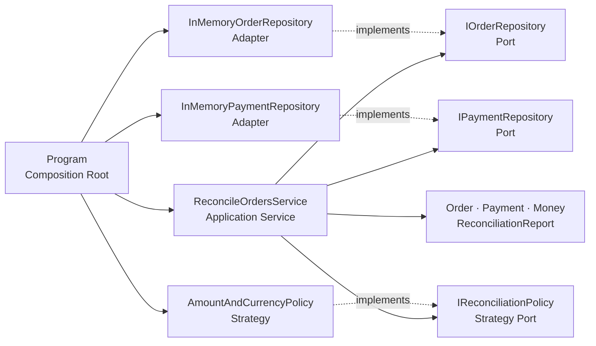
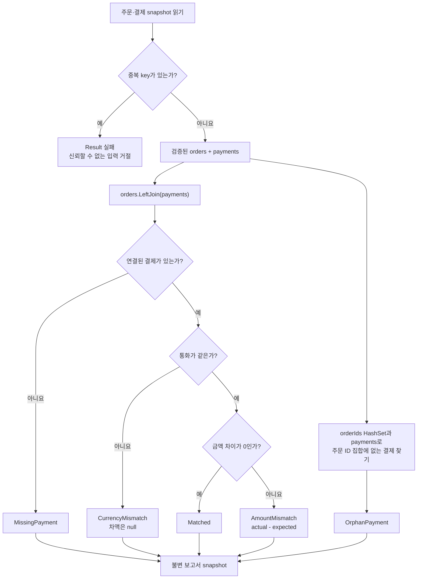

# 주문-결제 대사로 배우는 .NET 10 `LeftJoin`과 C# 14

## 👣 초보자를 위한 코드 읽는 순서 (Reading order)

처음부터 모든 파일을 동시에 이해하려 하지 마세요. 아래 순서대로 **입력 → 규칙 → 흐름 → 검증**을 따라가면 됩니다.

1. 이 README의 [오늘 만들 것과 한 줄 계약](#-오늘-만들-것과-한-줄-계약)을 읽고 결과 표를 먼저 예측합니다.
2. [`Program.cs`](./src/OrderPaymentReconciliation/Program.cs)에서 demo 입력과 객체 조립 위치를 찾습니다.
3. [`Money.cs`](./src/OrderPaymentReconciliation/Domain/Money.cs), [`Order.cs`](./src/OrderPaymentReconciliation/Domain/Order.cs), [`Payment.cs`](./src/OrderPaymentReconciliation/Domain/Payment.cs)에서 “잘못된 상태를 만들지 않는 방법”을 봅니다.
4. [`Error.cs`](./src/OrderPaymentReconciliation/Domain/Error.cs)와 [`Result.cs`](./src/OrderPaymentReconciliation/Domain/Result.cs)에서 예상 가능한 실패를 값으로 다루는 방법을 봅니다.
5. [`IOrderRepository.cs`](./src/OrderPaymentReconciliation/Application/Ports/IOrderRepository.cs), [`IPaymentRepository.cs`](./src/OrderPaymentReconciliation/Application/Ports/IPaymentRepository.cs), [`IReconciliationPolicy.cs`](./src/OrderPaymentReconciliation/Application/Ports/IReconciliationPolicy.cs)에서 Application이 의존하는 계약을 봅니다.
6. [`AmountAndCurrencyPolicy.cs`](./src/OrderPaymentReconciliation/Application/AmountAndCurrencyPolicy.cs)에서 상태와 차액을 결정하는 업무 규칙을 읽습니다.
7. [`ReconcileOrdersService.cs`](./src/OrderPaymentReconciliation/Application/ReconcileOrdersService.cs)에서 중복 검증 → `LeftJoin` → 고아 결제 탐지 → 정렬 흐름을 따라갑니다.
8. [`InMemoryOrderRepository.cs`](./src/OrderPaymentReconciliation/Infrastructure/InMemoryOrderRepository.cs)와 [`InMemoryPaymentRepository.cs`](./src/OrderPaymentReconciliation/Infrastructure/InMemoryPaymentRepository.cs)에서 Port를 구현한 Adapter를 확인합니다.
9. [`SelfTestRunner.cs`](./src/OrderPaymentReconciliation/SelfTesting/SelfTestRunner.cs)에서 33개 자동 검사가 어떤 계약을 지키는지 확인합니다.
10. [`EXERCISES.md`](./EXERCISES.md)를 직접 풀고 [`CHECKPOINT.md`](./CHECKPOINT.md)에서 말로 설명할 수 있는지 확인합니다.
11. [`architecture.html`](./architecture.html)을 열어 계층과 흐름을 검색·확대하며 다시 연결합니다.

---

## 📌 빠른 탐색

| 유형 | 바로가기 |
| --- | --- |
| 🎯 목표와 계약 | [오늘 만들 것](#-오늘-만들-것과-한-줄-계약) |
| 🔤 언어 기초 | [Syntax와 Grammar](#-syntax와-grammar) |
| 🔗 핵심 문법 | [`LeftJoin` 이해](#-leftjoin은-무엇을-보존하나요) |
| 🏗️ 아키텍처 | [구조도](#️-아키텍처-시각화) |
| 🧠 설계 이유 | [Why](#-설계-선택의-이유-why) |
| 🗂️ 코드 지도 | [파일 지도](#️-파일-지도) |
| ▶️ 실행 | [실행 방법](#️-실행-방법) |
| ✅ 검증 | [Validation stage](#-validation-stage) |
| ✍️ 실습 | [Beginner to Pro](#️-beginner-to-pro-연습) |
| 📚 최신 정보 | [버전과 공식 출처](#-버전과-microsoft-공식-출처) |

---

## 🎯 오늘 만들 것과 한 줄 계약

서로 다른 시스템에서 온 주문과 결제를 맞춰 보고, 사람이 확인해야 할 문제를 분류하는 콘솔 애플리케이션을 만듭니다.

```text
주문 4건                              결제 4건
ORD-100  35,000 KRW  ─────────────── PAY-100  35,000 KRW
ORD-101  12,000 KRW                  (없음)
ORD-102  50,000 KRW  ─────────────── PAY-102  45,000 KRW
ORD-103      29 USD  ─────────────── PAY-103      29 EUR
                                      PAY-999   8,000 KRW → 주문 없음
```

예상 보고서는 다음과 같습니다.

| OrderId | PaymentId | 상태 | 핵심 이유 |
| --- | --- | --- | --- |
| `ORD-100` | `PAY-100` | `Matched` | 통화와 금액이 모두 같음 |
| `ORD-101` | `null` | `MissingPayment` | 주문은 있지만 결제가 없음 |
| `ORD-102` | `PAY-102` | `AmountMismatch` | 같은 통화지만 5,000 KRW 부족 |
| `ORD-103` | `PAY-103` | `CurrencyMismatch` | USD와 EUR는 숫자만 빼면 안 됨 |
| `ORD-999` | `PAY-999` | `OrphanPayment` | 결제가 가리키는 주문이 없음 |

> **한 줄 계약:** 모든 유일한 주문은 보고서에 반드시 남기고, 결제가 없으면 `null`로 드러내며, 주문 없는 결제도 별도 검토 대상으로 놓치지 않습니다.

### 이 학습 예제의 명시적 전제

- 주문 ID와 결제 ID는 대소문자를 구분하는 정확한 식별자입니다.
- 주문 한 건에는 최종 결제가 최대 한 건이라는 단순한 업무 계약을 사용합니다.
- 금액은 0 이상, 소수 둘째 자리까지 허용합니다.
- 통화 코드는 영문 세 글자 형식만 검사하며 실제 ISO 4217 목록까지 검증하지는 않습니다.
- Repository는 process 안의 불변 snapshot입니다. 데이터베이스, 환율 변환, 부분 결제, 환불은 연습문제로 확장합니다.

이 제한을 숨기지 않는 것이 중요합니다. 작은 예제의 규칙과 실제 운영 시스템의 규칙을 같은 것으로 오해하면 안 됩니다.

---

## 🔤 Syntax와 Grammar

| 코드에서 만나는 문법 | 아주 짧은 뜻 | 이 예제에서 쓰는 이유 |
| --- | --- | --- |
| `var` | 오른쪽 값으로 변수의 **정적 형식**을 compiler가 추론 | 형식이 이미 분명한 지역 변수의 반복을 줄임 |
| `decimal`과 `35_000m` | 금융 계산에 적합한 10진수, `_`는 읽기 구분자, `m`은 decimal 표식 | `double`의 이진 부동소수점 오차를 피함 |
| `string?`, `Money?`, `decimal?` | 값이 없을 수 있음을 형식에 표시 | 결제 누락과 비교 불가능한 차액을 숨기지 않음 |
| `record` | 값 중심 equality와 간결한 불변 데이터 모델 | `Error`, `Money`, 주문, 결제, 보고서 행 표현 |
| `enum` | 가능한 이름을 제한한 값 집합 | 임의 문자열 대신 다섯 대사 상태를 compiler가 검사 |
| `if`, `is null`, `is not null` | 조건과 null 패턴 검사 | 누락과 중복을 명확한 분기로 처리 |
| `switch` 식과 `=>` | 입력 하나를 조건별 결과 하나로 변환 | 차액을 사람이 읽는 판정 이유로 변환 |
| `List<T>`, `IReadOnlyList<T>` | 같은 형식 여러 개를 담는 generic collection | 입력은 모으되 경계 밖에서는 수정 의도를 제한 |
| `[a, b, c]` | collection expression | C#에서 작은 고정 목록을 간결하게 생성 |
| `foreach` | sequence의 각 원소를 차례로 처리 | 보고서 행을 출력 |
| lambda `x => x.Id` | 이름 없는 작은 함수를 값처럼 전달 | join key, filter, 정렬 규칙을 LINQ에 전달 |
| LINQ | collection을 filter·변환·결합하는 표준 연산 | `LeftJoin`, `Where`, `Select`, `OrderBy`로 데이터 흐름 표현 |
| `async` / `await` | thread를 붙잡지 않고 비동기 완료를 기다림 | Repository가 DB나 외부 시스템으로 바뀌어도 계약 유지 |
| `CancellationToken` | 호출자가 “결과가 더 필요 없다”고 보내는 중단 신호 | 취소를 업무 실패로 숨기지 않고 끝까지 전달 |
| `?.` / `??` | null이면 접근을 건너뜀 / null일 때 대체값 선택 | nullable 보고서 값을 안전하게 표시 |
| `extension(...)` | C# 14 extension block | 원본 record 수정 없이 `NeedsReview` 계산 속성 추가 |

### `var`는 dynamic이 아닙니다

```csharp
var amount = 35_000m;
```

compiler는 오른쪽의 `m`을 보고 `amount`를 `decimal`로 확정합니다. 이후 `amount`에 문자열을 넣을 수 없습니다. `var`는 형식을 없애는 문법이 아니라, **명확한 형식을 compiler가 대신 적게 하는 문법**입니다.

### `?`, `?.`, `??`는 서로 역할이 다릅니다

```csharp
Money? actual = line.ActualAmount;       // ? : 값이 없을 수 있음
string text = actual?.ToString() ?? "-"; // ?. : null이면 호출 생략, ?? : null이면 "-"
```

결제 누락을 `Money(0, "KRW")`로 꾸며 내면 “결제가 없음”과 “0원 결제가 있음”을 구별할 수 없습니다. Nullable 안전성은 현실의 불확실성을 코드에 솔직하게 남기는 도구입니다.

### C# 14 extension block

[`ReconciliationLineExtensions.cs`](./src/OrderPaymentReconciliation/Domain/ReconciliationLineExtensions.cs)는 다음 모양을 사용합니다.

```csharp
extension(ReconciliationLine line)
{
    public bool NeedsReview => line.Status is not ReconciliationStatus.Matched;
}
```

호출하는 쪽에서는 `line.NeedsReview`라고 읽습니다. 확장 멤버는 원본 형식의 private 상태에 접근하지 못하며, 원본에 같은 이름의 실제 멤버가 생기면 실제 멤버가 우선합니다. 우리가 소유한 핵심 Domain Model에 중요한 규칙을 숨기기보다는, 작은 파생 표현이나 외부 형식 보조에 제한해 사용하는 편이 좋습니다.

---

## 🔗 `LeftJoin`은 무엇을 보존하나요?

두 목록을 ID로 연결할 때 가장 먼저 답해야 할 질문은 “연결되지 않은 원소를 버릴 것인가?”입니다.

| 연산 | 모든 주문 보존 | 결제 없는 주문 | 주문 없는 결제 |
| --- | --- | --- | --- |
| `Join` (inner join) | 아니요 | 결과에서 사라짐 | 결과에서 사라짐 |
| `LeftJoin(orders, payments, ...)` | **예** | `payment == null`로 남음 | 별도 처리 필요 |
| `GroupJoin` | 예 | 빈 payment group | 별도 처리 필요 |

이 예제에서 주문은 “반드시 확인해야 하는 기준 집합”이므로 왼쪽에 둡니다.

```csharp
var orderLines = orders.LeftJoin(
    payments,
    order => order.OrderId,
    payment => payment.OrderId,
    (order, payment) => policy.Compare(order, payment),
    StringComparer.Ordinal);
```

위 코드를 말로 읽으면 다음과 같습니다.

1. `orders`의 모든 주문을 하나씩 본다.
2. 주문의 `OrderId`와 결제의 `OrderId`가 같은 결제를 찾는다.
3. 찾으면 `(order, payment)`를 결과 선택 함수에 전달한다.
4. 찾지 못하면 `(order, null)`을 전달한다.
5. 비교 방식은 문화권 추측이 없는 `StringComparer.Ordinal`을 사용한다.

### 왜 inner join이면 위험한가요?

결제 없는 주문은 대사에서 가장 먼저 찾아야 할 문제입니다. 그런데 inner join은 양쪽에 모두 있는 원소만 남기므로 `ORD-101`을 조용히 없앱니다. 프로그램은 “문제가 없다”고 보일 수 있지만 실제로는 중요한 누락을 감춘 것입니다.

### 고아 결제는 왜 따로 찾나요?

왼쪽 join은 왼쪽 주문을 보존할 뿐, 오른쪽에만 있는 `PAY-999`를 보존하지 않습니다. 따라서 주문 ID를 `HashSet<string>`으로 만든 뒤, 그 집합에 없는 결제를 찾는 anti-join 단계를 추가합니다.

```csharp
var orphanLines = payments
    .Where(payment => !orderIds.Contains(payment.OrderId))
    .Select(policy.MarkOrphan);
```

완전한 업무 대사는 `LeftJoin` 한 번이 아니라 **왼쪽 누락 보존 + 오른쪽 고아 탐지** 두 관점이 필요합니다.

### 중복 key가 있으면 어떤 일이 생기나요?

주문 한 건과 결제 두 건이 같은 key로 만나면 join 결과도 두 행이 됩니다. 부분 결제라면 합계 규칙이 필요하고, 중복 수신이라면 데이터 오류일 수 있습니다. 이 예제는 “최종 결제 최대 한 건” 계약이므로 join 전에 중복 주문 ID, 중복 결제 ID, 주문별 복수 결제를 Result 오류로 거절합니다. **join이 업무 규칙을 대신 결정하게 두지 않습니다.**

### LINQ의 지연 실행

`LeftJoin`, `Where`, `Select`, `Concat`, `OrderBy`는 보통 결과를 즉시 만들지 않고 “나중에 어떻게 열거할지”를 표현합니다. [`ReconciliationReport.Create`](./src/OrderPaymentReconciliation/Domain/ReconciliationReport.cs)는 마지막에 `ToImmutableArray()`로 한 번 materialize해 이후 원본 변경과 분리된 snapshot을 만듭니다.

---

## 🏗️ 아키텍처 시각화

### 계층과 의존성 흐름

화살표는 compile-time 의존 방향입니다. Infrastructure가 Application의 Port를 구현하고, Application은 구체 Adapter를 모릅니다.



읽을 때는 다음 세 문장을 확인하세요.

- Domain은 Application, Infrastructure, Program을 모릅니다.
- Application은 `InMemory...`라는 구체 저장소 이름을 모릅니다.
- Program만 어떤 구현을 연결할지 결정합니다.

### 데이터 대사 결정 흐름



더 큰 화면에서 검색·집중 보기를 사용하려면 [탐색형 아키텍처 HTML](./architecture.html)을 여세요. 이 HTML은 설명용 산출물이며 실행 코드의 진실은 각 `.cs` 파일과 자동 검사입니다.

---

## 🧠 설계 선택의 이유 (Why)

### `Money` 값 객체와 불변성

금액 숫자만 전달하면 `100 KRW`와 `100 USD`를 실수로 같은 것으로 비교할 수 있습니다. `Money`는 금액과 통화를 묶고 생성 시점에 음수, 소수 자리, 통화 형식을 검사합니다. `record`와 get-only property를 사용해 생성 뒤 값이 바뀌지 않게 하므로 같은 보고서 안에서 판정 근거가 흔들리지 않습니다.

### Nullable 안전성

- `Payment?`: 연결된 결제가 실제로 없을 수 있습니다.
- `ExpectedAmount?`: 고아 결제에는 주문 기대 금액이 없습니다.
- `Difference?`: 통화가 다르면 단순 뺄셈 결과가 의미 없습니다.

`0`이나 빈 객체로 꾸미지 않고 `null`을 사용하면 호출자는 “없음”을 반드시 생각하게 됩니다. `<Nullable>enable</Nullable>`은 이 계약을 compiler 경고로 돕습니다.

### Result와 예외의 경계

| 상황 | 처리 | 이유 |
| --- | --- | --- |
| 음수 금액, 빈 ID | `Result<T>.Failure` | 사용자가 고칠 수 있는 예상 입력 실패 |
| 중복 ID, 주문별 복수 결제 | `Result<ReconciliationReport>.Failure` | 현재 업무 계약으로는 신뢰할 수 없는 데이터 |
| 취소 요청 | `OperationCanceledException` 전파 | 실패가 아니라 호출자가 요청한 제어 흐름 |
| demo fixture 자체가 잘못됨 | `InvalidOperationException` | 프로그램 작성자의 버그이므로 즉시 드러내야 함 |

모든 실패를 예외로 만들면 정상적인 입력 오류 처리와 장애 처리가 뒤섞입니다. 반대로 모든 예외를 Result로 삼키면 취소와 실제 버그를 숨깁니다.

### Repository Port와 Adapter

Application Service는 `IOrderRepository`와 `IPaymentRepository`만 압니다. 오늘은 메모리 Adapter를 연결하지만 내일 SQL, HTTP, 파일 Adapter로 바꿔도 use case의 join·판정 흐름은 그대로 둘 수 있습니다. 이것이 의존성 역전 원칙(DIP)의 작은 예입니다.

### Strategy와 개방-폐쇄 원칙

`AmountAndCurrencyPolicy`는 “정확히 같은 금액만 일치”라는 규칙입니다. 카드 결제 수수료나 허용 오차가 필요하다면 `IReconciliationPolicy`의 다른 구현을 만들 수 있습니다. `ReconciliationLine.ForPolicyMatch`는 같은 통화라는 구조적 조건만 지키고, 허용 가능한 금액 차이는 Strategy가 결정합니다. 그래서 Application Service나 Domain factory를 고치지 않고 새 Strategy를 추가할 수 있어 OCP에 가까워집니다.

### DI와 Composition Root

생성자 주입은 필요한 협력자를 숨기지 않습니다. `Program.BuildDemoService`만 `new InMemory...`와 `new AmountAndCurrencyPolicy()`를 선택합니다. 테스트는 같은 생성자에 원하는 snapshot Adapter를 넣습니다. DI framework가 없어도 **의존성을 밖에서 넣는 원리**는 같습니다.

### Application Service

`ReconcileOrdersService`는 화면 출력도, 저장 구현도, 세부 금액 판정도 직접 하지 않습니다. 하나의 use case 순서만 책임집니다.

1. Port에서 데이터 읽기
2. 입력 집합 불변식 확인
3. `LeftJoin`으로 주문 보존
4. Strategy에 판정 위임
5. anti-join으로 고아 결제 찾기
6. 결정적 정렬과 불변 snapshot 생성

책임이 명확하면 테스트가 “무엇이 깨졌는지”를 구체적으로 말할 수 있습니다.

### LINQ-to-Objects의 운영 한계

이 예제는 학습을 위해 모든 주문과 결제를 메모리에 읽은 뒤 LINQ-to-Objects로 결합합니다. 수백만 건 운영 데이터라면 다음을 검토해야 합니다.

- DB가 join과 filter를 수행하도록 query를 내려 보내기
- 날짜·tenant 등으로 입력 범위를 제한하기
- pagination 또는 streaming으로 메모리 상한 두기
- key index와 unique constraint로 중복을 저장 단계에서 막기
- 재실행 기준점, audit log, metric, 개인정보 보호 설계하기

작은 예제를 그대로 확장하는 대신 데이터 크기와 실패 모델에 맞춰 경계를 다시 설계해야 합니다.

### 테스트 용이성

`SelfTestRunner`는 외부 DB나 현재 시각 없이 고정 데이터로 실행됩니다. 검사는 다음 계약을 다룹니다.

- `Money` 검증과 정규화
- UTC 정규화
- 다섯 대사 상태와 차액
- `LeftJoin`의 결제 누락 보존
- 고아 결제 탐지
- 불변 report snapshot
- 세 종류의 중복 데이터 방어
- 취소 신호 전파
- C# 14 확장 속성

---

## 🗂️ 파일 지도

> 폴더 링크는 trailing slash를 사용하고, 모든 링크는 이 README 기준 상대 경로입니다.

| 유형 | 문서 / 폴더 | 설명 |
| --- | --- | --- |
| 📘 시작 문서 | [`README.md`](./README.md) | 개념, 구조도, 실행·검증 순서 |
| ✍️ 실습 | [`EXERCISES.md`](./EXERCISES.md) | Beginner부터 Pro까지 직접 바꾸는 과제 |
| ✅ 이해도 | [`CHECKPOINT.md`](./CHECKPOINT.md) | 답을 가리고 설명하는 질문과 해설 |
| 🏗️ 시각화 | [`architecture.html`](./architecture.html) | 검색·확대·집중 보기가 가능한 구조도 |
| 🏗️ 시각화 원본 | [`architecture.json`](./architecture.json) | 결정적 HTML을 만든 Archify 명세 |
| ⚙️ 빌드 | [`OrderPaymentReconciliation.slnx`](./OrderPaymentReconciliation.slnx) | solution 진입점 |
| ⚙️ SDK | [`global.json`](./global.json) | 설치된 안정 SDK 10.0.301 feature band 고정 |
| 🚪 실행 진입점 | [`Program.cs`](./src/OrderPaymentReconciliation/Program.cs) | Composition Root, demo, mode 선택 |
| 🧱 Domain | [`Domain/`](./src/OrderPaymentReconciliation/Domain/) | Error, Result, Money, 주문·결제, 상태, 보고서 |
| 🧭 Application | [`Application/`](./src/OrderPaymentReconciliation/Application/) | use case와 금액·통화 Strategy |
| 🔌 Port | [`Application/Ports/`](./src/OrderPaymentReconciliation/Application/Ports/) | Repository와 Strategy 계약 |
| 🗄️ Infrastructure | [`Infrastructure/`](./src/OrderPaymentReconciliation/Infrastructure/) | 메모리 Repository Adapter |
| 🧪 자동 검증 | [`SelfTesting/`](./src/OrderPaymentReconciliation/SelfTesting/) | 33개 self-test와 assertion helper |

---

## ▶️ 실행 방법

PowerShell에서 이 날짜 폴더로 이동합니다.

```powershell
cd dailyStudy/exercise/20261023
```

### 1. 복원과 Release 빌드

```powershell
dotnet restore .\OrderPaymentReconciliation.slnx
dotnet build .\OrderPaymentReconciliation.slnx -c Release --no-restore
```

완료 기준은 `경고 0개`, `오류 0개`입니다. `<TreatWarningsAsErrors>true</TreatWarningsAsErrors>`이므로 nullable 경고도 빌드를 실패시킵니다.

### 2. 전체 demo

```powershell
dotnet run --project .\src\OrderPaymentReconciliation\OrderPaymentReconciliation.csproj `
  -c Release --no-build -- --demo
```

핵심 출력은 다음과 같습니다.

```text
ORD-100 | PAY-100 | 35000.00 KRW | 35000.00 KRW | 0.00 | Matched
ORD-101 | - | 12000.00 KRW | - | - | MissingPayment
ORD-102 | PAY-102 | 50000.00 KRW | 45000.00 KRW | -5000.00 | AmountMismatch
ORD-103 | PAY-103 | 29.00 USD | 29.00 EUR | - | CurrencyMismatch
ORD-999 | PAY-999 | - | 8000.00 KRW | - | OrphanPayment
[DEMO:SUCCESS] total=5, matched=1, review=4
```

### 3. 자동 self-test

```powershell
dotnet run --project .\src\OrderPaymentReconciliation\OrderPaymentReconciliation.csproj `
  -c Release --no-build -- --self-test
```

완료 기준:

```text
[SELF-TEST] 33/33 checks passed
```

### 4. 코드 형식 검사

```powershell
dotnet format .\OrderPaymentReconciliation.slnx --verify-no-changes --no-restore
```

출력 없이 exit code 0이면 형식이 맞습니다.

---

## ✅ Validation stage

### Stage 1 — 실행 전에 손으로 예측

다음 질문에 먼저 답하세요.

1. `ORD-101`이 inner join에서는 왜 사라질까요?
2. `ORD-103`의 차액을 `0`으로 두지 않고 `null`로 두는 이유는 무엇일까요?
3. `PAY-999`는 `LeftJoin` 결과에 자동으로 나타날까요?
4. `ORD-102`의 `Difference`는 `-5000`일까요, `+5000`일까요?

### Stage 2 — build와 demo

- Release build 경고 0개·오류 0개를 확인합니다.
- 표에 다섯 상태가 한 번씩 나타나는지 확인합니다.
- 마지막 summary가 `total=5, matched=1, review=4`인지 확인합니다.

### Stage 3 — self-test

- `33/33 checks passed`를 확인합니다.
- [`SelfTestRunner.cs`](./src/OrderPaymentReconciliation/SelfTesting/SelfTestRunner.cs)에서 각 숫자가 어떤 계약을 검증하는지 하나씩 짚습니다.
- 한 검사 조건을 의도적으로 뒤집어 실패 메시지를 보고 반드시 되돌립니다.

### Stage 4 — 형식과 정적 안전성

- `dotnet format --verify-no-changes`가 통과하는지 확인합니다.
- `Money?`에서 `?`를 지워 보며 compiler가 어느 위치에서 문제를 알려 주는지 관찰하고 되돌립니다.
- `StringComparer.Ordinal`을 제거했을 때 “식별자 비교 규칙이 암묵적이 된다”는 점을 말로 설명합니다.

### Stage 5 — 이해를 말로 검증

코드를 보지 않고 다음 문장을 완성하세요.

- `LeftJoin`을 선택한 이유는 ______을 결과에서 잃지 않기 위해서다.
- `OrphanPayment`는 ______만으로는 찾을 수 없어 anti-join을 추가했다.
- `Result`는 ______ 실패에, 예외는 ______ 또는 취소에 사용했다.
- Repository Port 덕분에 Application Service는 ______을 알지 않는다.
- Strategy 덕분에 ______ 규칙을 use case 흐름과 분리했다.

---

## ✍️ Beginner to Pro 연습

자세한 실행 단계와 완료 기준은 [`EXERCISES.md`](./EXERCISES.md)에 있습니다.

| 단계 | 핵심 과제 | 배우는 것 |
| --- | --- | --- |
| Beginner 1 | 별도 4행 대사 시나리오를 손으로 예측 | 기본 자료형, enum, nullable |
| Beginner 2 | `Money` 경계값 표 검사 추가 | `if`, decimal, Result |
| Beginner 3 | join key를 바꿔 실패 관찰 | lambda, key selector |
| Beginner+ 4 | 결제 없는 주문 한 건 추가 | `LeftJoin` 보존성 |
| Intermediate 5 | 고아 결제 검사 확장 | `HashSet`, `Where`, anti-join |
| Intermediate 6 | 대소문자 정책 실험 | comparer와 식별자 계약 |
| Intermediate+ 7 | 허용 오차 Strategy 구현 | interface, OCP, DI |
| Advanced 8 | 부분 결제 집계 계약 설계 | `GroupBy`, 업무 불변식 |
| Advanced 9 | CSV Repository Adapter 추가 | Port/Adapter, parsing Result |
| Pro 10 | DB join 경계 설계 | query pushdown, pagination |
| Pro+ 11 | audit/metric 요구사항 추가 | 운영 가능성, 개인정보 보호 |

---

## 📚 버전과 Microsoft 공식 출처

### 2026-10-23 (Asia/Seoul) 확인 결과

| 구분 | 공식 최신 상태 | 이 예제에서의 선택 |
| --- | --- | --- |
| 안정 .NET | .NET 10 LTS, Runtime/ASP.NET Core `10.0.13` | `net10.0` target |
| 안정 SDK | `10.0.402` (2026-10-13) | 설치된 안정 SDK `10.0.301`로 실제 검증 |
| 안정 C# | C# 14 | `<LangVersion>14.0</LangVersion>` |
| 최신 RC | .NET 11 RC2, SDK full `11.0.100-rc.2.26504.105`, Runtime full `11.0.0-rc.2.26504.105` | 코드에 사용하지 않음 |
| 최신 언어 Preview | C# 15 Preview | 아래 설명만 제공, compile 대상에서 제외 |

현재 컴퓨터의 검증 환경은 SDK `10.0.301`, .NET Runtime `10.0.9`입니다. 온라인 최신 patch보다 낮지만 같은 .NET 10 안정 계열이며, 이 자료는 현재 설치 환경에서 실제 build·run했습니다. 최신 보안·servicing patch 적용은 별도 운영 작업입니다.

### 안정 기능과 Preview 기능의 경계

- 실행 코드의 `Enumerable.LeftJoin`, C# 14 extension block, collection expression은 `net10.0` / C# 14 안정 기능만 사용합니다.
- C# 15 Preview에는 collection expression arguments, union types, closed hierarchies, extension indexers, labeled `break`/`continue`, memory-safety 변화가 공개되어 있습니다.
- Preview 문법은 SDK·문서·동작이 바뀔 수 있으므로 이 예제의 `.cs` 파일에는 넣지 않았습니다.

### 오늘 주제의 Microsoft 공식 문서

| 주제 | 공식 URL |
| --- | --- |
| .NET 10 다운로드와 SDK `10.0.402` | <https://dotnet.microsoft.com/en-us/download/dotnet/10.0> |
| 2026년 10월 .NET `10.0.13` servicing 공지 | <https://devblogs.microsoft.com/dotnet/dotnet-and-dotnet-framework-october-2026-servicing-updates/> |
| C# 14의 안정 기능 | <https://learn.microsoft.com/en-us/dotnet/csharp/whats-new/csharp-14> |
| `Enumerable.LeftJoin` API (`net-10.0`) | <https://learn.microsoft.com/en-us/dotnet/api/system.linq.enumerable.leftjoin?view=net-10.0> |
| LINQ join 연산 설명 | <https://learn.microsoft.com/en-us/dotnet/csharp/linq/standard-query-operators/join-operations> |
| C# 14 extension members | <https://learn.microsoft.com/en-us/dotnet/csharp/programming-guide/classes-and-structs/extension-methods> |
| nullable reference types | <https://learn.microsoft.com/en-us/dotnet/csharp/nullable-references> |
| 비동기 프로그래밍 | <https://learn.microsoft.com/en-us/dotnet/csharp/asynchronous-programming/> |
| .NET dependency injection 개념 | <https://learn.microsoft.com/en-us/dotnet/core/extensions/dependency-injection> |
| .NET 11 RC2 다운로드 | <https://dotnet.microsoft.com/en-us/download/dotnet/11.0> |
| .NET 11 RC2 공식 발표 | <https://devblogs.microsoft.com/dotnet/dotnet-11-rc-2/> |
| C# 15 Preview | <https://learn.microsoft.com/en-us/dotnet/csharp/whats-new/csharp-15> |

---

## 🔁 간결한 복습 체크리스트

- [ ] inner join과 left join의 차이를 “누가 사라지는가”로 설명할 수 있다.
- [ ] `LeftJoin`에서 연결되지 않은 오른쪽 값이 왜 nullable인지 설명할 수 있다.
- [ ] 고아 결제에 anti-join이 추가로 필요한 이유를 설명할 수 있다.
- [ ] 중복 key를 join 전에 거절한 업무 전제를 말할 수 있다.
- [ ] `decimal`과 `Money` 값 객체를 선택한 이유를 설명할 수 있다.
- [ ] `record`, `enum`, lambda, LINQ, `async/await`, `?.`, `??`를 코드에서 찾을 수 있다.
- [ ] Result, 예외, 취소의 경계를 구분할 수 있다.
- [ ] Repository, Strategy, Application Service, DI, Composition Root의 역할을 한 문장씩 말할 수 있다.
- [ ] `ToImmutableArray()`가 지연 sequence를 snapshot으로 만드는 이유를 설명할 수 있다.
- [ ] demo와 self-test를 직접 실행해 build 0 warning/error와 `33/33`을 확인했다.
