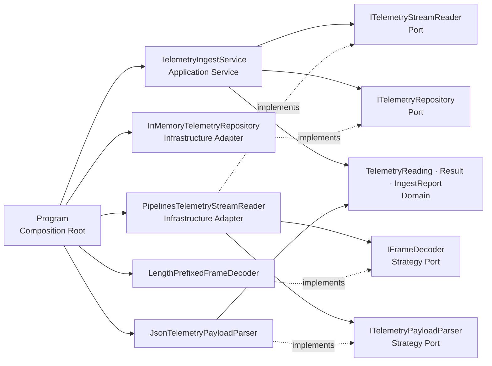
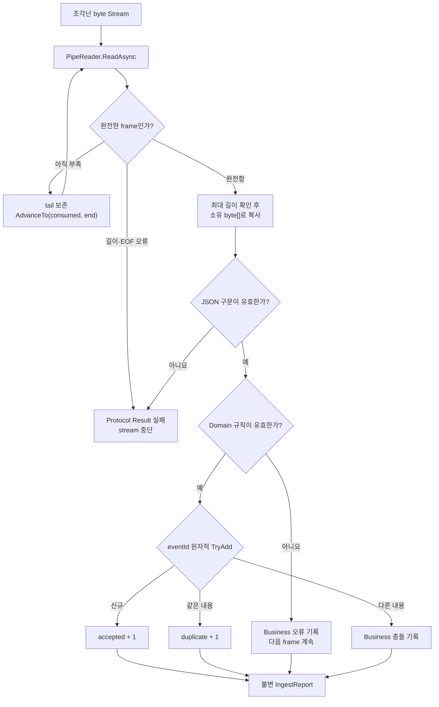

# 장치 텔레메트리 수신으로 배우는 .NET 10 `System.IO.Pipelines`

## 👣 초보자를 위한 코드 읽는 순서 (Reading order)

처음부터 모든 파일을 외우려 하지 마세요. **byte → frame → 값 → 저장 → 검증** 순서로 한 경계씩 따라가면 됩니다.

1. 이 README의 [오늘 만들 것과 한 줄 계약](#-오늘-만들-것과-한-줄-계약)에서 wire protocol 그림을 먼저 봅니다.
2. [`Program.cs`](./src/TelemetryStreamExercise/Program.cs)에서 demo byte를 만들고 객체를 조립하는 위치를 찾습니다.
3. [`ChunkedReadStream.cs`](./src/TelemetryStreamExercise/Infrastructure/ChunkedReadStream.cs)에서 한 메시지가 여러 `ReadAsync`로 잘리는 상황을 확인합니다.
4. [`LengthPrefixedFrameDecoder.cs`](./src/TelemetryStreamExercise/Infrastructure/Protocol/LengthPrefixedFrameDecoder.cs)에서 4-byte 길이 header와 payload를 원자적으로 읽는 규칙을 봅니다.
5. [`PipelinesTelemetryStreamReader.cs`](./src/TelemetryStreamExercise/Infrastructure/Protocol/PipelinesTelemetryStreamReader.cs)에서 `PipeReader`, `ReadOnlySequence<byte>`, `AdvanceTo`, `async iterator`의 수명 흐름을 따라갑니다.
6. [`JsonTelemetryPayloadParser.cs`](./src/TelemetryStreamExercise/Infrastructure/Protocol/JsonTelemetryPayloadParser.cs)와 [`TelemetryReading.cs`](./src/TelemetryStreamExercise/Domain/TelemetryReading.cs)에서 JSON 표현 검증과 업무 검증이 왜 분리되는지 봅니다.
7. [`TelemetryIngestService.cs`](./src/TelemetryStreamExercise/Application/TelemetryIngestService.cs)에서 protocol 오류는 중단하고 business 오류는 모은 뒤 계속 처리하는 use case를 읽습니다.
8. [`ITelemetryRepository.cs`](./src/TelemetryStreamExercise/Application/Ports/ITelemetryRepository.cs)와 [`InMemoryTelemetryRepository.cs`](./src/TelemetryStreamExercise/Infrastructure/InMemoryTelemetryRepository.cs)에서 Port, Adapter, 원자적 멱등 저장을 연결합니다.
9. [`SelfTestRunner.cs`](./src/TelemetryStreamExercise/SelfTesting/SelfTestRunner.cs)에서 부분 header, 부분 payload, 다중 frame, EOF, 크기 제한, JSON, 중복, 취소 계약을 확인합니다.
10. [`EXERCISES.md`](./EXERCISES.md)를 직접 풀고 [`CHECKPOINT.md`](./CHECKPOINT.md) 질문에 코드 없이 답해 봅니다.
11. 더 큰 화면에서는 [탐색형 아키텍처 HTML](./architecture.html)을 열어 계층과 데이터 흐름을 다시 연결합니다.

---

## 📌 빠른 탐색

| 유형 | 바로가기 |
| --- | --- |
| 🎯 목표와 계약 | [오늘 만들 것](#-오늘-만들-것과-한-줄-계약) |
| 🔤 언어 기초 | [Syntax와 Grammar](#-syntax와-grammar) |
| 📦 핵심 개념 | [Stream과 frame](#-stream에는-메시지-경계가-없습니다) |
| 🧵 Pipelines | [`PipeReader` 읽기 규칙](#-pipereader의-읽기-규칙) |
| 🏗️ 아키텍처 | [구조도](#️-아키텍처-시각화) |
| 🧠 설계 이유 | [Why](#-설계-선택의-이유-why) |
| 🗂️ 코드 지도 | [파일 지도](#️-파일-지도) |
| ▶️ 실행 | [실행 방법](#️-실행-방법) |
| ✅ 검증 | [Validation stage](#-validation-stage) |
| ✍️ 실습 | [Beginner to Pro](#️-beginner-to-pro-연습) |
| 📚 최신 정보 | [버전과 공식 출처](#-버전과-microsoft-공식-출처) |

---

## 🎯 오늘 만들 것과 한 줄 계약

장치가 보낸 여러 JSON 측정값을 하나의 byte stream으로 받아 안전하게 frame으로 나누고, 유효한 값만 멱등하게 저장하는 콘솔 애플리케이션을 만듭니다.

### Wire protocol

각 frame은 다음 두 부분으로 이루어집니다.

```text
┌─────────────────────────────── frame 1 ───────────────────────────────┐
│ 4-byte signed Int32, big-endian │ UTF-8 JSON payload                  │
│ 00 00 00 78  (= 120 bytes)     │ {"eventId":"evt-100", ... }        │
└─────────────────────────────────┴─────────────────────────────────────┘
┌─────────────────────────────── frame 2 ───────────────────────────────┐
│ 4-byte signed Int32, big-endian │ UTF-8 JSON payload                  │
└─────────────────────────────────┴─────────────────────────────────────┘
```

하지만 실제 `Stream.ReadAsync` 결과는 frame과 일치하지 않을 수 있습니다.

```text
read #1     read #2       read #3                 read #4
[00]        [00 00]       [78 { \" e v ...]       [...frame1][frame2 일부]
 \____________ 4-byte header ____________/          ↑ 여러 frame도 한 번에 가능
```

> **한 줄 계약:** `1..1,024` byte의 완전한 payload만 다음 계층에 넘기고, 부분 frame은 보존하며, 잘못된 길이·잘린 EOF·JSON 구문 오류는 protocol 실패로 중단하고, 정상 JSON의 업무 오류는 해당 frame만 거절한 뒤 계속 처리합니다.

### Demo에서 예상하는 결과

| 입력 | 처리 |
| --- | --- |
| `evt-100`, 서울 센서, 21.5℃ | 신규 저장 |
| `evt-101`, 부산 센서, 24.25℃ | 신규 저장 |
| `evt-100`의 같은 내용 재전송 | 안전한 중복으로 저장 생략 |
| `evt-102`, 500℃ | Domain 범위 오류로 거절하고 다음 처리 가능 |

최종 출력의 핵심은 `accepted=2`, `duplicate=1`, `rejected=1`, `stored=2`입니다. 작은 chunk를 반복 사용하므로 실제 read 횟수는 frame 수보다 훨씬 큽니다.

### 이 학습 예제의 명시적 전제

- header는 payload 길이를 나타내는 **4-byte signed Int32, network byte order(big-endian)** 입니다.
- payload 길이는 header를 제외한 UTF-8 byte 수이며 `1..1,024`만 허용합니다.
- payload 하나에는 JSON 객체 하나만 들어갑니다. 압축, 암호화, checksum, protocol version은 없습니다.
- `eventId`와 `deviceId`는 trim 후 비어 있지 않고 64자 이하여야 합니다.
- 온도는 학습 규칙으로 `-100..200`℃만 허용하며 `capturedAt`은 실제 offset 시각이어야 합니다.
- 같은 `eventId`와 같은 내용은 안전한 재전송, 같은 ID와 다른 내용은 충돌입니다.
- Repository는 process 안의 메모리 Adapter입니다. 재시작 내구성, 여러 process 사이의 원자성, 인증·권한은 제공하지 않습니다.
- length prefix 덕분에 malformed JSON 뒤의 frame 경계는 알 수 있지만, 이 예제는 한 sender/session의 wire 계약 위반 뒤 추가 side effect를 막는 **엄격한 fail-fast 정책**을 사용합니다.
- stream 처리는 transaction이 아닌 **증분 처리**입니다. protocol 오류 전에 저장한 정상 frame은 rollback하지 않으며, 전체 재시도 때 `eventId` 멱등성이 중복 저장을 막습니다.

작은 예제의 제한을 문서에 드러내야 운영 시스템의 보장으로 오해하지 않습니다.

---

## 🔤 Syntax와 Grammar

| 코드에서 만나는 문법 | 아주 짧은 뜻 | 이 예제에서 쓰는 이유 |
| --- | --- | --- |
| `byte`, `byte[]` | 0~255 정수 하나와 연속 byte 배열 | wire protocol 원본과 소유권이 있는 payload 표현 |
| `const int` | compile-time에 고정된 정수 | 4-byte header와 demo 최대 길이를 이름으로 표현 |
| `var` | 오른쪽 식으로 지역 변수의 **정적 형식**을 추론 | 형식이 분명한 `ReadResult`, `Result<T>`의 반복을 줄임 |
| `string?`, `Error?`, `T?` | 값이 없을 수 있음을 형식에 표시 | JSON 누락과 성공/실패 중 한쪽 값의 부재를 정직하게 표현 |
| `record` | 값 중심 equality를 제공하는 형식 | 같은 telemetry 재전송인지 전체 값으로 비교 |
| `enum` | 가능한 이름을 제한한 값 집합 | decode 상태와 저장 결과를 `bool`보다 구체적으로 표현 |
| generic `Result<T>` | 여러 형식에 같은 성공/실패 규칙 적용 | 입력 오류를 return type에 드러냄 |
| `where T : notnull` | generic 성공 값에 null을 허용하지 않는 제약 | 성공했지만 값이 없는 모순을 줄임 |
| `ref` parameter | 호출자의 변수를 method가 새 값으로 바꿀 수 있음 | frame 전체가 완성됐을 때만 원본 buffer 시작점을 commit |
| `Span<byte>` | 연속 memory 구간을 복사 없이 잠시 보는 값 | 작은 header를 읽고 big-endian 정수로 변환 |
| `ReadOnlyMemory<byte>` | 비동기 경계를 넘어 보관 가능한 읽기 전용 memory | 이 예제에서는 소유 `byte[]`를 감싸 `AdvanceTo` 뒤에도 안전한 payload 전달 |
| `ReadOnlySequence<byte>` | 여러 segment를 하나의 논리 sequence로 보는 값 | header와 payload가 memory 경계에 걸쳐도 처리 |
| `async` / `await` | thread를 붙잡지 않고 비동기 완료를 기다림 | stream read와 Repository 저장 대기 |
| `IAsyncEnumerable<T>` | 값이 준비될 때마다 비동기로 하나씩 생산하는 sequence | stream 전체를 한꺼번에 메모리에 올리지 않고 frame 전달 |
| `yield return` | iterator의 현재 값을 호출자에게 하나 전달 | frame마다 `Result<TelemetryReading>` 생산 |
| `await foreach` | async sequence를 비동기로 열거 | Application Service가 frame을 순서대로 처리 |
| `try` / `finally` | 성공·예외·취소와 무관하게 정리 코드 실행 | `PipeReader.CompleteAsync`로 buffer 자원 반환 |
| `switch` | 제한된 상태별 동작 선택 | 저장됨·중복·충돌 결과를 빠짐없이 처리 |
| collection expression `[]` | 목표 collection 형식에 맞춘 간결한 생성 문법 | self-test 실패 목록의 빈 초기값 |
| tuple `(Service, Repository)` | 이름 붙은 여러 값을 한 번에 묶음 | Composition Root가 service와 demo 관찰 대상을 함께 반환 |

### `var`는 `dynamic`이 아닙니다

```csharp
var readResult = await reader.ReadAsync(cancellationToken);
```

compiler는 `ReadAsync`의 반환 형식을 보고 `readResult`의 형식을 compile-time에 확정합니다. 이후 임의의 다른 형식 값을 넣을 수 없습니다. `var`는 형식을 없애는 문법이 아니라, 오른쪽에서 분명한 형식을 compiler가 대신 적는 문법입니다.

### `?`, `?.`, `!`는 서로 다릅니다

- `string?`는 문자열 또는 `null`이 올 수 있다는 계약입니다.
- `eventId?.Trim()`은 `eventId`가 null이면 `Trim`을 호출하지 않고 null을 만듭니다.
- `_value!`의 postfix `!`는 runtime 검사가 아닙니다. `Result<T>` 생성 불변식이 이미 안전하다는 근거로 compiler 경고만 억제합니다.

근거 없이 `!`를 붙이면 실제 null 오류를 숨기므로 사용 범위를 작게 유지해야 합니다.

### `record`가 자동으로 모든 것을 불변으로 만들지는 않습니다

`record`는 값 equality와 `with` 같은 편의 기능을 주지만, 변경 가능한 property나 `List<T>`를 넣으면 여전히 내부 상태가 바뀔 수 있습니다. 이 예제는 private 생성자, get-only property, `ImmutableArray<Error>` snapshot을 함께 사용합니다.

### `ref struct`와 비동기 경계

`SequenceReader<byte>`와 `Span<byte>`는 stack과 memory 안전 규칙이 강한 `ref struct`입니다. `await`를 넘어 살아 있을 수 없으므로 decoder는 **동기 method**로 두고, `PipeReader.ReadAsync`를 기다리는 역할과 분리합니다. 이 제약은 불편함이 아니라 buffer 수명을 실수로 늘리지 못하게 하는 안전장치입니다.

---

## 📦 Stream에는 메시지 경계가 없습니다

TCP, 파일, 압축 stream에서 한 번의 `ReadAsync`가 한 메시지를 반환한다고 가정하면 안 됩니다.

- header 4 byte가 `1 + 2 + 1` byte로 나뉠 수 있습니다.
- header는 왔지만 payload 일부만 올 수 있습니다.
- 한 번의 read에 frame 두 개와 세 번째 frame 일부가 함께 올 수 있습니다.
- EOF와 함께 마지막 완전한 frame이 올 수도 있습니다.

그래서 framing protocol이 필요합니다. 이 예제는 고정 4-byte 길이 header를 사용하고, decoder가 buffer 앞에서 **frame 하나만** 시도합니다.

### 원자적 decode: 완성됐을 때만 소비합니다

[`LengthPrefixedFrameDecoder.Decode`](./src/TelemetryStreamExercise/Infrastructure/Protocol/LengthPrefixedFrameDecoder.cs)는 로컬 `SequenceReader<byte>`로 header와 payload를 살펴봅니다.

```text
header 부족  → NeedMoreData, 원본 buffer 그대로
payload 부족 → NeedMoreData, 원본 buffer 그대로
길이 오류    → ProtocolError, 더 기다리지 않음
완전한 frame → payload 복사 후 원본 buffer를 다음 frame으로 이동
```

header만 읽었다고 원본 buffer를 먼저 이동하면 payload가 다음 read에 이어졌을 때 길이 정보를 잃습니다. “검사”와 “소비 commit”을 분리하는 것이 핵심입니다.

### 왜 길이를 먼저 제한하나요?

공격자가 header에 `2_000_000_000`을 기록할 수 있습니다. 검증 전에 배열을 만들거나 그 길이만큼 기다리면 메모리 고갈과 자원 고정 공격에 취약합니다.

1. 4 byte를 안전하게 읽습니다.
2. `0`, 음수, `1,024` 초과를 즉시 거절합니다.
3. 제한을 통과한 뒤에만 payload 완성을 기다리고 복사합니다.

크기 제한은 성능 최적화가 아니라 protocol 보안 계약입니다.

### `ReadOnlySequence<byte>`의 segment

`PipeReader`가 주는 buffer는 연속 배열 하나라는 보장이 없습니다.

```text
segment A       segment B          segment C
[00 00]         [00 78 { \"ev]     [entId\": ... }]
 \_____________________ 하나의 ReadOnlySequence _____________________/
```

`buffer.FirstSpan[..4]`처럼 첫 segment에 header가 전부 있다고 가정하면 깨집니다. `SequenceReader<byte>.TryCopyTo`는 segment 경계를 넘어 필요한 4 byte를 안전하게 모읍니다.

---

## 🧵 `PipeReader`의 읽기 규칙

[`PipelinesTelemetryStreamReader`](./src/TelemetryStreamExercise/Infrastructure/Protocol/PipelinesTelemetryStreamReader.cs)는 다음 lifecycle을 반복합니다.

1. `ReadAsync(cancellationToken)`으로 새 data를 기다립니다.
2. 받은 `ReadOnlySequence<byte>`에서 완전한 frame을 가능한 만큼 모두 꺼냅니다.
3. 각 payload를 JSON/Domain parser에 전달합니다.
4. `AdvanceTo(consumed, examined)`로 어디까지 소비하고 검사했는지 알립니다.
5. `IsCompleted`이면 마지막 buffer까지 처리한 뒤 종료합니다.
6. `finally`에서 `CompleteAsync`를 호출합니다.

### `consumed`와 `examined`

- `consumed`: 이 위치 전 byte는 다시 필요 없으므로 pool에 돌려줘도 됩니다.
- `examined`: 이 위치까지 확인했으므로 새 data가 오기 전에는 같은 buffer로 깨우지 않아도 됩니다.

부분 frame이 남았을 때는 `consumed = 남은 frame 시작`, `examined = 현재 buffer 끝`입니다. 시작까지 버리면 frame이 깨지고, 끝까지 보았다고 표시하지 않으면 같은 byte만 반복해서 보는 busy loop가 생길 수 있습니다.

### `AdvanceTo` 뒤의 buffer 수명

`ReadAsync`가 준 sequence는 `AdvanceTo` 뒤에 사용하면 안 됩니다. 그래서 decoder는 최대 길이를 검증한 다음 payload를 독립 `byte[]`로 복사하고 `ReadOnlyMemory<byte>`로 전달합니다. 이 복사는 비용이지만 소유권을 선명하게 만듭니다. 고성능 운영 코드에서는 pool과 명시적 lease를 검토할 수 있지만, 수명 계약도 함께 복잡해집니다.

### EOF는 먼저 data를 처리한 뒤 판단합니다

`IsCompleted == true`라도 `Buffer`가 비어 있다는 뜻은 아닙니다. 마지막 read에 완전한 frame이 함께 올 수 있으므로 먼저 decode합니다. 완전한 frame을 모두 처리한 뒤 남은 byte가 있으면 다음처럼 구분합니다.

- 1~3 byte 남음: `frame.truncated_header`
- 정상 header 뒤 payload 부족: `frame.truncated_payload`
- 아무것도 남지 않음: 정상 EOF

### 취소는 업무 오류가 아닙니다

`CancellationToken`은 호출자가 더 이상 결과를 원하지 않는다는 제어 신호입니다. `OperationCanceledException`을 `Result`로 바꾸지 않고 위로 전파해야 host, job runner, HTTP pipeline이 취소와 장애를 구분할 수 있습니다. `finally`의 정리는 취소 때도 실행됩니다.

---

## 🏗️ 아키텍처 시각화

### 계층과 compile-time 의존성

화살표는 “누가 누구를 안다”는 compile-time 의존 방향입니다. Infrastructure가 안쪽 계층의 Port를 구현합니다.



읽을 때는 세 문장을 확인하세요.

- Domain은 `PipeReader`, JSON serializer, `ConcurrentDictionary`를 모릅니다.
- Application Service는 구체 decoder와 메모리 Repository 이름을 모릅니다.
- Program만 어떤 구현을 연결할지 결정합니다.

### runtime 데이터와 실패 흐름



[탐색형 아키텍처 HTML](./architecture.html)은 검색·집중 보기·확대 기능을 제공합니다. 고정 Viewer UI는 영어로 표시되지만 diagram의 학습 내용은 한국어입니다. HTML은 보조 시각화이며 실행 코드의 진실은 `.cs` 파일과 self-test입니다.

---

## 🧠 설계 선택의 이유 (Why)

### Domain Model과 불변성

`TelemetryReading.Create`는 ID, 시각, 온도 범위를 검사한 뒤에만 객체를 만듭니다. 생성자는 private이고 property는 get-only입니다. 저장 뒤 값이 바뀌지 않으므로 같은 `eventId` 재전송의 내용 비교가 안정적입니다.

`record`의 값 equality를 사용하지만 불변성은 keyword 하나로 완성되지 않습니다. 변경 가능한 collection을 외부에 그대로 노출하지 않고 `IngestReport`가 `ImmutableArray<Error>` snapshot을 만드는 이유입니다.

### Nullable 안전성

JSON property는 누락될 수 있으므로 transport record의 `EventId`와 `DeviceId`는 `string?`입니다. 이를 빈 문자열로 꾸미거나 postfix `!`로 덮지 않고 Domain factory가 명시적으로 거절합니다. `<Nullable>enable</Nullable>`은 “null을 생각하지 않은 접근”을 compiler warning으로 알려 줍니다.

### Result, 예외, 취소의 경계

| 상황 | 표현 | 이유 |
| --- | --- | --- |
| malformed JSON, 0/음수/초대형 길이, 잘린 EOF | `Result`의 `Protocol` 오류 | 외부 입력이 wire 계약을 깬 예상 가능한 실패 |
| 빈 ID, 범위 밖 온도, idempotency 충돌 | `Result`/report의 `Business` 오류 | frame은 읽었지만 업무 규칙을 통과하지 못함 |
| 취소 요청 | `OperationCanceledException` 전파 | 업무 실패가 아닌 호출자의 제어 흐름 |
| 성공 Result에서 `Error` 읽기, 알 수 없는 enum | 예외 | 프로그램 작성자가 API 계약을 어긴 bug |
| 예상하지 못한 serializer/Repository 장애 | 예외 전파 | 무차별 catch로 실제 운영 장애를 숨기지 않음 |

모든 실패를 예외로 만들면 정상 입력 거절과 장애가 섞입니다. 반대로 모든 예외를 Result로 바꾸면 cancellation과 programmer bug를 숨깁니다.

malformed JSON도 이미 길이 prefix를 읽었으므로 **다음 frame의 물리적 경계는 압니다**. 여기서 중단하는 이유는 경계를 잃어서가 아니라, 같은 sender/session의 wire 계약을 더 이상 신뢰하지 않고 추가 저장을 막겠다는 의도적인 fail-fast 정책입니다. frame 단위 격리를 우선하는 시스템이라면 이 정책을 바꿔 다음 frame을 계속 처리할 수 있습니다.

### Application Service

`TelemetryIngestService`는 다음 use case 순서만 조율합니다.

1. stream reader Port에서 frame 결과를 비동기로 받습니다.
2. protocol 오류면 전체 stream을 중단합니다.
3. business 오류면 기록하고 다음 frame을 계속합니다.
4. 유효한 값은 Repository Port에 멱등 저장합니다.
5. 신규·중복·충돌을 결정적으로 집계해 불변 report를 만듭니다.

byte parsing, JSON 세부 설정, 저장 collection을 직접 다루지 않으므로 책임과 테스트 실패 원인이 선명합니다.

이 service는 stream 전체 transaction을 열지 않습니다. 앞선 정상 frame을 저장한 뒤 protocol 오류가 오면 실패 `Result`를 반환하지만 기존 저장은 유지됩니다. 호출자는 전체 stream을 다시 보낼 수 있고, Repository의 `eventId` 멱등성이 이미 저장한 frame을 duplicate로 처리합니다. “실패면 전부 rollback”이 필요한 업무라면 staging table과 transaction/checkpoint를 별도로 설계해야 합니다.

### Repository Port와 Adapter

Application은 `ITelemetryRepository`만 압니다. 오늘은 `ConcurrentDictionary` Adapter지만 SQL unique constraint, Redis, cloud database로 바꿔도 use case 코드는 저장 기술 이름을 알 필요가 없습니다. 이것이 의존성 역전 원칙(DIP)의 작은 예입니다.

`ContainsKey` 뒤 `Add`처럼 두 단계로 처리하면 동시 요청 사이에 race가 생깁니다. `TryAdd` 한 번으로 “없으면 추가”를 원자적으로 시도합니다. 단, 이 보장은 현재 process 안에서만 유효합니다.

### Strategy와 단일 책임

- `IFrameDecoder`: byte에서 frame 경계를 찾는 규칙
- `ITelemetryPayloadParser`: frame payload를 Domain 값으로 바꾸는 규칙
- `ITelemetryStreamReader`: transport lifecycle과 비동기 생산 규칙

이들을 나누면 length-prefixed binary 대신 newline framing을 쓰거나 JSON 대신 다른 payload를 쓸 때 Application Service를 고치지 않고 구현을 교체할 수 있습니다. OCP와 SRP를 무리 없이 연습하는 지점입니다.

### DI와 Composition Root

DI는 framework 이름이 아니라 “필요한 협력자를 class 안에서 직접 만들지 않고 밖에서 넣는 방식”입니다. `Program.BuildApplication`이 decoder → parser → stream reader → Repository → service 순으로 조립합니다. 테스트는 같은 생성자에 실패를 만드는 fake를 넣을 수 있습니다.

### `PipeReader`를 Infrastructure에 가둔 이유

`System.IO.Pipelines`는 강력하지만 buffer 수명과 cursor 규칙을 동반합니다. 이를 Domain과 Application 전체에 노출하면 모든 계층이 `AdvanceTo`를 알아야 합니다. Adapter 안에서 소유권을 끝내고 `Result<TelemetryReading>`만 내보내면 안쪽 코드는 업무 언어로 읽힙니다.

### protocol 오류와 business 오류를 다르게 처리하는 이유

길이가 잘못되면 다음 frame 시작점도 신뢰할 수 없으므로 stream을 계속 읽을 수 없습니다. malformed JSON은 다음 frame 경계는 알지만 이 예제의 엄격한 session 정책 때문에 중단합니다. 반면 500℃라는 값은 wire 계약을 읽었고 해당 측정값만 업무 규칙을 어겼으므로 오류를 기록하고 다음 frame을 처리합니다. 실패 분류와 정책은 UI 문구가 아니라 **복구 전략**을 결정합니다.

### 테스트 용이성

`ChunkedReadStream`은 운영 network 없이 header와 payload가 임의로 잘리는 상황을 결정적으로 재현합니다. 현재 시각, 외부 DB, 실제 socket에 의존하지 않으므로 self-test는 빠르고 반복 가능합니다. 크기·EOF·segment·중복·취소 경계는 행복 경로보다 먼저 깨지기 쉬운 계약입니다.

### 운영으로 옮길 때 추가할 것

- protocol version, content type, checksum 또는 인증된 암호화
- 연결별·tenant별 frame 크기와 처리량 제한, idle timeout
- strict UTF-8 정책과 JSON 최대 깊이
- persistent unique constraint 또는 compare-and-set
- retry, dead-letter, checkpoint와 재시작 의미
- metric: accepted/duplicate/rejected/protocol-error, frame byte histogram
- 낮은 카디널리티 log와 개인정보·device ID 보호
- pooled ownership을 쓸 경우 명시적 lease/dispose 계약

---

## 🗂️ 파일 지도

> 모든 링크는 이 README 기준 상대 경로이며, 폴더 링크에는 trailing slash를 붙였습니다.

| 유형 | 문서 / 폴더 | 설명 |
| --- | --- | --- |
| 📘 시작 문서 | [`README.md`](./README.md) | 개념, 구조도, 실행·검증 순서 |
| ✍️ 실습 | [`EXERCISES.md`](./EXERCISES.md) | Beginner부터 Pro+까지 직접 바꾸는 과제 |
| ✅ 이해도 | [`CHECKPOINT.md`](./CHECKPOINT.md) | 답을 가리고 설명하는 질문과 해설 |
| 🏗️ 시각화 | [`architecture.html`](./architecture.html) | 탐색 가능한 아키텍처 Viewer |
| 🏗️ 시각화 원본 | [`architecture.json`](./architecture.json) | Archify가 검증한 구조도 specification |
| 🧰 SDK | [`global.json`](./global.json) | 안정 SDK 10.0.301과 patch roll-forward 고정 |
| 🧩 Solution | [`TelemetryStreamExercise.slnx`](./TelemetryStreamExercise.slnx) | 실행 프로젝트 진입점 |
| 🚀 Composition Root | [`Program.cs`](./src/TelemetryStreamExercise/Program.cs) | demo, mode 선택, 구체 구현 조립 |
| 🧠 Domain | [`Domain/`](./src/TelemetryStreamExercise/Domain/) | `TelemetryReading`, `Result`, 오류와 report |
| 🎯 Application | [`Application/`](./src/TelemetryStreamExercise/Application/) | 수집 use case와 Port 계약 |
| 🔌 Ports | [`Application/Ports/`](./src/TelemetryStreamExercise/Application/Ports/) | frame, payload, stream, Repository 추상화 |
| 🧱 Infrastructure | [`Infrastructure/`](./src/TelemetryStreamExercise/Infrastructure/) | 작은 chunk Stream과 메모리 Repository Adapter |
| 📦 Protocol | [`Infrastructure/Protocol/`](./src/TelemetryStreamExercise/Infrastructure/Protocol/) | framing, JSON parsing, PipeReader lifecycle |
| 🧪 Self-test | [`SelfTesting/`](./src/TelemetryStreamExercise/SelfTesting/) | 경계값·실패·취소 자동 검사 |
| ⚙️ Project | [`TelemetryStreamExercise.csproj`](./src/TelemetryStreamExercise/TelemetryStreamExercise.csproj) | `net10.0`, C# 14, nullable, warnings-as-errors |

---

## ▶️ 실행 방법

PowerShell에서 이 날짜 폴더로 이동한 뒤 실행합니다.

```powershell
cd dailyStudy/exercise/20261026
dotnet --version
dotnet restore .\TelemetryStreamExercise.slnx
dotnet build .\TelemetryStreamExercise.slnx -c Release --no-restore
dotnet run --project .\src\TelemetryStreamExercise\TelemetryStreamExercise.csproj -c Release --no-build -- --demo
dotnet run --project .\src\TelemetryStreamExercise\TelemetryStreamExercise.csproj -c Release --no-build -- --self-test
dotnet format .\TelemetryStreamExercise.slnx --verify-no-changes --no-restore
```

이 저장소에서 검증한 local stable SDK는 `10.0.301`, runtime은 `10.0.9`입니다. `global.json`은 `10.0.301`을 기준으로 같은 feature band의 최신 patch로만 roll forward합니다.

---

## ✅ Validation stage

초보자는 “실행됐다”에서 멈추지 말고 아래 순서로 이해를 검증하세요.

### 1단계 — 실행 결과 예측

코드를 실행하기 전에 종이에 적어 봅니다.

- 왜 네 frame인데 저장 수는 두 개인가?
- 중복과 충돌은 어떻게 다른가?
- 500℃ frame 뒤의 frame은 처리할 수 있는가?
- header가 3 byte만 온 상태는 오류인가, 대기인가?

### 2단계 — breakpoint로 buffer 관찰

`LengthPrefixedFrameDecoder.Decode` 첫 줄과 `reader.AdvanceTo` 줄에 breakpoint를 둡니다.

- `buffer.Length`가 header보다 작은 경우
- header는 있지만 payload가 작은 경우
- frame 하나를 소비한 뒤 남은 `buffer.Length`
- EOF에서 남은 byte 수

### 3단계 — 한 줄씩 바꿔 실패 만들기

- 최대 길이를 `32`로 낮춥니다.
- encoder가 쓰는 endian을 little-endian으로 바꿉니다.
- `AdvanceTo(buffer.Start, buffer.End)`를 잘못 바꾸기 전 어떤 문제가 생길지 먼저 말합니다.
- 온도 범위를 `-50..100`으로 바꾸고 self-test가 어디서 깨지는지 봅니다.

실험 뒤에는 반드시 원래 코드로 되돌립니다.

### 4단계 — 자동 검증

`--self-test`가 다음 범주를 모두 통과하는지 확인합니다.

- Domain과 Result 불변식
- 부분 header·부분 payload 복구
- 한 buffer의 여러 frame
- 0·음수·최대 초과 길이 즉시 거절
- 잘린 header·payload EOF
- malformed JSON, 알 수 없거나 중복된 property
- protocol 오류 전 저장 유지와 전체 stream 멱등 재시도
- business 오류 뒤 계속 처리
- 안전한 중복과 ID 충돌
- cancellation 전파와 resource 정리

### 5단계 — 말로 설명

[`CHECKPOINT.md`](./CHECKPOINT.md)의 답을 가린 채 다음을 2분 안에 설명합니다.

1. 왜 Stream read 횟수와 message 개수는 같지 않은가?
2. 왜 완전한 payload 전에는 원본 buffer를 소비하면 안 되는가?
3. `consumed`와 `examined`는 무엇이 다른가?
4. 왜 protocol 오류는 중단하고 business 오류는 계속하는가?
5. 왜 Repository와 decoder를 interface 뒤에 두는가?

---

## ✍️ Beginner to Pro 연습

자세한 단계와 완료 기준은 [`EXERCISES.md`](./EXERCISES.md)에 있습니다.

| 단계 | 연습 | 핵심 |
| --- | --- | --- |
| Beginner | demo 값과 chunk 계획 바꾸기 | 변수, 배열, 반복, 결과 예측 |
| Beginner+ | ID·온도 validation 추가 | 조건문, nullable, Result |
| Intermediate | exact maximum과 여러 frame 검사 | 경계값, byte 길이 |
| Intermediate+ | CRC32 checksum field 설계 | framing version, 무결성 |
| Advanced | newline decoder Strategy 추가 | OCP, Strategy, 교체 가능성 |
| Advanced | strict UTF-8 정책 추가 | 표현 계층과 protocol 오류 |
| Pro | persistent Repository Adapter 설계 | unique constraint, transaction, idempotency |
| Pro | backpressure·metric 설계 | 자원 상한, 관측 가능성 |
| Pro+ | pooled payload ownership 설계 | 성능과 수명 안전성의 trade-off |

---

## 📚 버전과 Microsoft 공식 출처

2026-10-26(Asia/Seoul)에 코드 작성 전에 Microsoft 공식 문서와 .NET Blog를 확인했습니다.

| 구분 | 확인한 상태 | 이 자료의 선택 |
| --- | --- | --- |
| 최신 Stable | .NET 10 LTS runtime `10.0.13`, 대표 SDK `10.0.402`, C# 14 — 2026-10-13 공개 | 설치된 stable SDK `10.0.301`로 `net10.0` / C# 14 빌드 |
| 최신 Preview/RC | .NET 11 RC2 runtime `11.0.0-rc.2.26504.105`, SDK `11.0.100-rc.2.26504.105` — 2026-10-13 공개 | 실행 코드에 포함하지 않고 설명만 제공 |
| 최신 C# Preview | C# 15 Preview 문서 공개, .NET 11 prerelease SDK 필요 | preview syntax는 예제에 넣지 않음 |

> 다운로드 페이지의 .NET 11 RC2 “Language support” 표는 C# 14를 표시하지만, C# 15 문서는 .NET 11 preview SDK에서 C# 15 preview 기능을 시험하도록 안내합니다. 이 자료는 그 차이에 기대지 않고 안정 C# 14만 사용합니다.

### 공식 링크

> - [.NET 10 다운로드 — runtime 10.0.13 / SDK 10.0.402](https://dotnet.microsoft.com/en-us/download/dotnet/10.0)
> - [.NET 지원 정책과 LTS 수명](https://dotnet.microsoft.com/en-us/platform/support/policy/dotnet-core)
> - [C# 14의 새로운 기능](https://learn.microsoft.com/en-us/dotnet/csharp/whats-new/csharp-14)
> - [C# 언어 버전 구성](https://learn.microsoft.com/en-us/dotnet/csharp/language-reference/configure-language-version)
> - [System.IO.Pipelines 안내](https://learn.microsoft.com/en-us/dotnet/standard/io/pipelines)
> - [System.Buffers와 `ReadOnlySequence<T>`](https://learn.microsoft.com/en-us/dotnet/standard/io/buffers)
> - [`PipeReader` API](https://learn.microsoft.com/en-us/dotnet/api/system.io.pipelines.pipereader?view=net-10.0)
> - [`PipeReader.AdvanceTo` API](https://learn.microsoft.com/en-us/dotnet/api/system.io.pipelines.pipereader.advanceto?view=net-10.0)
> - [`SequenceReader<T>` API](https://learn.microsoft.com/en-us/dotnet/api/system.buffers.sequencereader-1?view=net-10.0)
> - [`BinaryPrimitives.ReadInt32BigEndian` API](https://learn.microsoft.com/en-us/dotnet/api/system.buffers.binary.binaryprimitives.readint32bigendian?view=net-10.0)
> - [UTF-8 JSON 역직렬화](https://learn.microsoft.com/en-us/dotnet/standard/serialization/system-text-json/deserialization)
> - [`ConcurrentDictionary<TKey,TValue>.TryAdd`](https://learn.microsoft.com/en-us/dotnet/api/system.collections.concurrent.concurrentdictionary-2.tryadd?view=net-10.0)
> - [.NET 11 RC2 발표](https://devblogs.microsoft.com/dotnet/dotnet-11-rc-2/)
> - [.NET 11 RC2 다운로드](https://dotnet.microsoft.com/en-us/download/dotnet/11.0)
> - [C# 15 Preview의 새로운 기능](https://learn.microsoft.com/en-us/dotnet/csharp/whats-new/csharp-15)

### Preview는 어떻게 다루나요?

C# 15의 union types, closed hierarchies, extension indexers 등은 흥미롭지만 현재 설치된 stable SDK로 이 자료를 그대로 빌드할 수 있어야 합니다. 따라서 Preview 코드는 README 설명에만 두고 실행 프로젝트의 `<LangVersion>`은 `14.0`으로 고정했습니다. 학습용 branch에서 시험하더라도 production code와 project를 분리하세요.

---

## 🔁 간결한 복습 체크리스트

- [ ] Stream에는 message 경계가 없다고 설명할 수 있다.
- [ ] 4-byte big-endian header가 뜻하는 값을 손으로 읽을 수 있다.
- [ ] 부분 header/payload에서 원본 buffer를 보존해야 하는 이유를 안다.
- [ ] `ReadOnlySequence<byte>`가 여러 segment일 수 있음을 안다.
- [ ] `AdvanceTo(consumed, examined)` 두 위치의 차이를 설명할 수 있다.
- [ ] `AdvanceTo` 뒤 이전 buffer를 보관하면 안 되는 이유를 안다.
- [ ] 최대 frame 길이를 할당 전에 검사한다.
- [ ] 마지막 `IsCompleted` buffer도 먼저 처리한다.
- [ ] protocol 오류와 business 오류의 복구 전략을 구분한다.
- [ ] malformed JSON 뒤 중단은 경계 유실이 아닌 명시적 fail-fast 정책임을 설명한다.
- [ ] protocol 오류 전 저장은 유지되며 전체 재시도는 멱등해야 함을 안다.
- [ ] nullable과 불변 Domain factory가 막는 잘못된 상태를 설명할 수 있다.
- [ ] Result, 예외, cancellation을 같은 것으로 취급하지 않는다.
- [ ] Repository Port와 Adapter의 차이를 설명할 수 있다.
- [ ] Strategy, DI, Composition Root가 테스트를 쉽게 만드는 이유를 안다.
- [ ] `TryAdd`가 `ContainsKey` + `Add`보다 안전한 이유를 안다.
- [ ] demo, self-test, Release build, format 검증을 직접 실행했다.
