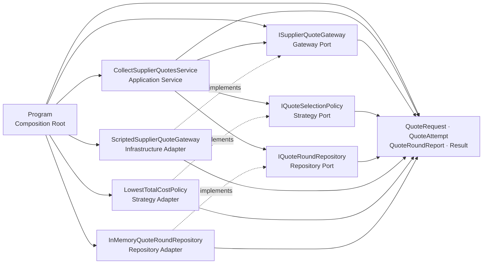
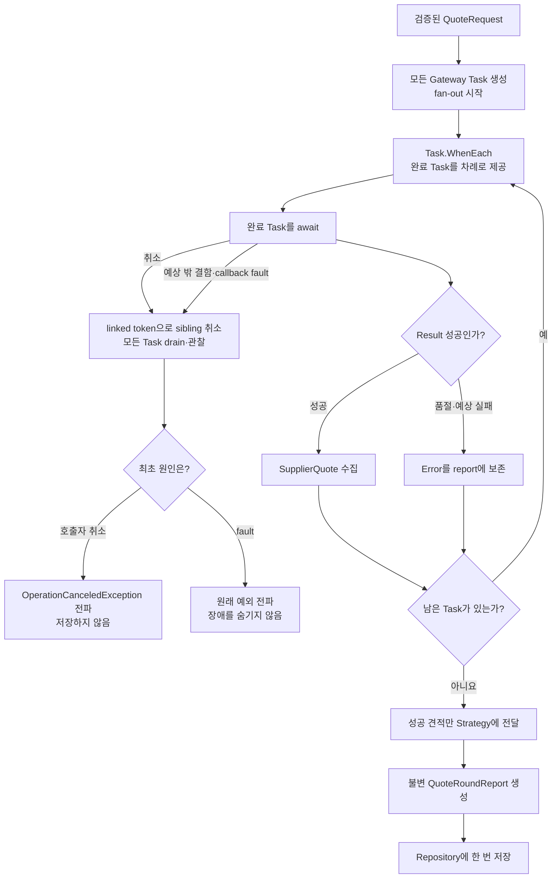

# 공급업체 견적 집계로 배우는 `Task.WhenEach`와 부분 실패

여러 공급업체에 견적을 **동시에** 요청하고, 입력 순서가 아니라 **완료된 순서**대로 진행 상황을 처리하는 실행 가능한 .NET 10 콘솔 실습입니다. 빠른 성공, 예상 가능한 품절, 느리지만 더 저렴한 성공을 한 회차에 모으면서 C# 기초 문법부터 `Result`, Application Service, Gateway/Repository, Strategy, DI까지 단계적으로 연결합니다.

## 1. 코드 읽는 순서

처음부터 모든 파일을 이해하려 하지 말고 아래 순서로 한 번 실행한 뒤 다시 코드를 읽으세요.

1. [`Program.cs`](./src/SupplierQuoteExercise/Program.cs) — 세 공급업체와 요청을 만들고 객체를 조립하는 시작점입니다. 먼저 demo 입력과 예상 출력만 따라갑니다.
2. [`QuoteRequest.cs`](./src/SupplierQuoteExercise/Domain/QuoteRequest.cs), [`SupplierQuote.cs`](./src/SupplierQuoteExercise/Domain/SupplierQuote.cs) — 외부 값을 검증한 뒤에만 불변 객체를 만드는 Domain factory를 읽습니다.
3. [`Result.cs`](./src/SupplierQuoteExercise/Domain/Result.cs), [`Error.cs`](./src/SupplierQuoteExercise/Domain/Error.cs), [`QuoteAttempt.cs`](./src/SupplierQuoteExercise/Domain/QuoteAttempt.cs) — 성공과 예상 가능한 실패를 값으로 표현하는 방법을 확인합니다.
4. [`ISupplierQuoteGateway.cs`](./src/SupplierQuoteExercise/Application/Ports/ISupplierQuoteGateway.cs), [`IQuoteSelectionPolicy.cs`](./src/SupplierQuoteExercise/Application/Ports/IQuoteSelectionPolicy.cs), [`IQuoteRoundRepository.cs`](./src/SupplierQuoteExercise/Application/Ports/IQuoteRoundRepository.cs) — Application이 구체 기술 대신 어떤 계약에 의존하는지 봅니다.
5. [`CollectSupplierQuotesService.cs`](./src/SupplierQuoteExercise/Application/CollectSupplierQuotesService.cs) — 오늘의 핵심입니다. 모든 `Task`를 먼저 시작하고 `Task.WhenEach`로 완료 순서대로 소비하는 흐름을 천천히 읽습니다.
6. [`ScriptedSupplierQuoteGateway.cs`](./src/SupplierQuoteExercise/Infrastructure/ScriptedSupplierQuoteGateway.cs), [`LowestTotalCostPolicy.cs`](./src/SupplierQuoteExercise/Infrastructure/LowestTotalCostPolicy.cs), [`InMemoryQuoteRoundRepository.cs`](./src/SupplierQuoteExercise/Infrastructure/InMemoryQuoteRoundRepository.cs) — Port를 구현하는 교체 가능한 Adapter와 Strategy를 확인합니다.
7. [`QuoteRoundReport.cs`](./src/SupplierQuoteExercise/Domain/QuoteRoundReport.cs) — 완료 순서, 성공·실패, 최종 선택을 불변 snapshot으로 보관하는 이유를 읽습니다.
8. [`SelfTestRunner.cs`](./src/SupplierQuoteExercise/SelfTesting/SelfTestRunner.cs) — 동시 시작, 완료 순서, 부분 실패, 취소와 예외 경계가 실제로 검증되는지 확인합니다.
9. [`EXERCISES.md`](./EXERCISES.md) → [`CHECKPOINT.md`](./CHECKPOINT.md) — 코드를 직접 바꾼 뒤 말로 설명하며 이해도를 검증합니다.

> 첫 학습에서는 `Program.cs` → `CollectSupplierQuotesService.cs` → `--demo` 실행까지만 끝내도 충분합니다. 두 번째 회독에서 Domain과 Port를 연결하세요.

---

## 2. 빠른 탐색

| 유형 | 바로가기 |
| --- | --- |
| 🎯 목표와 실행 환경 | [학습 목표](#3-학습-목표), [버전과 공식 근거](#4-버전과-공식-근거) |
| 🔤 언어 기초 | [Syntax와 Grammar](#5-syntax와-grammar) |
| ⚡ 핵심 비동기 흐름 | [`Task.WhenEach` 이해](#6-taskwheneach-이해), [`WhenAll`과 비교](#taskwheneach와-taskwhenall은-무엇이-다른가) |
| 🏗️ 아키텍처 | [구조도](#7-아키텍처-시각화), [설계 이유](#8-설계-선택의-이유-why) |
| ▶️ 실행 | [빌드와 실행](#9-빌드와-실행) |
| 🧪 학습 검증 | [Validation stage](#10-validation-stage), [연습문제](./EXERCISES.md), [이해도 검증](./CHECKPOINT.md) |
| 🚧 운영 관점 | [예제의 범위와 운영 확장](#11-예제의-범위와-운영-확장) |
| ✅ 복습 | [복습 체크리스트](#12-복습-체크리스트) |

### 소스 네비게이션

| 구역 | 파일 | 역할 |
| --- | --- | --- |
| 진입점 | [`Program.cs`](./src/SupplierQuoteExercise/Program.cs) | demo/self-test 선택, Adapter 조립, 진행 출력 |
| Domain | [`QuoteRequest.cs`](./src/SupplierQuoteExercise/Domain/QuoteRequest.cs) | SKU·수량 요청 검증과 정규화 |
| Domain | [`SupplierQuote.cs`](./src/SupplierQuoteExercise/Domain/SupplierQuote.cs) | 단가·납기 견적과 총액 계산 |
| Domain | [`Result.cs`](./src/SupplierQuoteExercise/Domain/Result.cs), [`Error.cs`](./src/SupplierQuoteExercise/Domain/Error.cs), [`ErrorKind.cs`](./src/SupplierQuoteExercise/Domain/ErrorKind.cs) | 성공/예상 실패의 명시적 계약 |
| Domain | [`QuoteAttempt.cs`](./src/SupplierQuoteExercise/Domain/QuoteAttempt.cs), [`QuoteRoundReport.cs`](./src/SupplierQuoteExercise/Domain/QuoteRoundReport.cs) | 완료 한 건과 회차 결과의 불변 snapshot |
| Application | [`CollectSupplierQuotesService.cs`](./src/SupplierQuoteExercise/Application/CollectSupplierQuotesService.cs) | fan-out, 완료 순서 소비, 선택, 저장 조율 |
| Port | [`Application/Ports/`](./src/SupplierQuoteExercise/Application/Ports/) | Gateway·Strategy·Repository 추상화 |
| Infrastructure | [`ScriptedSupplierQuoteGateway.cs`](./src/SupplierQuoteExercise/Infrastructure/ScriptedSupplierQuoteGateway.cs) | 지연과 성공/실패를 재현하는 학습용 외부 Adapter |
| Infrastructure | [`LowestTotalCostPolicy.cs`](./src/SupplierQuoteExercise/Infrastructure/LowestTotalCostPolicy.cs) | 납기 내 최저 총액을 고르는 Strategy |
| Infrastructure | [`InMemoryQuoteRoundRepository.cs`](./src/SupplierQuoteExercise/Infrastructure/InMemoryQuoteRoundRepository.cs) | process 메모리 저장 Adapter |
| 검증 | [`SelfTesting/`](./src/SupplierQuoteExercise/SelfTesting/) | package 없이 실행하는 결정적 self-test |
| 시각화 | [`architecture.html`](./architecture.html), [`architecture.json`](./architecture.json) | 검색·확대 가능한 구조도와 원본 명세 |

---

## 3. 학습 목표

완료 후 다음을 코드 위치와 함께 설명할 수 있어야 합니다.

- 변수, 기본 형식, `if`, `foreach`, collection, method, class와 interface의 역할을 구분합니다.
- `var`, nullable `?`, null 조건부 `?.`, `record`, generic `Result<T>`, lambda, LINQ를 읽습니다.
- `async` / `await`, `Task<T>`, `IAsyncEnumerable<T>`, `await foreach`가 서로 어떻게 이어지는지 설명합니다.
- 모든 공급업체 `Task`를 먼저 시작해야 진짜 fan-out이 되는 이유를 설명합니다.
- `Task.WhenEach`가 반환하는 **완료된 Task**를 한 번 더 `await`하는 이유를 설명합니다.
- 공급업체 품절은 `Result`에 남기고, 취소와 예상 밖 예외는 위로 전파하는 경계를 구분합니다.
- Domain Model, Application Service, Gateway/Repository Port와 Adapter, Strategy, DI, Composition Root를 작은 코드에서 찾습니다.
- 완료 순서와 최종 업무 정렬이 서로 다른 개념임을 설명합니다.

---

## 4. 버전과 공식 근거

확인 기준일은 **2026-10-27 (Asia/Seoul)** 입니다.

| 구분 | 오늘 확인한 상태 | 이 자료의 선택 |
| --- | --- | --- |
| 최신 Stable | .NET **10.0.14** LTS, SDK **10.0.403**, C# **14** | Stable API만 사용 |
| 이 PC의 검증 환경 | SDK **10.0.301**, runtime **10.0.9** | `global.json`으로 Stable SDK 계열 사용, `net10.0` / C# 14 빌드 |
| Preview | .NET **11.0.0-rc.3**, SDK **11.0.100-rc.3**, C# **15** | 설명만 제공하고 Preview 문법은 코드에 넣지 않음 |
| 핵심 API | `Task.WhenEach`는 .NET 9부터 제공되고 .NET 10에서 Stable 사용 가능 | 설치된 .NET 10 SDK로 직접 컴파일·실행 |

공식 문서:

- [.NET 10 다운로드와 최신 Stable 버전](https://dotnet.microsoft.com/en-us/download/dotnet/10.0)
- [.NET 11 다운로드와 RC 상태](https://dotnet.microsoft.com/en-us/download/dotnet/11.0)
- [C# 14의 새로운 기능](https://learn.microsoft.com/en-us/dotnet/csharp/whats-new/csharp-14)
- [C# 15의 새로운 기능](https://learn.microsoft.com/en-us/dotnet/csharp/whats-new/csharp-15)
- [`Task.WhenEach` API](https://learn.microsoft.com/en-us/dotnet/api/system.threading.tasks.task.wheneach?view=net-10.0)
- [비동기 stream 생성과 소비](https://learn.microsoft.com/en-us/dotnet/csharp/asynchronous-programming/generate-consume-asynchronous-stream)

> RC는 최신 Stable보다 번호가 높아도 아직 정식 일반 공급(GA) 버전이 아닙니다. 오늘 코드는 Preview SDK 없이 전부 빌드됩니다.

---

## 5. Syntax와 Grammar

| 코드에서 만나는 문법 | 쉬운 뜻 | 이 예제에서 쓰는 이유 |
| --- | --- | --- |
| `string`, `int`, `decimal`, `bool` | 문자열, 정수, 십진수, 참/거짓 | SKU·수량·금액·분기 표현 |
| `DateOnly` | 시간대 없는 달력 날짜 | 구매 요청의 납기일 비교 |
| `var` | 오른쪽 식으로 **정적 형식**을 compile-time에 추론 | 형식이 명확한 지역 변수의 반복을 줄임 |
| `if` / 삼항 연산자 | 조건에 따라 실행 또는 값 선택 | 성공/실패 출력과 exit code 결정 |
| `foreach` / `await foreach` | 동기 collection / async sequence를 한 항목씩 방문 | 저장된 결과 출력 / 완료 Task 소비 |
| collection expression `[]` | 목표 형식에 맞춰 collection 생성 | demo Gateway 목록과 빈 테스트 목록 |
| `record` | 속성 값 중심 equality를 제공하는 형식 | Error와 완료 결과를 값처럼 비교 |
| `T?` | 값이 없을 수 있음을 형식에 표시 | callback과 선택 견적의 부재 표현 |
| `?.` | 왼쪽이 null이 아니면 멤버를 호출 | 선택적 완료 callback을 안전하게 호출 |
| `?? throw` | null이면 즉시 예외 발생 | 잘못 조립된 필수 의존성을 생성 시점에 거절 |
| generic `Result<T>` | 여러 성공 값 형식에 같은 실패 규칙 재사용 | 입력·공급업체 실패를 반환 형식에 표시 |
| lambda `x => ...` | 짧은 이름 없는 함수 값 | Gateway별 Task 생성, 필터·정렬, 완료 callback |
| LINQ | collection 변환을 연산 체인으로 표현 | 성공 견적 필터와 결정적 정책 정렬 |
| `async` / `await` | 기다리는 동안 thread를 붙잡지 않고 완료 뒤 계속 | 외부 I/O 지연과 결과 소비 |
| `Task<T>` | 나중에 `T`, 예외, 취소로 완료될 작업 | 공급업체 한 곳의 비동기 호출 표현 |
| `IAsyncEnumerable<T>` | 값이 준비될 때마다 비동기로 내보내는 sequence | `Task.WhenEach`의 완료 Task stream 표현 |
| pattern `is null`, `is < 1 or > 10_000` | 값 모양이나 범위를 읽기 쉽게 검사 | nullable·수량 경계 검증 |
| tuple `(Service, Repository)` | 이름 붙은 여러 값을 한 묶음으로 반환 | 조립한 service와 demo 관찰 대상을 함께 전달 |

### `var`는 `dynamic`이 아닙니다

```csharp
var pendingTasks = _gateways
    .Select(gateway => RequestOneAsync(gateway, request, siblingCancellation.Token))
    .ToArray();
```

compiler는 오른쪽 식을 보고 `pendingTasks`가 `Task<QuoteAttempt>[]`임을 compile-time에 확정합니다. `var`는 형식을 없애지 않으며, 이후 다른 형식 값을 넣을 수 없습니다. `siblingCancellation.Token`은 호출자 취소와 내부 첫 결함을 연결한 token이라, 한 작업이 비정상 종료되면 아직 대기 중인 형제 작업도 정리할 수 있습니다.

### `record`와 불변성은 같은 말이 아닙니다

`record`는 값 equality를 편하게 만들지만 변경 가능한 `List<T>`를 그대로 노출하면 내용은 바뀔 수 있습니다. 이 자료는 private 생성자, get-only 속성, `ImmutableArray<QuoteAttempt>` snapshot을 함께 사용합니다. 불변성은 keyword 하나가 아니라 **생성 경로와 소유권을 함께 제한하는 설계**입니다.

### nullable 표기와 runtime 검증

- `Action<QuoteAttempt>?`는 callback이 없을 수 있다는 compile-time 계약입니다.
- `SupplierQuote?`는 선택 가능한 성공 견적이 없을 수 있다는 Domain 의미입니다.
- `onCompleted?.Invoke(attempt)`는 null일 때 호출하지 않습니다.
- nullable 분석은 외부 입력 검증을 대신하지 않습니다. `QuoteRequest.Create`는 실제 문자열과 수량을 별도로 검사합니다.

### LINQ는 흐름을 숨기지 않을 때 사용합니다

`LowestTotalCostPolicy`는 납기를 지키는 견적만 `Where`로 남기고 총액 → 배송일 → 공급업체 ID로 정렬합니다. 반면 동시 요청 시작과 완료 순서 처리는 부수 효과와 시간 순서가 중요하므로 Application Service에서 명시적인 `Task` 배열과 `await foreach`로 보여 줍니다.

---

## 6. `Task.WhenEach` 이해

### 먼저 모든 작업을 시작합니다

다음 코드는 Gateway마다 `Task`를 만들고 `ToArray()`가 sequence를 즉시 열거하므로 세 요청이 모두 시작됩니다.

```csharp
var pendingTasks = _gateways
    .Select(gateway => RequestOneAsync(gateway, request, siblingCancellation.Token))
    .ToArray();
```

반대로 아래처럼 loop 안에서 바로 하나씩 `await`하면 앞 공급업체가 끝날 때까지 다음 호출을 시작하지 못합니다.

```csharp
// 비교용 안티패턴: 외부 호출이 서로 독립이어도 직렬 실행됩니다.
foreach (var gateway in _gateways)
{
    var attempt = await RequestOneAsync(gateway, request, cancellationToken);
}
```

동시성은 `async` keyword가 자동으로 만들어 주지 않습니다. **여러 비동기 작업을 await 전에 시작**해야 서로 겹쳐 진행될 수 있습니다.

### 완료된 Task부터 소비합니다

```csharp
await foreach (var completedTask in Task
                   .WhenEach(pendingTasks)
                   .WithCancellation(siblingCancellation.Token))
{
    var attempt = await completedTask;
    attempts.Add(attempt);
    onCompleted?.Invoke(attempt);
}
```

읽는 순서는 다음과 같습니다.

1. `Task.WhenEach(pendingTasks)`는 입력 Task를 **완료되는 순서**대로 내보내는 `IAsyncEnumerable<Task<QuoteAttempt>>`를 만듭니다.
2. `await foreach`는 다음 완료 Task가 생길 때까지 비동기로 기다립니다.
3. sequence가 주는 값은 `QuoteAttempt`가 아니라 **완료된 Task**이므로 `await completedTask`로 결과를 꺼냅니다.
4. 그 두 번째 `await`가 faulted/canceled 상태를 관찰하므로 예상 밖 예외와 취소를 잃지 않습니다.
5. callback은 각 결과가 끝난 즉시 진행 상황을 알립니다.

Gateway 또는 callback 하나가 예상 밖 예외를 내면 linked `CancellationTokenSource`가 아직 끝나지 않은 sibling Gateway를 취소합니다. 그런 다음 모든 Task를 끝까지 await해 fault를 관찰하고, 정리 과정의 부수 예외가 아닌 **최초 원인**을 다시 던집니다. 이 구조는 background 작업과 관찰되지 않은 예외를 남기지 않는 작은 structured-concurrency 경계입니다.

입력 배열은 일부러 **느린 `BusanBudget` → 빠른 `SeoulParts` → `NoStockParts`** 순서로 둡니다. 하지만 지연은 각각 160ms, 40ms, 100ms이므로 출력은 `SeoulParts → NoStockParts → BusanBudget` 순서입니다. 이 차이가 `Task.WhenEach`가 입력 위치가 아니라 **실제 완료 시점**을 기준으로 내보낸다는 증거입니다.

### `Task.WhenEach`와 `Task.WhenAll`은 무엇이 다른가?

| 질문 | `Task.WhenEach` | `Task.WhenAll` |
| --- | --- | --- |
| 결과를 언제 관찰하나? | 각 Task가 끝나는 즉시 | 모든 Task가 끝난 뒤 |
| 진행 표시 | 자연스럽게 가능 | 별도 callback/continuation 없이는 마지막에 한꺼번에 보임 |
| 결과 순서 | 완료 순서 | 입력 Task 순서에 맞춘 결과 배열 |
| 대표 용도 | 진행 UI, 빠른 결과 우선 처리, 부분 결과 streaming | 전부 끝나야 다음 단계로 갈 수 있는 단순 fan-out/fan-in |
| 예외 정책 | 각 완료 Task를 await하는 지점에서 관찰 | 결합 Task를 await할 때 관찰 |

둘 중 하나가 항상 더 좋은 것은 아닙니다. 오늘은 “각 공급업체 완료를 즉시 알린다”는 요구가 있어 `WhenEach`가 의도를 더 잘 드러냅니다. 최종 선택은 모든 시도를 모은 뒤 수행하므로, 빠른 응답이 자동으로 최종 승자가 되지는 않습니다.

### 완료 순서와 업무 정렬은 분리합니다

- `QuoteRoundReport.CompletionOrder`: 누가 실제로 먼저 끝났는지 보존합니다. 진행 표시와 진단에 유용합니다.
- `LowestTotalCostPolicy`: 완료 시각과 상관없이 납기 내 성공 견적을 총액 → 배송일 → ID 순으로 비교합니다.

빠른 응답이라는 기술적 사실과 가장 좋은 견적이라는 업무 판단을 섞지 않는 것이 핵심입니다.

---

## 7. 아키텍처 시각화

### 계층과 compile-time 의존성

실선은 “사용한다”, 점선은 Infrastructure class가 Application Port를 “구현한다”는 뜻입니다. Program은 유일한 Composition Root입니다.



확인할 세 문장:

- Domain은 `Task.Delay`, `InMemoryQuoteRoundRepository` 같은 특정 저장소 구현, console을 모릅니다. Domain 내부의 임시 `List<T>`는 검증된 불변 snapshot을 만드는 구현 세부 사항일 뿐 저장소가 아닙니다.
- Application Service는 `ScriptedSupplierQuoteGateway`나 `InMemoryQuoteRoundRepository`라는 구체 class를 모릅니다.
- Program만 어떤 Adapter와 Strategy를 사용할지 결정합니다.

### runtime 완료·실패 흐름



[탐색형 아키텍처 HTML](./architecture.html)은 검색·집중 보기·확대를 지원합니다. 고정 Viewer UI는 영어로 표시될 수 있지만 작성된 diagram 내용은 한국어입니다. 구조도의 원본은 [`architecture.json`](./architecture.json)이며, 실행 동작의 최종 근거는 C# 코드와 self-test입니다.

---

## 8. 설계 선택의 이유 (Why)

### Domain Model과 Nullable 안전성

`QuoteRequest.Create`와 `SupplierQuote.Create`는 외부 값을 검증한 뒤에만 객체를 만듭니다. private 생성자와 get-only 속성 덕분에 “수량이 0인 요청”이나 “단가가 음수인 견적”이 유효 객체인 척 돌아다니지 않습니다. 단가는 `1,000,000,000` 이하로 제한해 최대 허용 수량 `10,000`과 곱해도 `decimal` 범위를 넘지 않도록 입력 경계에서 막습니다.

없음이 정상 의미인 곳에는 nullable을 숨기지 않습니다. 성공 견적이 모두 납기를 놓치면 `SelectedQuote`는 `null`입니다. 반면 성공 `Result<T>`의 값은 `where T : notnull`로 null을 금지해 “성공했지만 값 없음”이라는 모순을 줄입니다.

### Result, 예외, 취소의 경계

| 상황 | 표현 | 이유 |
| --- | --- | --- |
| 빈 SKU, 범위 밖 수량 | 실패 `Result<QuoteRequest>` | 사용자가 고칠 수 있는 예상 입력 실패 |
| 품절, 과도한 단가, Gateway/견적 ID 불일치 | 실패 `Result<SupplierQuote>` | 유효하지 않은 한 공급업체 응답을 전체 회차 장애로 만들지 않음 |
| 호출자 취소 | `OperationCanceledException` 전파 | 업무 실패가 아니라 “더 이상 결과가 필요 없음”이라는 제어 신호 |
| 예상 밖 Gateway bug/장애 | 예외 전파 | 무차별 catch로 운영 결함을 정상 부분 실패처럼 숨기지 않음 |
| 실패 Result에서 `Value` 접근 | `InvalidOperationException` | 프로그래머가 Result 계약을 어긴 bug |

모든 실패를 예외로 만들면 품절 같은 정상 업무 분기와 장애가 섞입니다. 반대로 모든 예외를 Result로 바꾸면 취소와 코드 결함을 숨깁니다.

### Application Service

`CollectSupplierQuotesService`는 유스케이스 순서만 조율합니다.

1. Gateway별 Task를 모두 시작합니다.
2. 완료 순서로 성공과 실패를 모읍니다.
3. 취소·Gateway fault·callback fault가 나면 sibling을 취소하고 모든 Task를 관찰한 뒤 최초 원인을 전파합니다.
4. 성공 견적만 선택 Strategy에 전달합니다.
5. 불변 report를 만듭니다.
6. 모든 Task가 정상적으로 관찰된 뒤 report를 한 번 저장합니다.

외부 API 호출 세부, 선택 규칙, 저장 collection을 직접 구현하지 않으므로 한 책임의 변경이 다른 책임을 흔들지 않습니다. 이것이 SRP를 작은 코드에 적용한 모습입니다.

### Gateway Port와 Adapter

`ISupplierQuoteGateway`는 외부 시스템과의 경계입니다. 오늘 Adapter는 `Task.Delay`로 결정적인 성공/실패를 재현하지만 실제 구현은 `HttpClient`를 사용할 수 있습니다. Application은 Gateway ID와 성공 견적 안의 supplier ID도 대조해 잘못 매핑된 외부 응답을 실패 Result로 바꿉니다. Port에만 의존하므로 테스트에서는 느린 network 없이 fake Gateway를 넣을 수 있고, 실제 공급업체 SDK를 바꿔도 유스케이스 흐름은 유지됩니다.

### Strategy와 OCP

`IQuoteSelectionPolicy`는 “무엇이 가장 좋은 견적인가”라는 변하기 쉬운 규칙입니다. 오늘은 납기 내 최저 총액을 선택하지만, 빠른 납기 우선이나 신뢰 점수 우선 구현으로 바꿔도 `CollectSupplierQuotesService`는 고칠 필요가 없습니다. 확장에는 열리고 기존 조율 코드 수정에는 닫히는 OCP의 작은 예입니다.

### Repository Port와 불변 snapshot

Application은 `IQuoteRoundRepository`만 알고 저장 기술을 모릅니다. 오늘 메모리 Adapter는 학습용이며 재시작하면 사라집니다. `QuoteRoundReport`가 `ImmutableArray` snapshot을 보관하므로 저장 뒤 원본 `List`가 바뀌어도 과거 회차가 변하지 않습니다.

### DI와 Composition Root

DI는 framework 이름이 아니라 “필요한 협력자를 class 내부에서 몰래 만들지 않고 밖에서 주입하는 방식”입니다. `Program.BuildApplication`이 Gateway 목록, 선택 정책, Repository를 생성자에 넣습니다. 이 한곳만 구체 구현을 알게 하므로 테스트는 같은 생성자에 fake를 넣을 수 있습니다.

### SOLID를 억지로 외우지 않고 찾기

- **SRP**: 수집 조율, 외부 호출, 선택 규칙, 저장을 별도 class로 둡니다.
- **OCP**: 새 선택 Strategy나 Gateway Adapter를 추가해도 service 흐름은 유지됩니다.
- **LSP**: 각 Port 구현은 같은 입력·출력·취소 계약을 지켜 교체 가능합니다.
- **ISP**: Gateway, 선택, 저장 인터페이스가 작은 역할 하나씩만 가집니다.
- **DIP**: Application이 Infrastructure 구현이 아니라 안쪽 Port에 의존합니다.

### 테스트 용이성

실제 HTTP, 현재 시각, 외부 DB에 의존하지 않습니다. 지연과 결과를 제어하는 Gateway 또는 test double로 “모두 시작됐는가”, “B가 먼저 끝나면 B가 먼저 보고되는가”, “취소 시 저장하지 않는가”를 빠르고 반복 가능하게 검증할 수 있습니다.

---

## 9. 빌드와 실행

PowerShell에서 이 날짜 폴더로 이동한 뒤 실행합니다.

```powershell
cd dailyStudy/exercise/20261027
dotnet --version
dotnet restore ./SupplierQuoteExercise.slnx
dotnet build ./SupplierQuoteExercise.slnx -c Release --no-restore
dotnet run --project ./src/SupplierQuoteExercise -c Release --no-build -- --demo
dotnet run --project ./src/SupplierQuoteExercise -c Release --no-build -- --self-test
```

demo의 핵심 출력은 다음과 같습니다.

```text
SKU=GEAR-100, 수량=25, 납기=2026-11-05
세 공급업체 요청을 동시에 시작합니다.
[1] 성공 SeoulParts: 단가=1,200, 납기=2026-11-02
[2] 실패 NoStockParts: supplier.out_of_stock
[3] 성공 BusanBudget: 단가=1,050, 납기=2026-11-04
요약: 성공=2, 실패=1, 저장=1
선택: BusanBudget, 총액=26,250
[DEMO:SUCCESS]
```

숫자 자릿수 구분 문자는 실행 PC 문화권에 따라 다르게 보일 수 있습니다. 중요한 계약은 완료 순서, 성공 2건·실패 1건, `BusanBudget` 선택, 저장 1회, `[DEMO:SUCCESS]`입니다.

self-test는 마지막 줄이 다음 형태이고 process exit code가 0이면 통과입니다.

```text
[SELF-TEST] passed=61, failed=0
```

빌드하면서 생긴 `bin/`, `obj/`, `TestResults/`, `*.trx`는 이 날짜의 [`.gitignore`](./.gitignore)로 제외합니다.

---

## 10. Validation stage

초보자는 “읽었다”보다 “예측하고 확인했다”를 기준으로 삼으세요.

### Stage 1 — 실행 전 예측

코드를 실행하기 전에 종이에 답합니다.

1. 어떤 공급업체가 가장 먼저 완료되는가?
2. 품절 공급업체가 있어도 나머지 성공 두 건이 report에 남는가?
3. 가장 빠른 `SeoulParts`와 가장 저렴한 `BusanBudget` 중 누가 선택되는가?
4. Repository는 결과 하나마다 저장하는가, 회차 report를 한 번 저장하는가?

그다음 `--demo`를 실행해 네 답을 비교합니다.

### Stage 2 — 기본 문법 추적

- `request`, `pendingTasks`, `attempts`, `successfulQuotes`, `selectedQuote`의 실제 형식을 말합니다.
- `if`, lambda, LINQ, `await foreach`가 각각 어느 collection 또는 Task를 다루는지 표시합니다.
- 실패 Result에서 `Value`를 읽지 않는 guard를 찾습니다.

### Stage 3 — 순차 실행과 비교

연습 branch에서 잠시 Gateway loop 안에 바로 `await`하는 직렬 버전을 만들어 demo 시간을 관찰합니다. 원래 코드로 되돌린 뒤 다음을 설명합니다.

- 직렬 버전: 대략 각 지연의 합만큼 걸립니다.
- 동시 시작 버전: 대략 가장 느린 한 요청의 시간에 가까워집니다.
- 짧은 timer는 환경 영향을 받으므로 핵심 self-test는 시간 숫자보다 시작·완료 신호를 제어해야 합니다.

### Stage 4 — 자동 검증

```powershell
dotnet run --project ./src/SupplierQuoteExercise -c Release --no-build -- --self-test
```

`failed=0`인지 확인하고, [`SelfTestRunner.cs`](./src/SupplierQuoteExercise/SelfTesting/SelfTestRunner.cs)에서 다음 경계를 찾아 설명합니다.

- 모든 Gateway가 첫 완료 전에 시작됨
- 지정한 완료 순서가 callback과 report에 보존됨
- 일부 실패가 다른 성공을 지우지 않음
- 모두 실패하면 선택 견적이 없음
- Strategy의 납기/총액/tie-break 규칙
- 예상 밖 예외와 취소가 전파됨
- Gateway/callback fault 때 blocked sibling이 취소되고 모든 Task가 관찰됨
- 최대 단가 경계, 공급업체 ID 일치, report 불변식이 지켜짐
- 취소 또는 fault 회차는 Repository에 저장되지 않음

### Stage 5 — 설명으로 마무리

다음 문장을 자기 말로 완성하면 오늘 학습을 통과한 것입니다.

> “`Task.WhenEach`를 쓴 이유는 ______이고, 품절은 Result지만 취소는 예외로 전파한 이유는 ______이며, 선택 정책을 Strategy로 뺀 이유는 ______이다.”

더 깊게 연습하려면 [`EXERCISES.md`](./EXERCISES.md)를 Beginner부터 순서대로 풀고, [`CHECKPOINT.md`](./CHECKPOINT.md)의 답을 먼저 말한 뒤 펼쳐 보세요.

---

## 11. 예제의 범위와 운영 확장

이 예제는 개념을 선명하게 하기 위해 의도적으로 작습니다.

- 공급업체 Adapter는 실제 HTTP가 아니라 `Task.Delay`와 script 결과를 사용합니다.
- Repository는 process 메모리뿐이며 재시작 내구성이나 여러 instance 사이 일관성이 없습니다.
- demo는 공급업체가 3개라 모두 동시에 시작해도 안전합니다.
- retry, timeout, circuit breaker, rate limit, 인증, 분산 trace, metric은 구현하지 않습니다.

운영 코드에서는 다음을 별도로 설계해야 합니다.

### 무제한 fan-out을 막는 bulkhead

Gateway가 3개일 때와 30,000개일 때 “모두 먼저 시작”의 비용은 다릅니다. `SemaphoreSlim`, bounded `Channel<T>`, partitioned rate limiter 같은 도구로 동시 실행 수를 제한하고, 허용량만큼씩 시작해야 합니다. `Task.WhenEach`는 **완료 순서 소비**를 해결할 뿐 동시성 상한을 자동으로 정하지 않습니다.

### timeout, retry, circuit breaker

- 전체 회차 deadline과 공급업체별 timeout을 구분합니다.
- 이 예제의 정리 단계는 모든 sibling Task를 관찰해 예외가 유실되지 않게 합니다. 따라서 Gateway는 전달받은 `CancellationToken`을 반드시 협력적으로 지켜야 하며, 이를 무시한 작업이 영원히 끝나지 않으면 정리도 기다리게 됩니다. 운영 환경에서는 전체 deadline과 process/worker 격리 같은 강제 경계도 함께 둡니다.
- retry는 멱등한 요청인지 확인하고 jitter를 포함한 제한된 횟수만 사용합니다.
- 계속 실패하는 공급업체에는 circuit breaker를 검토합니다.
- 사용자가 취소한 `OperationCanceledException`과 timeout을 로그·metric에서 구분합니다.

### 실제 HTTP와 데이터 경계

실제 Gateway Adapter는 `HttpClientFactory`, 명시적 request/response DTO, JSON 검증, 응답 크기 제한, 상태 code 분류가 필요합니다. 외부 DTO를 곧바로 Domain Model로 쓰지 말고 Adapter에서 검증된 `SupplierQuote` 또는 실패 `Result`로 변환합니다.

### 관측성과 개인정보

회차 ID, supplier ID, latency, 성공/실패 code를 structured log와 metric으로 남기되 높은 카디널리티와 민감 정보를 피합니다. 완료 순서 report는 진단에 유용하지만 원문 응답이나 인증 token을 저장해서는 안 됩니다.

### 저장 원자성과 중복 실행

운영 Repository에는 회차 ID, unique constraint, transaction 또는 compare-and-swap 같은 중복 방지 규칙이 필요합니다. process 메모리의 `lock`은 다른 process나 server instance까지 보호하지 않습니다.

---

## 12. 복습 체크리스트

- [ ] `var`가 compile-time 정적 형식 추론임을 설명할 수 있다.
- [ ] `record`만으로 완전한 불변성이 보장되지 않는 이유를 말할 수 있다.
- [ ] `Task<T>`의 성공·예외·취소 세 상태를 구분할 수 있다.
- [ ] 모든 Task를 `await` 전에 시작해야 하는 이유를 설명할 수 있다.
- [ ] `Task.WhenEach`가 완료된 Task를 내보낸다는 점을 안다.
- [ ] `await foreach` 안에서 완료 Task를 다시 `await`하는 이유를 안다.
- [ ] 완료 순서와 최종 선택 정렬을 구분할 수 있다.
- [ ] 품절은 `Result`, 취소와 예상 밖 장애는 예외 전파라는 경계를 설명할 수 있다.
- [ ] 첫 fault 뒤 sibling을 취소하고 모든 Task를 관찰하는 이유를 말할 수 있다.
- [ ] Application Service가 맡는 일과 맡지 않는 일을 나눌 수 있다.
- [ ] Gateway, Repository, Strategy Port를 실제 구현과 구분할 수 있다.
- [ ] DI와 Composition Root가 테스트를 쉽게 만드는 이유를 말할 수 있다.
- [ ] 운영 환경에서 동시성 상한이 필요한 이유를 말할 수 있다.
- [ ] Release build, demo, self-test를 직접 실행해 `failed=0`을 확인했다.

다음 단계: [`EXERCISES.md`](./EXERCISES.md)에서 코드를 바꾸고, [`CHECKPOINT.md`](./CHECKPOINT.md)에서 설명 능력을 확인하세요.
